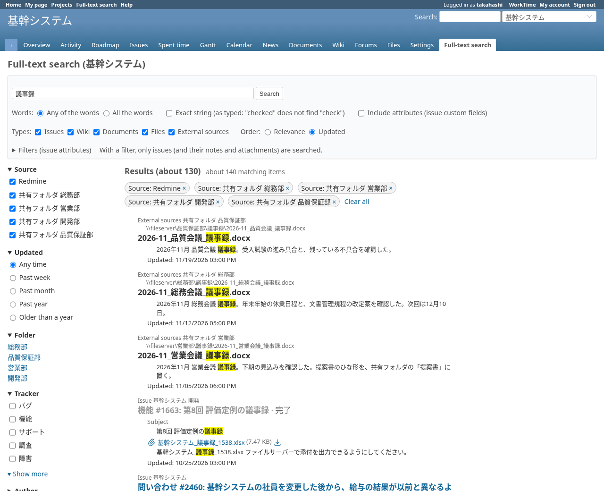
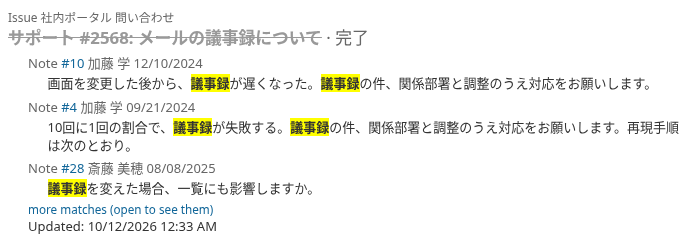
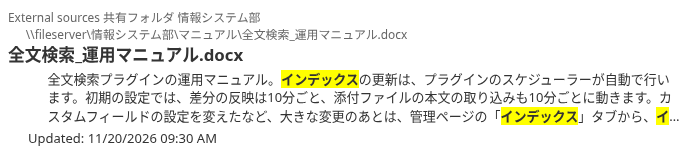
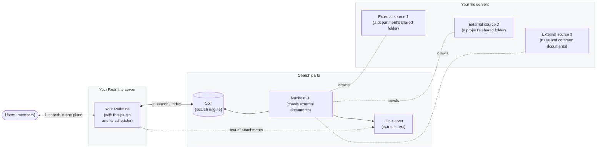

# Redmine Solr Search

[日本語](README.md) | English

**Adds full-text search to Redmine. And while you are at it, the documents in your shared folders can be found from the same search box.**

> **Made for Japanese text.** The search is tuned for Japanese (word forms, parts of words, spelling variants). How well it searches documents in English or other languages has not been checked. The manual and the other documents are in Japanese for now; this page is the English entry point.



*This is what it looks like in Redmine (with Redmine's language set to English; the sample data is in Japanese). Searching for 議事録 (minutes) with "Full-text search" in a project's menu lists Word documents from shared folders and Redmine issues together (narrowed to Redmine and four departments' folders, newest first; the "Source" box on the left shows only the chosen ones).*

"Did I attach those minutes to an issue, or put them in the shared folder?" Wherever they are, one search in Redmine finds them.
It uses Apache Solr as the search engine and comes with settings for Japanese.

| Where | What can be found |
|---|---|
| **Inside Redmine** | Issues, notes, wiki pages, documents, and the contents of attachments |
| **Outside Redmine** | The contents of Word, Excel, PowerPoint, PDF and other files in shared folders and the like |

**A hit inside Redmine** (an issue and its notes)



**A hit in a shared folder** (a Word document in a department's folder)



The two above are single results enlarged (cut out of separate searches on the sample data).
Who sees what follows Redmine's projects and roles. Shared folders can also be **shown to the people of the projects you choose, folder by folder** ([Deciding who sees what](#deciding-who-sees-what)).

## How it fits together

It works by **adding search parts (Solr, Tika, ManifoldCF) to the Redmine you already run**.
Your Redmine server and your file servers stay as they are; the search parts sit between them. They can be installed on servers directly or run in containers.



How it works is explained in the manual: [the main points](docs/manual.md#第2章仕組みの要点) and [the layout and the flows](docs/manual.md#161-全体の配置と流れ) (Japanese).

Searching shared folders can be added later. You can start with Redmine's data only.

| Stage | What can be searched | Parts to add |
|---|---|---|
| 1. Search Redmine's data | Inside Redmine | Solr, and Tika for the contents of attachments |
| 2. Search shared folders too | Inside and outside Redmine | ManifoldCF and Tika on top of 1 |
| 3. Add redundancy and monitoring | The same as 2 | Two or more Solr nodes (with ZooKeeper and an nginx in front), Prometheus and Grafana |

### Docker packages for an easy start

Installing and setting up each part one by one takes time, so **packages for Docker Compose are provided**. Choose one settings file and start it: Solr's settings are uploaded and the collection is made automatically.

| What you want | Package |
|---|---|
| Try it with a Redmine of its own | `try-minimal`, `try-external`, `try-full` ([Try it](#try-it)) |
| Add to your Redmine: stage 1 | `minimal` ([steps](#1-search-redmines-data)) |
| Add to your Redmine: stage 2 | `external` ([steps](#2-search-shared-folders-too)) |
| Add to your Redmine: stage 3 | `full` ([steps](#3-add-redundancy-and-monitoring)) |
| Try it on a Windows PC | `windows` ([how](docs/docker.md#5-windowsでの使いかたwindowsのスターター), Japanese) |

When adding to your Redmine, the plugin and its scheduler go on Redmine's side ([steps](#on-redmines-side)). The parts can also be installed on servers without Docker ([key points](docs/manual.md#46-dockerを使わないで入れるときの要点), Japanese).

## What it does

The links after each item lead to the detailed behaviour in the manual (Japanese).

### Search everything at once

- **Shared folders in the same search**: register a folder as an "external source", and its documents are listed with Redmine's data.
  - Checked with folders and with SMB shared folders mounted by the OS. Bringing documents in is left to Apache ManifoldCF or the like. Other sources, such as SharePoint, have not been checked.
  - Details: [external sources](docs/manual.md#23-外部ソース), [from crawling to registering](docs/manual.md#第8章外部ソースタブ), [data of external documents](docs/schema.md#4-外部文書外部ソースのマッピング仕様)
- **Full-text search of Redmine's main data**: issues, notes, wiki pages, documents and the contents of attachments. A hit in a note or an attachment is shown under its issue or wiki page, with excerpts of where it was found.
  - Limited to the data where a project's information gathers. Forums, news, time entries, repository commit messages and other plugins' data (such as DMSF documents) are not searched.
  - Details: [how results are grouped](docs/manual.md#入れ物group_idとまとめ表示), [what is indexed](docs/schema.md#32-インデックス対象の判定条件), [attachments](docs/manual.md#74-添付ファイル)
- **Search made for Japanese**: word forms (確認した / 確認する), parts of words (議事 / 議事録), spelling variants (バイオリン / ヴァイオリン) and registered synonyms.
  - It searches by words, without GPUs or outside AI services. RAG, LLMs and vector search are not part of it for now.
  - Details: [how Japanese is searched](docs/manual.md#112-日本語の探されかた), [the analysis](docs/manual.md#日本語解析の2本立てハイブリッド検索), [variants and synonyms](docs/manual.md#115-表記ゆれと同義語), [field types](docs/schema.md#22-テキストフィールド型と日本語解析仕様)
- **Narrowing down and ordering**: by project, external source, folder, date updated and issue attributes. Order by relevance or by date updated.
  - By relevance, Redmine's data tends to come first; to find shared-folder documents, narrow by "Types" or "Folder", or order by date.
  - Details: [narrowing down](docs/manual.md#121-左の欄での絞り込み種類プロジェクトソースフォルダ更新日), [the order](docs/manual.md#123-並び順), [weights](docs/manual.md#並びの重み)

### Deciding who sees what

- **Redmine's permissions as they are**: private projects, private issues and notes, and tracker and custom field restrictions are followed. Results are checked again with Redmine's own rules just before they are shown, so what was deleted or can no longer be seen does not appear.
  - The count ("about N results") is therefore an estimate: until the index is updated, it may count things that are not listed.
  - Details: [permissions](docs/manual.md#22-権限の考え方), [the two checks](docs/manual.md#検索時の2段階セキュリティ), [permission data](docs/schema.md#34-権限情報の付与とセキュリティ), [the count](docs/manual.md#124-ページ送りと件数の表示)
- **Shared folders shared by department or project**: an administrator allows a folder for some projects, and each of those projects chooses what to search. Only people with the search permissions in a linked project can search it. Changes are recorded, and unlinking takes it out of that project's search at once.
  - It works by folder so that permissions need not be kept file by file, for uses like "the sales department's folder for the sales projects".
  - The file server's own access rights are not carried over: everything in a registered folder is visible to the same people. Leave documents for a few people out of the folder, or split folders so that they do not overlap and register them as separate external sources.
  - Details: [allowing](docs/manual.md#82-登録と利用を許可するプロジェクト), [the three permissions](docs/manual.md#92-3つの権限), [linking to a project](docs/manual.md#93-外部ソースの紐付けプロジェクトの設定の全文検索タブ), [preventing spoofing](docs/manual.md#外部文書のなりすまし防止セキュリティ更新チェイン)

### Running it without fuss

- **The index updates itself**: a regular crawl, every 10 minutes by default. Saving an issue does not wait for it.
  - The text of attachments goes in in turn. External documents (added, changed or deleted) follow at the crawl interval.
  - Details: [time until found](docs/manual.md#21-インデックスと反映までの時間), [tasks and intervals](docs/manual.md#71-定期的な処理と間隔), [the three ways data comes in](docs/manual.md#3つのデータ投入経路)
- **Care on the admin page**: status, rebuilding the index, the search log, synonyms and tuning the order. An example of monitoring (Prometheus, Grafana) is included.
  - Details: [the status tab](docs/manual.md#第6章状態タブ), [search quality](docs/manual.md#第14章検索の品質の手入れ), [monitoring](docs/manual.md#152-監視prometheusgrafana), [where settings live](docs/manual.md#163-設定の置き場所)

## Try it

With Docker Compose, a Redmine with sample data comes up too.

```sh
git clone https://github.com/yoohey/redmine_solr_search.git redmine_solr_search
cd redmine_solr_search/docker
cp env.example.try-minimal .env
docker compose up -d
```

Wait a few minutes (not counting the image downloads), log in to http://localhost:3000/ as `admin` / `password`, and search for something like 議事録 (minutes) with "Full-text search" in the top menu. The password is a placeholder: use it only for trying.

To try shared folders too, use `env.example.try-external` (a folder to crawl has to be set and registered).

`docker compose down -v` cleans up (the data goes too). That, the redundant setup and the Windows combination are in [the bundled Docker setup](docs/docker.md) (Japanese).

## Adding it to your Redmine

Start the search parts, then set up Redmine's side.

To use the Docker packages, get this repository and run one of the three below in its `docker/`. To use a Solr you installed yourself, make the settings and the collection as in [the manual's 4.1](docs/manual.md#41-solrの準備configsetの組み立てとアップロードコレクションの作成) (Japanese) instead.

### 1. Search Redmine's data

```sh
cp env.example.minimal .env
docker compose up -d
```

- **What starts**: Solr (one node) and Tika (text of attachments).
- ManifoldCF and the file servers in the figure are not used.

### 2. Search shared folders too

```sh
cp env.example.external .env
# set MCF_SOURCE_DIR in .env to the folder to bring in
docker compose up -d
```

- **What starts**: 1, and ManifoldCF (brings in external documents regularly).
- Make the crawl with `manifoldcf/add-folder.sh`, register it in the "External sources" tab of Redmine's admin page, and link it to projects ([steps](docs/manual.md#第8章外部ソースタブ), Japanese).

### 3. Add redundancy and monitoring

```sh
cp env.example.full .env
docker compose up -d
```

- **What starts**: 2 with two Solr nodes (and three ZooKeeper nodes and an nginx in front), plus Prometheus and Grafana.
- Search goes on when one Solr node stops.
- To show Redmine's metrics in the monitoring, give Redmine the environment variable `SOLR_SEARCH_METRICS_TOKEN` with the same value as `METRICS_TOKEN` in `.env`, and set Redmine's address in `monitoring/prometheus.yml`.

### On Redmine's side

The same for every stage.

1. **Install the plugin and restart Redmine**.

   ```sh
   cd /path/to/redmine/plugins
   git clone https://github.com/yoohey/redmine_solr_search.git redmine_solr_search
   cd /path/to/redmine
   bin/rake redmine:plugins:migrate RAILS_ENV=production
   ```

2. **Tell it where Solr and Tika are**: Administration > Full-text search > the "Status" tab. With the bundled search parts on the same machine, Solr is `http://127.0.0.1:8983/solr` and Tika is `http://127.0.0.1:9998` ([other machines or a Redmine in a container](docs/manual.md#43-接続先の設定solrtika), Japanese).
3. **Keep the scheduler running**: it also makes the first index by itself ([with systemd or cron](docs/manual.md#44-スケジューラーの置き場所), Japanese).

   ```sh
   cd /path/to/redmine
   bin/rake redmine:solr_search:scheduler RAILS_ENV=production
   ```

4. **Open it to users**: once the counts look right in the "Status" tab, enable the project module "Full-text search" and set the role permissions ([the manual's chapter 9](docs/manual.md#第9章プロジェクトでの有効化と外部ソースの紐付け), Japanese).

## Requirements

| Part | Needed | Versions | Checked |
|---|---|---|---|
| Redmine | Yes | 5.1 to 7.x | Developed on 6.1; the main screens and search on 5.1.12, 6.0.11, 6.1.5 and 7.0.2. No extra gems |
| Database | Yes | As Redmine | PostgreSQL only |
| Apache Solr | Yes | 9.x, 10.x | Developed on 9.10.1; search, permissions and external sources also on 10.1.0 (crawling with ManifoldCF on 9.10.1 only). SolrCloud mode even on one node, with the module `analysis-extras` |
| Apache Tika Server | Optional | — | 4.1.0. Extracts the text of attachments and external documents |
| Apache ManifoldCF | Optional | — | 2.31 (needs Java 25). Brings in external documents |

`try-minimal` with only the sample data used about 1.9 GB of memory. With more data in mind, 4 GB or more is recommended.

How it was checked (permissions, search quality, size and speed, versions) is summed up in [the verification summary](docs/verification.md) (Japanese).

## Before opening it to others

- **Do not expose Solr or Tika to users' networks**: in the bundled setup, neither has authentication. Anyone who reaches Solr can read the whole index regardless of Redmine's permissions, and delete it.
- **Docker's published ports bypass ufw rules**: when opening them to other machines, restrict who can connect with the `DOCKER-USER` chain or an outside firewall. Use Docker Engine 28.0.0 or later ([notes on publishing](docs/docker.md#公開するときの注意), Japanese).
- **The global search is open to anonymous users by default**: they see only what Redmine shows them, but to narrow it, change "Global search access" in the plugin's settings. If Redmine itself requires login, so does the search.
- **The search log keeps login names and search words**: until deleted. Decide how long to keep it and tell your users ([the search log](docs/manual.md#141-検索ログタブ), Japanese).
- **Split external sources by who may see them**: the file server's access rights are not carried over; who sees what is decided by the external source's allowing and linking and by Redmine's permissions. Before linking, make sure a registered folder holds nothing that must not be shown ([permissions](docs/manual.md#22-権限の考え方), Japanese).
- **Change the placeholder passwords and tokens of the bundled setup**: `change-me…` in `.env`, Grafana, ManifoldCF (`admin` / `admin`) and the like.

## Documents

The documents are in Japanese for now. An English manual is planned for a later version.

| For | Document |
|---|---|
| People who search | [Manual, part 5](docs/manual.md#第10章検索のはじめかた) |
| Project managers | [Manual, part 4](docs/manual.md#第9章プロジェクトでの有効化と外部ソースの紐付け) |
| Administrators (installing) | [Manual, part 2](docs/manual.md#第3章動作要件と構成の選びかた), [the bundled Docker setup](docs/docker.md) |
| Administrators (without Docker) | [Manual, 4.6](docs/manual.md#46-dockerを使わないで入れるときの要点) |
| Administrators (running it) | [Manual, part 3](docs/manual.md#第6章状態タブ) and [part 6](docs/manual.md#第14章検索の品質の手入れ) |
| How it works, specifications | [Manual, chapter 16](docs/manual.md#第16章仕組みとデータ技術解説), [schema](docs/schema.md) |
| Trouble | [FAQ and known limits](docs/manual.md#第18章faq困ったとき既知の制約) |
| How it was checked | [Verification summary](docs/verification.md) |
| Changes by version | [Change log](CHANGELOG.en.md) |

## Bug reports and questions

- **Bug reports** are welcome in GitHub Issues, in English or Japanese. Please write the Redmine and Solr versions, your setup (which combination of the bundled Docker, for example), the steps to reproduce, and what you expected and what happened.
- **Setting up your own environment or doing settings for you** is not offered. For installing, see [the manual](docs/manual.md) and [the bundled Docker setup](docs/docker.md) (Japanese).
- This is developed by one person, so no promise can be made about when replies or fixes come.

## License

MIT License
