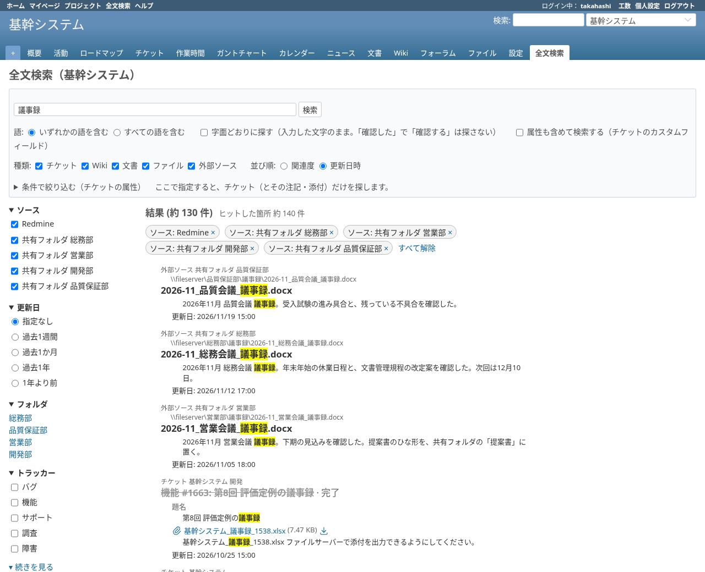
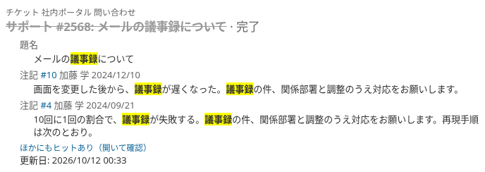
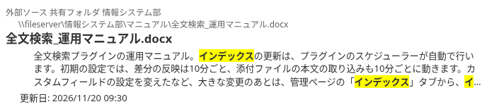
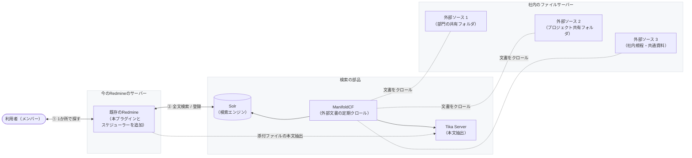

# Redmine Solr Search

日本語 | [English](README.en.md)

**Redmineに全文検索を追加します。ついでに、共有フォルダの文書も、同じ検索窓から探せます。**



*Redmineの上では、このように見えます。プロジェクトのメニューの「全文検索」で「議事録」を探すと、共有フォルダのWordの文書とRedmineのチケットが、1つの一覧に並びます（見本のデータで、Redmineと4つの部門のフォルダに絞り、更新日時の順に並べたところ。左の「ソース」は選んだものだけを表示しています）。*

「あの議事録は、チケットに貼ったのか、共有フォルダに置いたのか」。どちらにあっても、Redmineの画面で一度検索するだけです。
検索エンジンにはApache Solrを使い、日本語向けの設定を同梱しています。

| 探す場所 | 探せるもの |
|---|---|
| **Redmineの中** | チケット、注記、Wikiページ、文書、添付ファイルの中身 |
| **Redmineの外** | 共有フォルダなどに置いたWord・Excel・PowerPoint・PDFなどの中身 |

**Redmineの中で見つかった例**（チケットと、その注記）



**共有フォルダで見つかった例**（部門のフォルダにあるWordの文書）



上の2つは、結果の1件ずつを拡大したものです（見本のデータでの別々の検索から切り出しました）。
誰に何を見せるかは、Redmineのプロジェクトとロールで決められます。共有フォルダも、**フォルダの単位で、どのプロジェクトの人に見せるかを分けられます**（[見せる相手を決める](#見せる相手を決める)）。

## 構成

**すでに運用しているRedmineに、検索の部品（Solr・Tika・ManifoldCF）を足す**形で動きます。
今のRedmineのサーバーと社内のファイルサーバーはそのまま残し、その間に検索の部品を置いて連携させます。部品の入れかた（サーバーに直接か、コンテナか）は問いません。



どう動くのかは、[仕組みの要点](docs/manual.md#第2章仕組みの要点)（やさしい説明）と、[全体の配置と処理の流れ](docs/manual.md#161-全体の配置と流れ)（技術解説）で確認できます。

共有フォルダの検索は後から足せます。まずRedmineの中だけで始めてもかまいません。

| 段階 | 探せる範囲 | 足す部品 |
|---|---|---|
| 1. Redmineのデータを検索する | Redmineの中 | Solr、Tika（添付ファイルの中身も探すなら） |
| 2. 共有フォルダの文書も検索する | Redmineの中と外 | 1に、ManifoldCFとTika |
| 3. 冗長化と監視も足す | 2と同じ | 2のSolrを2台以上にし（ZooKeeperと振り分けのnginx）、Prometheus・Grafanaを足す |

### 簡単に導入するためのDockerのパッケージ

これらの部品を1つずつ入れて設定するのは手間がかかります。そこで、**Docker Composeで導入できるパッケージを用意しています**。設定ファイルを1つ選んで起動すると、Solrの設定の登録とコレクションの作成まで自動で終わります。

| したいこと | 用意しているパッケージ |
|---|---|
| Redmineごと手元で試す | `try-minimal`・`try-external`・`try-full`（[試す](#試す)） |
| 今のRedmineに足す：段階1 | `minimal`（[手順](#1-redmineのデータを検索する)） |
| 今のRedmineに足す：段階2 | `external`（[手順](#2-共有フォルダの文書も検索する)） |
| 今のRedmineに足す：段階3 | `full`（[手順](#3-冗長化と監視も足す)） |
| WindowsのPCで試す | `windows`（[使いかた](docs/docker.md#5-windowsでの使いかたwindowsのスターター)） |

今のRedmineに足すときは、プラグインとスケジューラーをRedmineの側に入れます（[手順](#redmineの側を設定する)）。Dockerを使わずに、各部品をサーバーに直接入れることもできます（[要点](docs/manual.md#46-dockerを使わないで入れるときの要点)）。

## できること

各項目の「詳しい仕様」から、実際にどう動くのかを確認できます。

### まとめて探す

- **共有フォルダも一緒に検索**：フォルダを「外部ソース」として登録すると、Redmineのデータと同じ一覧で探せます。
  - フォルダと、OSでつないだSMBの共有フォルダで、取り込みを確かめています。取り込みはApache ManifoldCFなどに任せる作りです。SharePointなど、ほかの取り込み元はまだ確かめていません。
  - 詳しい仕様：[外部ソースの仕組み](docs/manual.md#23-外部ソース)、[取り込みから登録までの流れ](docs/manual.md#第8章外部ソースタブ)、[外部の文書のデータ仕様](docs/schema.md#4-外部文書外部ソースのマッピング仕様)
- **Redmineの主な情報を全文検索**：チケット、注記、Wikiページ、文書、添付ファイルの中身を探せます。注記や添付ファイルで当たっても、チケットやWikiページの単位にまとめて、当たった箇所の抜粋を出します。
  - プロジェクトの情報が集まる、これらのデータに絞っています。フォーラム、ニュース、作業時間、リポジトリのコミットメッセージ、他のプラグインのデータ（DMSFの文書など）は対象外です。
  - 詳しい仕様：[結果がまとまる仕組み](docs/manual.md#入れ物group_idとまとめ表示)、[インデックスに入るものの条件](docs/schema.md#32-インデックス対象の判定条件)、[添付ファイルの扱い](docs/manual.md#74-添付ファイル)
- **日本語に合わせた検索**：語の活用（確認した／確認する）、語の一部（議事／議事録）、綴りのゆれ（バイオリン／ヴァイオリン）、登録した同義語を扱います。
  - GPUや外部のAIサービスがなくても動く、語で探す方式です。RAG・LLM・ベクトル検索は、現時点では扱っていません。
  - 詳しい仕様：[日本語の探されかた](docs/manual.md#112-日本語の探されかた)、[解析の仕組み](docs/manual.md#日本語解析の2本立てハイブリッド検索)、[表記ゆれと同義語](docs/manual.md#115-表記ゆれと同義語)、[解析のフィールド仕様](docs/schema.md#22-テキストフィールド型と日本語解析仕様)
- **目的に合わせた絞り込みと並び**：プロジェクト、外部ソース、フォルダ、更新日、チケットの属性で絞り込めます。並びは関連度と更新日時から選べます。
  - 関連度の順ではRedmineの情報が上に出やすいので、共有フォルダの文書を探すときは「種類」「フォルダ」で絞るか、更新日時の順にすると見つけやすくなります。
  - 詳しい仕様：[絞り込みの動き](docs/manual.md#121-左の欄での絞り込み種類プロジェクトソースフォルダ更新日)、[並び順の決まりかた](docs/manual.md#123-並び順)、[並びの重み](docs/manual.md#並びの重み)

### 見せる相手を決める

- **Redmineの権限をそのまま反映**：非公開のプロジェクト、プライベートのチケットと注記、トラッカーとカスタムフィールドの制限に従います。表示の直前にもRedmineの判定で確かめるので、消したものや見られなくなったものは一覧に出ません。
  - そのため件数は「約 N 件」の目安です。インデックスが更新されるまでは、一覧に出ないものも数えることがあります。
  - 詳しい仕様：[権限の考え方](docs/manual.md#22-権限の考え方)、[2段階の判定の仕組み](docs/manual.md#検索時の2段階セキュリティ)、[権限のデータ仕様](docs/schema.md#34-権限情報の付与とセキュリティ)、[件数の表示](docs/manual.md#124-ページ送りと件数の表示)
- **共有フォルダは、部門やプロジェクトの単位で分けて共有**：システム管理者が利用を許可したフォルダから、各プロジェクトで探すものを選びます。検索できるのは、紐付けたプロジェクトで検索の権限がある人だけです。変更は履歴に残り、紐付けを外せば、そのプロジェクトからはすぐに検索できなくなります。
  - ファイル1つずつの権限を管理しなくて済むよう、フォルダの単位にしています。「営業部のフォルダは営業部のプロジェクトへ」のような、部門での使いかたを想定しています。
  - ファイルサーバー側の細かいアクセス権は引き継がず、登録したフォルダの中は同じ相手に見えます。限られた人だけの文書は、登録するフォルダに含めないか、範囲が重ならないようにフォルダを分けて、別の外部ソースにしてください。
  - 詳しい仕様：[利用の許可](docs/manual.md#82-登録と利用を許可するプロジェクト)、[3つの権限](docs/manual.md#92-3つの権限)、[プロジェクトへの紐付け](docs/manual.md#93-外部ソースの紐付けプロジェクトの設定の全文検索タブ)、[なりすましの防止](docs/manual.md#外部文書のなりすまし防止セキュリティ更新チェイン)

### 無理なく運用する

- **インデックスを自動で更新**：定期的なクロールで、初期設定では10分おきに更新します。チケットの保存などの操作を待たせません。
  - 添付ファイルの本文は順に入ります。外部の文書は、追加・変更・削除とも取り込みの間隔で反映します。
  - 詳しい仕様：[反映までの時間](docs/manual.md#21-インデックスと反映までの時間)、[処理ごとの間隔と動き](docs/manual.md#71-定期的な処理と間隔)、[データが入る3つの経路](docs/manual.md#3つのデータ投入経路)
- **管理画面で手入れ**：状態の確認、インデックスの作り直し、検索ログ、同義語、並びの調整を行えます。監視（Prometheus・Grafana）の例もあります。
  - 詳しい仕様：[状態の見かた](docs/manual.md#第6章状態タブ)、[検索の品質の手入れ](docs/manual.md#第14章検索の品質の手入れ)、[監視](docs/manual.md#152-監視prometheusgrafana)、[設定の置き場所](docs/manual.md#163-設定の置き場所)

## 試す

Docker Composeがあれば、サンプルデータつきのRedmineごと立ち上がります。

```sh
git clone https://github.com/yoohey/redmine_solr_search.git redmine_solr_search
cd redmine_solr_search/docker
cp env.example.try-minimal .env
docker compose up -d
```

数分待って（イメージの取得の時間は別）http://localhost:3000/ に`admin`／`password`でログインし、上のメニューの「全文検索」から「議事録」などを探してみてください。仮のパスワードなので、試す用途にだけ使ってください。

共有フォルダの検索まで試すなら`env.example.try-external`を使います（取り込むフォルダの指定と登録が要ります）。

片付けは`docker compose down -v`です（データも消えます）。その手順と、冗長構成、Windowsで試す組み合わせは[同梱のDockerの構成](docs/docker.md)にあります。

## 今のRedmineに入れる

検索の部品を立ててから、Redmineの側を設定します。

Dockerのパッケージを使うなら、このリポジトリを取得し、その`docker/`で、次の3つのどれか1つを実行します。自分で入れたSolrを使うなら、代わりに[マニュアルの4.1](docs/manual.md#41-solrの準備configsetの組み立てとアップロードコレクションの作成)のとおりに設定とコレクションを作ります。

### 1. Redmineのデータを検索する

```sh
cp env.example.minimal .env
docker compose up -d
```

- **立ち上がるもの**：Solr（1台）、Tika（添付ファイルの本文の取り出し）です。
- 図のManifoldCFとファイルサーバーの部分は使いません。

### 2. 共有フォルダの文書も検索する

```sh
cp env.example.external .env
# ここで .env の MCF_SOURCE_DIR に、取り込むフォルダを書きます
docker compose up -d
```

- **立ち上がるもの**：1に加えて、ManifoldCF（外部の文書の定期的な取り込み）です。
- 取り込みの設定は`manifoldcf/add-folder.sh`で作り、Redmineの管理ページの「外部ソース」タブで登録して、プロジェクトに紐付けます（[手順](docs/manual.md#第8章外部ソースタブ)）。

### 3. 冗長化と監視も足す

```sh
cp env.example.full .env
docker compose up -d
```

- **立ち上がるもの**：2のSolrを2台（とZooKeeper 3台、振り分けのnginx）にし、Prometheus・Grafanaの監視を足したものです。
- Solrが1台止まっても検索を続けられます。
- 監視にRedmineの指標も出すには、Redmineの環境変数`SOLR_SEARCH_METRICS_TOKEN`に`.env`の`METRICS_TOKEN`と同じ値を渡し、`monitoring/prometheus.yml`のRedmineの宛先を実際のアドレスに直します。

### Redmineの側を設定する

どの段階でも同じです。

1. **プラグインを入れ、Redmineを再起動します**。

   ```sh
   cd /path/to/redmine/plugins
   git clone https://github.com/yoohey/redmine_solr_search.git redmine_solr_search
   cd /path/to/redmine
   bin/rake redmine:plugins:migrate RAILS_ENV=production
   ```

2. **接続先を設定する**：管理 →「全文検索」→「状態」タブで設定します。同梱の検索の部品を同じマシンで動かすなら、Solrは`http://127.0.0.1:8983/solr`、Tikaは`http://127.0.0.1:9998`です（[別のマシンやコンテナのRedmineの場合](docs/manual.md#43-接続先の設定solrtika)）。
3. **スケジューラーを常駐させる**：最初のインデックスも自動で作られます（[systemdやcronでの動かし方](docs/manual.md#44-スケジューラーの置き場所)）。

   ```sh
   cd /path/to/redmine
   bin/rake redmine:solr_search:scheduler RAILS_ENV=production
   ```

4. **使う人に開く**：「状態」タブで件数を確かめたら、プロジェクトのモジュール「全文検索」と、ロールの権限を設定します（[マニュアルの第9章](docs/manual.md#第9章プロジェクトでの有効化と外部ソースの紐付け)）。

## 動作要件

| 部品 | 要るか | 対応する版 | 確かめた範囲 |
|---|---|---|---|
| Redmine | 要る | 5.1〜7.x | 6.1で開発。5.1.12・6.0.11・6.1.5・7.0.2で主な画面と検索。追加のgemは要らない |
| データベース | 要る | Redmineに従う | PostgreSQLだけ |
| Apache Solr | 要る | 9.x・10.x | 9.10.1で開発。10.1.0でも検索・権限・外部ソースの検索（ManifoldCFからの投入は9.10.1だけ）。1台でもSolrCloudモードにし、モジュール`analysis-extras`を有効にする |
| Apache Tika Server | 任意 | — | 4.1.0。添付ファイルと外部の文書の本文を取り出す |
| Apache ManifoldCF | 任意 | — | 2.31（Java 25が要る）。外部の文書を取り込む |

メモリは、`try-minimal`をサンプルデータだけで動かして約1.9GBでした。データが増える分を見て、4GB以上を勧めます。

## 公開の前に確かめること

- **Solr・Tikaを利用者のネットワークに出さない**：同梱の構成では、どちらにも認証がありません。Solrに届いた人は、Redmineの権限に関係なく、すべてのインデックスを読めて、消すこともできます。
- **Dockerが公開したポートに、ufwの規則は効かない**：別のマシンに開くときは、`DOCKER-USER`チェインか外のファイアウォールで相手を絞ってください。Docker Engineは28.0.0以上を使ってください（[公開するときの注意](docs/docker.md#公開するときの注意)）。
- **全体検索は、初期の設定ではログインしていない人も使える**：見えるのはRedmineでその人に見えるものだけですが、狭めたいときは、プラグインの設定の「全体検索の利用範囲」を変えてください。Redmine自体が認証必須なら、ログインが要ります。
- **検索ログには、ログイン名と検索語が残る**：消すまで残るので、保持する期間を決め、利用者に知らせてください（[検索ログ](docs/manual.md#141-検索ログタブ)）。
- **外部ソースは、見せてよい相手ごとに分ける**：ファイルサーバー側のアクセス権は引き継がず、外部ソースの許可・紐付けとRedmineの権限で見せる相手が決まります。登録するフォルダに、見せてはいけない文書が入っていないかを、紐付けの前に確かめてください（[権限の考え方](docs/manual.md#22-権限の考え方)）。
- **同梱の構成の仮のパスワードとトークンは変える**：`.env`の`change-me…`やGrafana、ManifoldCF（`admin`／`admin`）などを変えてから使ってください。

## 文書

| 読む人 | 文書 |
|---|---|
| 検索する人 | [マニュアル 第5部](docs/manual.md#第10章検索のはじめかた) |
| プロジェクトの管理者 | [マニュアル 第4部](docs/manual.md#第9章プロジェクトでの有効化と外部ソースの紐付け) |
| システム管理者（導入） | [マニュアル 第2部](docs/manual.md#第3章動作要件と構成の選びかた)、[同梱のDockerの構成](docs/docker.md) |
| システム管理者（Dockerを使わない） | [マニュアル 4.6（Dockerを使わないで入れるときの要点）](docs/manual.md#46-dockerを使わないで入れるときの要点) |
| システム管理者（運用） | [マニュアル 第3部](docs/manual.md#第6章状態タブ)・[第6部](docs/manual.md#第14章検索の品質の手入れ) |
| 仕組み・仕様を知りたい人 | [マニュアル 第16章（技術解説）](docs/manual.md#第16章仕組みとデータ技術解説)、[スキーマ仕様書](docs/schema.md) |
| 困ったとき | [FAQ・既知の制約](docs/manual.md#第18章faq困ったとき既知の制約) |
| どう確かめたか | [検証のまとめ](docs/verification.md)（権限、検索の質、量と速さ、対応する版） |
| 版ごとの変更 | [変更の履歴](CHANGELOG.md) |

## 不具合の報告と問い合わせ

- **不具合の報告**は、GitHubのIssuesで受け付けます。Redmine・Solrの版、構成（同梱のDockerのどの組み合わせか、など）、再現の手順と、期待した結果・実際の結果を書いてください。
- **個別の環境の構築や設定の代行**は、お受けしていません。導入のしかたは、[マニュアル](docs/manual.md)と[同梱のDockerの構成](docs/docker.md)を見てください。
- 個人で開発しているため、返答や修正の時期はお約束できません。

## ライセンス

MIT License
