# 同梱のDockerの構成

同梱のDocker Composeの構成です。ファイルは`docker/`にあります。

**役目ごとにcomposeファイルを1つずつ分けています**。使う組み合わせを`.env`で選ぶと、選んだファイルが1つの構成としてつながり、目的に応じた機能が立ち上がります。

---

## 目次

- [1. 目的別の選びかたとクイックスタート](#1-目的別の選びかたとクイックスタート)
  - [パターンA：手元のPCで今すぐ試す（Redmineも同梱）](#パターンa手元のpcで今すぐ試すredmineも同梱)
  - [パターンB：すでに運用しているRedmineに足す（検索バックエンドのみ）](#パターンbすでに運用しているredmineに足す検索バックエンドのみ)
  - [パターンC：Windowsで手元のフォルダを検索する](#パターンcwindowsで手元のフォルダを検索する)
- [2. 組み合わせ一覧と .env の仕組み](#2-組み合わせ一覧と-env-の仕組み)
  - [2.1 .env ファイルの役割と書き方](#21-env-ファイルの役割と書き方)
  - [2.2 組み合わせ対応表（env.example.* 一覧）](#22-組み合わせ対応表envexample-一覧)
  - [2.3 共通の決めごと](#23-共通の決めごと)
- [3. 全体アーキテクチャのパターン図](#3-全体アーキテクチャのパターン図)
  - [構成1：基本（Redmineのデータを検索）](#構成1基本redmineのデータを検索)
  - [構成2：外部ソース追加（共有フォルダも検索）](#構成2外部ソース追加共有フォルダも検索)
  - [構成3：冗長化と監視（止まりにくくして見張る）](#構成3冗長化と監視止まりにくくして見張る)
- [4. 各ファイルの中身と仕組み（リファレンス）](#4-各ファイルの中身と仕組みリファレンス)
  - [compose.redmine.yaml（お試し用Redmine）](#composeredmineyamlお試し用redmine)
  - [compose.solr.yaml（Solr 1台構成）](#composesolryamlsolr-1台構成)
  - [compose.solrcloud.yaml（Solr 2台冗長化構成）](#composesolrcloudyamlsolr-2台冗長化構成)
  - [compose.tika.yaml（本文抽出サーバー）](#composetikayaml本文抽出サーバー)
  - [compose.manifoldcf.yaml（外部文書取り込み）](#composemanifoldcfyaml外部文書取り込み)
  - [compose.monitoring.yaml（監視ダッシュボード）](#composemonitoringyaml監視ダッシュボード)
- [5. Windowsでの使いかた（Windowsのスターター）](#5-windowsでの使いかたwindowsのスターター)

---

## 1. 目的別の選びかたとクイックスタート

使い方は、大きく分けて2通りあります。

- **A. 手元のPCで今すぐ試す（お試し）**：Redmineもサンプルデータも一緒に立ち上がります。約2分で検索を試せます。
- **B. すでに運用しているRedmineに足す（本番・連携）**：Redmineは立ち上げず、検索サーバー（Solr・Tika・ManifoldCFなど）だけを立ち上げます。

やりたいことに合わせて、対応する`env.example.*`を`.env`にコピーして起動します。

| あなたの目的・状況 | 検索対象 | 使うファイル（`.env` にコピー） | 特徴・起動後のアクセス |
|---|---|---|---|
| **手元でサクッと試したい**（まず動かすならこれ） | Redmineのみ | `env.example.try-minimal` | 約2分で全自動起動。http://localhost:3000 （admin / password） |
| **手元で共有フォルダの検索も試したい** | Redmine ＋ 外部文書 | `env.example.try-external` | ManifoldCFも一緒に起動。取り込むフォルダを指定し、`add-folder.sh`で取り込んで横断検索 |
| **本番フル構成を手元で検証したい** | Redmine ＋ 外部 ＋ 冗長・監視 | `env.example.try-full` | Solr 2台＋監視ダッシュボード（http://localhost:3001） |
| **運用中のRedmineに検索を追加したい** | Redmineのみ | `env.example.minimal` | 既存Redmineはそのまま、検索基盤（Solr＋Tika）だけ起動 |
| **運用中のRedmineで共有フォルダも検索したい** | Redmine ＋ 外部文書 | `env.example.external` | 検索基盤＋ManifoldCFを起動 |
| **運用中のRedmineを本番フル構成にしたい** | Redmine ＋ 外部 ＋ 冗長・監視 | `env.example.full` | Solr 2台＋ZooKeeper 3台＋Prometheus/Grafanaを起動 |
| **Windowsのローカルフォルダを検索したい** | Redmine ＋ PC内フォルダ | `env.example.windows` | ManifoldCFをWindows直接にして高速クロール |

### パターンA：手元のPCで今すぐ試す（Redmineも同梱）

自分のPCにRedmineがない場合や、プラグインの動きをひと通り確かめたい場合の使いかたです。**すべての構成要素がDockerコンテナとして立ち上がります**。

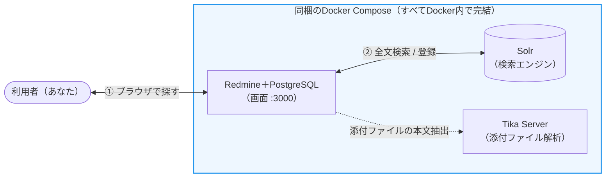

#### 1. チケットやWikiの検索を試す（最も手軽）
```bash
cp env.example.try-minimal .env
docker compose up -d
```
- **画面**: http://localhost:3000 （管理者: `admin` / `password`）
- **中身**: Redmine、PostgreSQL、サンプルデータ（`ja-basic`）、Solr（1台）、Tika（添付ファイル解析）、スケジューラーが自動で立ち上がり、約2分で全データのインデックスが完了して検索できるようになります。

#### 2. 共有フォルダの文書も一緒に試す
```bash
cp env.example.try-external .env
docker compose up -d
```
- 上記に加えて **ManifoldCF** が立ち上がります。外部の文書の見本は同梱していないので、`.env`の`MCF_SOURCE_DIR`に取り込みたいフォルダを指定してから起動し、`manifoldcf/add-folder.sh`でコレクションとジョブを作り（[4章](#composemanifoldcfyaml外部文書取り込み)）、Redmineの管理ページの「外部ソース」タブで登録してプロジェクトに紐付けると、Redmineと外部文書の横断検索を試せます。
- ※ ManifoldCFの詳しい仕組みやジョブの設定の注意は、[マニュアルの8.1](manual.md#81-外部ソースの準備と取り込みmanifoldcftika)を参照してください。

#### 3. 本番に近い冗長化（Solr 2台）と監視も試す
```bash
cp env.example.try-full .env
docker compose up -d
```
- Solrが2台（SolrCloud + ZooKeeper 3台 + 負荷分散nginx）になり、**Prometheus・Grafana**（http://localhost:3001）による監視ダッシュボードも立ち上がります。

---

### パターンB：すでに運用しているRedmineに足す（検索バックエンドのみ）

すでに社内や手元で動いているRedmineサーバーがあり、**検索サーバー（Solr・Tika・ManifoldCFなど）だけをDockerで追加構築する場合**の使いかたです。

既存のRedmineサーバーや社内ファイルサーバーは実機上にそのまま残し、その間にDockerで検索バックエンドを配置して連携させます。

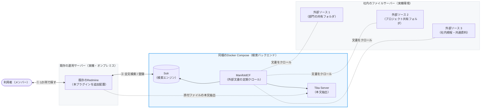

#### 1. Redmineのデータを検索する
```bash
cp env.example.minimal .env
docker compose up -d
```
- **立ち上がるもの**: Solr（1台）、Tika（添付ファイル解析）です。
- **Redmine側の設定**:
  1. プラグインをRedmineの `plugins/redmine_solr_search` に配置し、Redmineのフォルダで `bin/rake redmine:plugins:migrate RAILS_ENV=production` を実行して、Redmineを再起動します。
  2. Redmineの「管理」→「全文検索」の「状態」タブで、SolrとTikaの接続先を設定します（環境変数 `SOLR_URL`・`TIKA_URL` でもかまいません。そのときはRedmineとスケジューラーの両方に渡します）。値は、Redmineがどこで動いているかで変わります。

     | Redmineの場所 | Solrの接続先 | Tikaの接続先 | `.env`の変更 |
     |---|---|---|---|
     | Dockerと同じマシン（直接入れたもの） | `http://127.0.0.1:8983/solr` | `http://127.0.0.1:9998` | 要りません |
     | 別のマシン | `http://<DockerホストのIP>:8983/solr` | `http://<DockerホストのIP>:9998` | `SOLR_BIND`・`TIKA_BIND`をそのIPに変えます。**先に[公開するときの注意](#公開するときの注意)を読んでください** |

     Redmineが別のコンテナで動いているときは、コンテナの中の `127.0.0.1` はそのコンテナ自身なので、届きません。届く名前かアドレスを入れてください。
  3. スケジューラーを常駐させます（この組み合わせには入っていません）。Redmineのフォルダで `bin/rake redmine:solr_search:scheduler RAILS_ENV=production` を動かし続けます。systemdやcronでの動かし方は、[マニュアルの4.4](manual.md#44-スケジューラーの置き場所)を参照してください。**スケジューラーもcronもないと、インデックスは更新されず、管理ページからの依頼も待ち続けます**。
  4. 最初のインデックスは、スケジューラーが自動で作ります。「状態」タブで件数を確かめてください。

#### 2. 共有フォルダの文書も検索する
```bash
cp env.example.external .env
docker compose up -d
```
- Redmine側の設定は、上の1と同じです。
- 上記に加えて **ManifoldCF** が立ち上がります。共有フォルダを取り込むジョブを作成して外部ソースとして検索できます。
- ※ 共有フォルダを読み取るジョブの設定の注意は、[マニュアルの8.1](manual.md#81-外部ソースの準備と取り込みmanifoldcftika)を参照してください。同梱の `add-folder.sh` スクリプトを使えばコマンド一発で設定できます（詳細は[4. 各ファイルの中身](#composemanifoldcfyaml外部文書取り込み)を参照してください）。

#### 3. 本番に近い冗長化と監視も足す
```bash
cp env.example.full .env
docker compose up -d
```
- Solr 2台（SolrCloud）とZooKeeper 3台、Prometheus、Grafanaが立ち上がります。
- Redmine側の設定は、上の1と同じです（8983は振り分けのnginxが受けます）。

---

### パターンC：Windowsで手元のフォルダを検索する

Windowsの自分のPCで、**ローカルのフォルダ（`C:\Users\...`）を高速に検索したい場合**の使いかたです。

NTFSへのファイルアクセス速度を落とさないため、**ManifoldCFだけをWindows実機に直接配置し、Redmine・Solr・TikaをDocker（WSL2）上で動かすハイブリッド構成**をとります。

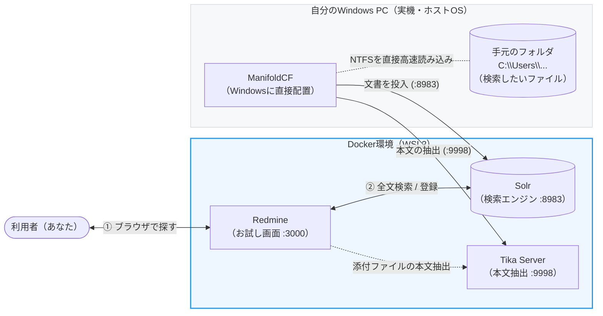

```bash
cp env.example.windows .env
docker compose up -d
```
- Windows（WSL2）上でRedmine・Solr・Tikaを動かし、Windows側のManifoldCFからPC内のローカルフォルダを取り込む構成です（詳細は[後述の節](#5-windowsでの使いかたwindowsのスターター)を参照してください）。

---

## 2. 組み合わせ一覧と `.env` の仕組み

### 2.1 `.env` ファイルの役割と書き方

`.env` ファイルは、単なるパスワードやポートの置き場所ではなく、**「どのcomposeファイルをどの順で組み合わせて立ち上げるか」を指定するコントローラーの役割**を果たしています。

Docker Compose の標準機能である複数ファイル読み込み（`COMPOSE_FILE`）を使っており、composeファイル名をコロン（`:`）で繋ぐことで、選んだファイルが自動的に合成（マージ）されて1つのシステムとして立ち上がります。

#### 設定例（`env.example.try-minimal` の場合）

```bash
# プロジェクト名の指定（コンテナ名やボリューム名のプレフィックスになります）
COMPOSE_PROJECT_NAME=redmine-solr-search

# composeファイルを複数連結するときの区切り文字（コロン）
COMPOSE_PATH_SEPARATOR=:

# 立ち上げるcomposeファイルを順番に指定（左から順に読み込まれて合成されます）
COMPOSE_FILE=compose.redmine.yaml:compose.solr.yaml:compose.tika.yaml

# 監視（Grafana・Prometheus）も一緒に立ち上げたい場合は、コメントアウトを切り替えて末尾に足すだけです
#COMPOSE_FILE=compose.redmine.yaml:compose.solr.yaml:compose.tika.yaml:compose.monitoring.yaml

# 各種パラメータ（メモリ割り当て、ポート、パスワード等）
SOLR_HEAP=512m
REDMINE_PORT=3000
DB_PASSWORD=redmine
```

#### `.env` で設定できる主な内容

1. **`COMPOSE_FILE`（部品の組み立て）**:
   立ち上げたいcomposeファイルを `:` で連結して指定します。例えば「お試し環境に監視も足したい」と思ったら、既存の設定はいじらずに末尾に `:compose.monitoring.yaml` を書き足すだけで、プラグインのように機能を追加できます。
2. **ポートとバインドアドレス（セキュリティ）**:
   `SOLR_BIND=127.0.0.1` や `TIKA_BIND=127.0.0.1` のように、外部から直接アクセスされたくない検索エンジン等は既定でローカルホスト（`127.0.0.1`）限定で待ち受けるよう制御されています。別サーバーのRedmineからアクセスさせる場合は、このIPをマシンの実IPに変更します。**SolrとTikaには認証がないので、変える前に[公開するときの注意](#公開するときの注意)を読んでください。**
3. **リソースの調整（パフォーマンス）**:
   `SOLR_HEAP=512m`（既定）〜`2g` のように、マシンスペックや検索文書数に応じたメモリ割り当てをこの1行で調整できます。
4. **外部ソースの取り込みパス**:
   `try-external` や `external` では、`MCF_SOURCE_DIR=./data/mcf-source`（ホスト側のフォルダ）と `MCF_SOURCE_PATH=/source`（コンテナ内のマウント先）を指定することで、どのフォルダをクロール対象にするかを設定します。

---

### 2.2 組み合わせ対応表（`env.example.*` 一覧）

各ファイルがどのcomposeファイル（部品）を立ち上げるかの対応表です。

| ファイル | redmine | solr | solrcloud | tika | manifoldcf | monitoring | 用途・使える機能 | メモリ（測った例） |
|---|---|---|---|---|---|---|---|---|
| `env.example.try-minimal` | ○ | ○ | | ○ | | | **まず試す用**。Redmine＋Solr＋Tika（サンプルデータ入り。admin / password） | 約1.9GB（※1） |
| `env.example.minimal` | | ○ | | ○ | | | 今運用しているRedmineに、全文検索を足す | （測っていません） |
| `env.example.try-external` | ○ | ○ | | ○ | ○ | | ＋共有フォルダなどの外部文書も一緒に検索（お試し） | （測っていません） |
| `env.example.external` | | ○ | | ○ | ○ | | 今運用しているRedmineに、外部文書の検索も足す | （測っていません） |
| `env.example.try-full` | ○ | | ○ | ○ | ○ | ○ | ＋冗長化と監視（本番に近い形を試す） | 約4〜8GB（※1） |
| `env.example.full` | | | ○ | ○ | ○ | ○ | 今運用しているRedmineに、本番に近い形で足す | （測っていません） |
| `env.example.windows` | ○ | ○ | | ○ | （※2） | | Windowsで自分のPCのフォルダを検索する | （測っていません） |

- ※1: 2026-11-05に、起動して検索ができる状態で測った例です（データはサンプルだけです）。`try-full`は、Solrのヒープ設定で変わります（各512MBで約3.9GiB、各2GBで約8.0GiB）。ほかの組み合わせは測っていません。データが増えるとSolrのメモリも増えるので、本番の機器では測り直してください。
- ※2: `windows`では、ManifoldCFをWindows側に直接入れて動かします（NTFSの高速読み出しのため）。

### 2.3 共通の決めごと

- **部品どうしの連携**: サービス名（ホスト名）で通信します。どのファイルも、相手のコンテナが「あるかもしれないし、ないかもしれない」前提で書かれています（部品をまたぐ依存は `required: false`）。
- **ポートの公開**: 既定では `127.0.0.1` だけで待ち受けます。外部からアクセスさせたい場合は、`.env` で設定を変えます（[公開するときの注意](#公開するときの注意)）。例外は`windows`で、Windows側のManifoldCFから届くように、SolrとTikaをWSL2の中の`0.0.0.0`で待ち受けます。ネットワークの設定によっては、ほかのPCからも届きえます（同じ注意を参照してください）。
- **自動復旧**: コンテナが落ちた場合は自動で再起動します（`restart: unless-stopped`）。初期化用の1回だけ動くコンテナ（`solr-init`, `seed`, `manifoldcf-init`）は終了後に常駐しません。
- **データの永続化**: すべてDockerボリュームに保存されます。`docker compose down` をしてもデータは消えません（まっさらに戻したい場合は `docker compose down -v` を実行します）。

#### 公開するときの注意

**SolrとTikaには認証がありません。** 届いた相手は、Redmineの権限に関係なく、インデックスの中身をすべて読めて、消すこともできます。

- **別のマシンのRedmineから使うとき**：届く相手を、必ずRedmineのサーバーだけに絞ってください。
- **Linuxでは、Dockerが公開したポートにufwの規則は効きません**。iptablesの`DOCKER-USER`チェインに規則を入れるか、サーバーの外のファイアウォールで絞ってください（[Dockerの公式の説明](https://docs.docker.com/engine/network/firewall-iptables/)）。
- **Docker Engineが28.0.0より古いと**、`127.0.0.1`に公開したポートにも、同じネットワーク（L2）のほかのマシンから届くことがあります。28.0.0以上を使ってください（[Dockerの公式の説明](https://docs.docker.com/engine/network/port-publishing/)）。
- **`windows`の`0.0.0.0`が届く範囲は、WSL2のネットワークの設定で変わります**（[Microsoftの公式の説明](https://learn.microsoft.com/windows/wsl/networking)。実機では試していません）。
  - NAT（既定）：ほかのPCからは、そのままでは届きません。Windowsで転送（`netsh interface portproxy`）などを設定すると届きます。
  - mirrored：LANから直接届きえます。ファイアウォール（Windows、Hyper-V）で受信を許可していないかを確かめてください。
  - Docker Desktopやほかの設定での範囲は、確かめていません。信頼できるネットワークで、試すときだけ使ってください。

---

## 3. 全体アーキテクチャのパターン図

各構成でコンテナがどうつながるかの関係図です。四角の1つ1つがcomposeファイルに対応しています。

### 構成1：基本（Redmineのデータを検索）
チケット・注記・Wiki・文書などのRedmineデータを高速検索する最小構成です。

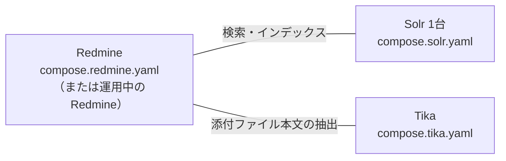

### 構成2：外部ソース追加（共有フォルダも検索）
ManifoldCFを追加し、共有フォルダのファイル（PDFやOffice文書など）を定期クロールしてSolrに投入する構成です。
（※ ManifoldCFのジョブの設定の注意は [マニュアルの8.1](manual.md#81-外部ソースの準備と取り込みmanifoldcftika) を参照してください）

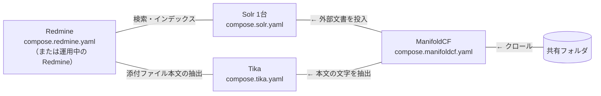

### 構成3：冗長化と監視（止まりにくくして見張る）
Solrを2台構成（SolrCloud + ZooKeeper 3台）にして耐障害性を高め、Prometheus・Grafanaで死活や性能を可視化する構成です。

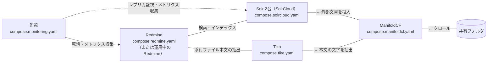

---

## 4. 各ファイルの中身と仕組み（リファレンス）

各composeファイルが何をしているかの詳細リファレンスです。

### compose.redmine.yaml（お試し用Redmine）

公式の `redmine` イメージに、このリポジトリそのものをプラグインとしてマウントして動かします（イメージの独自ビルドは不要です）。

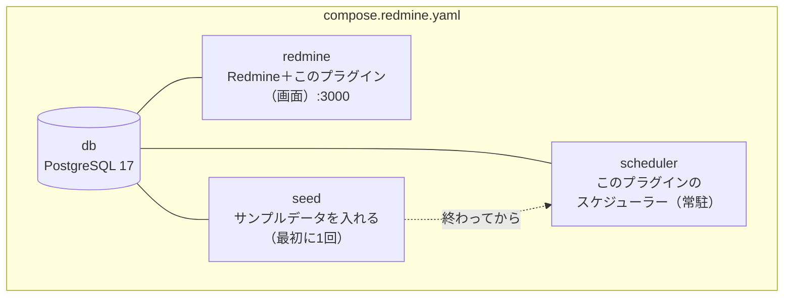

| サービス | 何をしているか |
|---|---|
| `db` | PostgreSQL 17。パスワードは `DB_PASSWORD`（既定 `redmine`）。起動確認（healthcheck）を持ちます |
| `redmine` | Redmine本体画面（`127.0.0.1:3000`）。起動時にプラグインのDBマイグレーションを自動実行します |
| `seed` | 初回起動時に `redmine/seed.sh` を実行：既定データ設定 → サンプルデータ（ja-basic）投入 → 添付ファイルのインデックス作成。完了の印を残し、2回目以降は何もしません |
| `scheduler` | プラグインの非同期スケジューラー（常駐プロセス）。1分ごとに、時刻になった処理（初期の設定で、差分の反映と添付ファイルは10分ごと、送り直しと突き合わせは1日ごと）と、管理ページからの依頼を動かします。インデックスがまだないときは、最初に全件のインデックスを作成します。**`seed` が完了してから動き出します**（日付順序の整合性を保つため） |

- 3つのRedmineサービス共通の設定（イメージ、DB接続先、`SOLR_URL`、`TIKA_URL`、ボリュームマウント等）は冒頭の `x-redmine` にまとめて定義されています。
- `SOLR_SEARCH_METRICS_TOKEN` は、監視コンテナがRedmineの指標を取得するための認証トークンです（空の場合はメトリクス口を無効化します）。

### compose.solr.yaml（Solr 1台構成）

最小限のSolrスタンドアロン構成です（組み込みZooKeeper）。

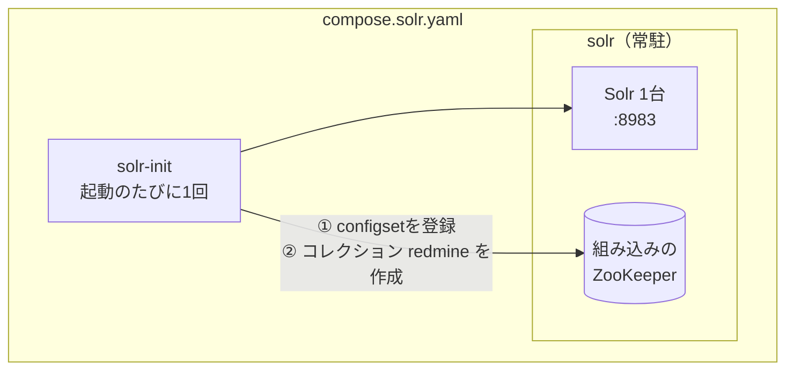

| サービス | 何をしているか |
|---|---|
| `solr` | Solr本体（`solr start -c -f` で起動）。組み込みZooKeeperでSolrCloudモードとして動作。データは `solr` ボリュームに保持。日本語正規化のため `analysis-extras` モジュールを自動読み込み |
| `solr-init` | 起動時に `solr-init/init.sh` を実行：リポジトリ内のスキーマ設定（configset）をZooKeeperに登録・更新し、コレクション `redmine` がなければ自動作成します |

### compose.solrcloud.yaml（Solr 2台冗長化構成）

本番運用向けの構成です。`compose.solr.yaml` の代わりに選択します。

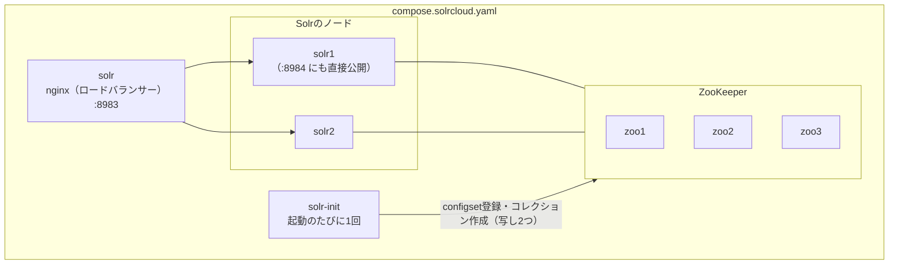

| サービス | 何をしているか |
|---|---|
| `zoo1`〜`zoo3` | 独立したZooKeeper 3台アンサンブル。設定情報とシャード・レプリカ状態を保持。1台が故障しても多数決で稼働を継続 |
| `solr1`・`solr2` | Solr 2台。コレクションのレプリカを各ノードに1つずつ持ち、片方が停止しても検索を継続可能 |
| `solr` | **2台の手前に配置されるnginx**。サービス名が `solr` なので、外部からは1台構成と同じ `http://solr:8983/solr` でアクセス可能（クライアント側の設定変更が不要）。ダウンしたノードへの振り分けを自動で一時除外 |
| `solr-init` | configsetをZooKeeperに登録し、レプリカ数2でコレクションを作成します |

- `solr1` のポート8984は、Windows版ManifoldCF（HTTP/2通信を行うためHTTP/1.1のnginxを介さず直接通信させる）向けに公開されています。

### compose.tika.yaml（本文抽出サーバー）

PDF、Word、Excelなどのファイルからテキストを抽出します。

| サービス | 何をしているか |
|---|---|
| `tika` | Apache Tika Server（`127.0.0.1:9998`）。渡されたバイナリファイルからテキスト本文を抽出して返します。内部で子プロセスを並列起動するため、メモリ上限を1.5GBに設定しています |

Tikaは自らSolrへ投入は行いません。テキストを抽出して呼び出し元（スケジューラーやManifoldCF）へ返す役割に徹します。

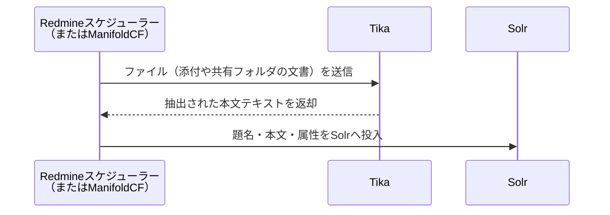

### compose.manifoldcf.yaml（外部文書取り込み）

共有フォルダなどの外部ファイルを定期的に取得・同期します。

> ※ ManifoldCFの設定の注意と、Web画面で手で作るときの要点は、[マニュアルの第8章](manual.md#manifoldcfの画面で作るときの要点)を参照してください。通常は後述の `add-folder.sh` スクリプトで自動構成できます。

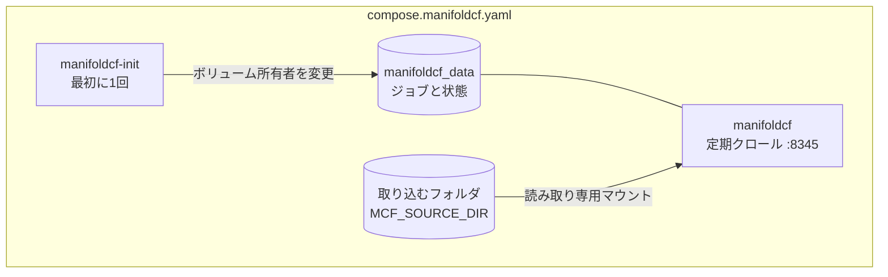

| サービス | 何をしているか |
|---|---|
| `manifoldcf-init` | Dockerボリュームの所有者をManifoldCF実行ユーザー（UID）に変更して終了する初期化処理 |
| `manifoldcf` | ManifoldCF本体（Web管理画面: `127.0.0.1:8345`）。取り込みフォルダ（ホスト側の `MCF_SOURCE_DIR`）を読み取り専用でマウントし、スケジュールに従って自動クロール |

- **フォルダの追加登録**: 手動で画面をポチポチ設定する代わりに、同梱のスクリプトで一発設定できます。
  ```bash
  # docker/ ディレクトリ内で実行します
  manifoldcf/add-folder.sh /source src_shared --start
  ```
  コレクション作成（configset `src`）、ManifoldCFの接続の作成（取り込みの流れ：ファイル → 許可する文書 → Tika → 長さの上限 → メタデータ → Solr）、ジョブ作成を行い、`--start`で初回クロールを開始します。外部の文書の`source`・`type`などは、Solr側のconfigset `src`が上書きします。その後、Redmineの「外部ソース」タブで登録してプロジェクトに紐付けます。

### compose.monitoring.yaml（監視ダッシュボード）

SolrやRedmineの稼働状態、インデックス遅れ、検索クエリ数などを監視します。どの構成（1台構成・SolrCloud）にもそのまま追加できます。

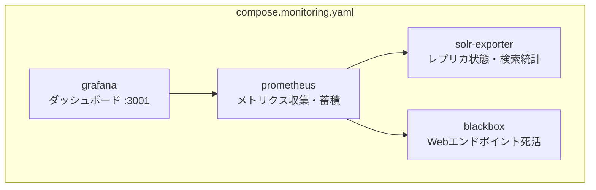

| サービス | 何をしているか |
|---|---|
| `prometheus` | 各サービスから15秒間隔でメトリクスを収集・保持（最大7日間または2GB） |
| `solr-exporter` | ZooKeeperおよびSolrからレプリカの健全性やクエリレスポンス時間を取得 |
| `blackbox` | Redmine・Solr・Tika・ManifoldCFのHTTP死活監視 |
| `grafana` | 日本語設定済みの監視ダッシュボード（`127.0.0.1:3001`、初期アカウント `admin` / `admin`） |

---

## 5. Windowsでの使いかた（Windowsのスターター）

Windows環境で自分のPC内のフォルダを高速に検索したい場合の推奨構成です。

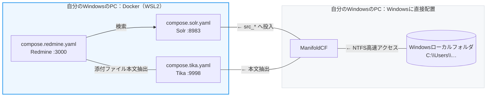

- **なぜManifoldCFだけWindowsに直接入れるのか？**: Docker（WSL2）内部からWindows側のNTFSファイルシステム（`/mnt/c/...`）をマウントしてクロールすると、ファイルアクセスのオーバーヘッドが大きく速度が低下するためです。ManifoldCFをWindows側で動かすことで、ローカルファイルを最高速度で取り込めます。
- **手順**: Docker側は `env.example.windows` で起動し、Windows側のManifoldCFからSolr（`localhost:8983`）およびTika（`localhost:9998`）へ投入します。SolrとTikaに届く範囲は、使う前に[公開するときの注意](#公開するときの注意)で確かめてください。
- フォルダの登録は、同梱のPowerShellスクリプト `windows/add-folder.ps1` で実行できます。
