# Redmine Solr Search 運用・利用マニュアル

本書は、Redmineプラグイン **`redmine_solr_search`（全文検索）** の運用・利用マニュアルです。Redmineのデータ（チケット・注記・Wikiページ・文書・添付ファイル）と、部門の文書（共有フォルダなどの外部の文書）を、Redmineの画面からまとめて検索するためのプラグインです。

環境の構築・運用を担うシステム管理者から、プロジェクトの管理者、検索して使うプロジェクトのメンバーまでを対象としています。部は、使い始める順（入れる → プロジェクトで有効にする → 使う）に並べています。ご自身の役割に合わせて、必要な部をお読みください。

| 役割 | 読む部 |
|---|---|
| システム管理者 | すべて（特に第2部・第3部・第6部・第7部）。[第3章](#第3章動作要件と構成の選びかた)から |
| プロジェクトの管理者 | 第1部、第4部。[第9章](#第9章プロジェクトでの有効化と外部ソースの紐付け) |
| メンバー（検索して使う人） | 第1部、第5部。すぐに使うなら[クイックスタート](#クイックスタート)から |

画面の画像は、試験用の環境の架空のデータ（プロジェクト・人物・文書は、すべて架空です）で撮っています。

---

## 全体目次

- **【第1部：コンセプトと全体像】**
  - [第1章：プラグインの概要](#第1章プラグインの概要)
    - [1.1 背景と目的](#11-背景と目的)
    - [1.2 できること](#12-できること)
    - [1.3 主な画面と役割](#13-主な画面と役割)
    - [1.4 構成のパターン](#14-構成のパターン)
  - [第2章：仕組みの要点](#第2章仕組みの要点)
    - [2.1 インデックスと、反映までの時間](#21-インデックスと反映までの時間)
    - [2.2 権限の考え方](#22-権限の考え方)
    - [2.3 外部ソース](#23-外部ソース)
    - [2.4 用語](#24-用語)
- **【第2部：システム管理者（導入）】**
  - [第3章：動作要件と構成の選びかた](#第3章動作要件と構成の選びかた)
    - [3.1 動作要件](#31-動作要件)
    - [3.2 構成の選びかた](#32-構成の選びかた)
    - [3.3 同梱のDocker Compose](#33-同梱のdocker-compose)
  - [第4章：据え付け](#第4章据え付け)
    - [4.1 Solrの準備（configsetの組み立てとアップロード、コレクションの作成）](#41-solrの準備configsetの組み立てとアップロードコレクションの作成)
    - [4.2 プラグインの配置とマイグレーション](#42-プラグインの配置とマイグレーション)
    - [4.3 接続先の設定（Solr・Tika）](#43-接続先の設定solrtika)
    - [4.4 スケジューラーの置き場所](#44-スケジューラーの置き場所)
    - [4.5 初めてのインデックスの作成と、動作の確認](#45-初めてのインデックスの作成と動作の確認)
    - [4.6 Dockerを使わないで入れるときの要点](#46-dockerを使わないで入れるときの要点)
  - [第5章：設定](#第5章設定)
    - [5.1 プラグインの設定の画面](#51-プラグインの設定の画面)
    - [5.2 環境変数](#52-環境変数)
- **【第3部：システム管理者（運用の準備）】**
  - [第6章：「状態」タブ](#第6章状態タブ)
    - [6.1 Solrの接続先とコレクション](#61-solrの接続先とコレクション)
    - [6.2 Tikaの接続先](#62-tikaの接続先)
    - [6.3 件数とレプリカの状態](#63-件数とレプリカの状態)
    - [6.4 スケジューラーの生存](#64-スケジューラーの生存)
  - [第7章：「インデックス」タブ](#第7章インデックスタブ)
    - [7.1 定期的な処理と間隔](#71-定期的な処理と間隔)
    - [7.2 インデックスの作り直し](#72-インデックスの作り直し)
    - [7.3 部分インデックスの作り直し](#73-部分インデックスの作り直し)
    - [7.4 添付ファイル](#74-添付ファイル)
  - [第8章：「外部ソース」タブ](#第8章外部ソースタブ)
    - [8.1 外部ソースの準備と取り込み（ManifoldCF・Tika）](#81-外部ソースの準備と取り込みmanifoldcftika)
    - [8.2 登録と、利用を許可するプロジェクト](#82-登録と利用を許可するプロジェクト)
    - [8.3 場所の見せかた（表示の形式、リンクの書式、場所の読み替え）](#83-場所の見せかた表示の形式リンクの書式場所の読み替え)
    - [8.4 リンクを自分で作り換える（View Customize）](#84-リンクを自分で作り換えるview-customize)
- **【第4部：プロジェクトの管理者】**
  - [第9章：プロジェクトでの有効化と外部ソースの紐付け](#第9章プロジェクトでの有効化と外部ソースの紐付け)
    - [9.1 「全文検索」モジュールを有効にする](#91-全文検索モジュールを有効にする)
    - [9.2 3つの権限](#92-3つの権限)
    - [9.3 外部ソースの紐付け（プロジェクトの設定の「全文検索」タブ）](#93-外部ソースの紐付けプロジェクトの設定の全文検索タブ)
- **【第5部：メンバー】**
  - [第10章：検索のはじめかた](#第10章検索のはじめかた)
    - [10.1 全体検索とプロジェクトの中の検索](#101-全体検索とプロジェクトの中の検索)
    - [10.2 結果の画面の見かた](#102-結果の画面の見かた)
  - [第11章：語の入れかた](#第11章語の入れかた)
    - [11.1 複数の語](#111-複数の語)
    - [11.2 日本語の探されかた](#112-日本語の探されかた)
    - [11.3 「字面どおりに探す」](#113-字面どおりに探す)
    - [11.4 「属性も含めて検索する」](#114-属性も含めて検索する)
    - [11.5 表記ゆれと同義語](#115-表記ゆれと同義語)
  - [第12章：絞り込みと並び](#第12章絞り込みと並び)
    - [12.1 左の欄での絞り込み（種類・プロジェクト・ソース・フォルダ・更新日）](#121-左の欄での絞り込み種類プロジェクトソースフォルダ更新日)
    - [12.2 「条件で絞り込む（チケットの属性）」](#122-条件で絞り込むチケットの属性)
    - [12.3 並び順](#123-並び順)
    - [12.4 ページ送りと件数の表示](#124-ページ送りと件数の表示)
  - [第13章：見つからない・見えないとき](#第13章見つからない見えないとき)
    - [13.1 権限で見えないもの](#131-権限で見えないもの)
    - [13.2 新しいものが出ない、消したものが出る](#132-新しいものが出ない消したものが出る)
    - [13.3 添付ファイルの中身で探せない](#133-添付ファイルの中身で探せない)
    - [13.4 1文字の語、語の一部](#134-1文字の語語の一部)
    - [13.5 「検索できませんでした」と出たとき](#135-検索できませんでしたと出たとき)
    - [13.6 検索の記録について](#136-検索の記録について)
- **【第6部：システム管理者（品質の手入れと運用監視）】**
  - [第14章：検索の品質の手入れ](#第14章検索の品質の手入れ)
    - [14.1 「検索ログ」タブ](#141-検索ログタブ)
    - [14.2 「同義語」タブ](#142-同義語タブ)
    - [14.3 「詳細調整」タブ（並びの重み、試し検索）](#143-詳細調整タブ並びの重み試し検索)
    - [14.4 外部のリランカー](#144-外部のリランカー)
    - [14.5 正解つきの検索で品質を測る（上級者・専門家向け）](#145-正解つきの検索で品質を測る上級者専門家向け)
  - [第15章：変更の履歴と監視](#第15章変更の履歴と監視)
    - [15.1 「変更の履歴」タブ](#151-変更の履歴タブ)
    - [15.2 監視（Prometheus・Grafana）](#152-監視prometheusgrafana)
    - [15.3 Solrについて見てほしいこと](#153-solrについて見てほしいこと)
- **【第7部：保守と逆引き】**
  - [第16章：仕組みとデータ（技術解説）](#第16章仕組みとデータ技術解説)
    - [16.1 全体の配置と流れ](#161-全体の配置と流れ)
    - [16.2 プラグインのテーブル](#162-プラグインのテーブル)
    - [16.3 設定の置き場所](#163-設定の置き場所)
    - [16.4 Solrのスキーマの要点](#164-solrのスキーマの要点)
  - [第17章：バックアップ・バージョンアップ・アンインストール](#第17章バックアップバージョンアップアンインストール)
    - [17.1 バックアップと復旧](#171-バックアップと復旧)
    - [17.2 バージョンアップ](#172-バージョンアップ)
    - [17.3 アンインストール](#173-アンインストール)
  - [第18章：FAQ・困ったとき・既知の制約](#第18章faq困ったとき既知の制約)
    - [18.1 困ったとき](#181-困ったとき)
    - [18.2 性能の目安](#182-性能の目安)
    - [18.3 既知の制約](#183-既知の制約)

---

# 【第1部：コンセプトと全体像】

## 第1章：プラグインの概要

### 1.1 背景と目的

プロジェクトを進めるとき、情報はいくつもの場所に分かれて管理されがちです。

| 情報 | 管理する場所 |
|---|---|
| 課題・タスク・議論 | Redmine（チケット、Wiki、文書） |
| 計画書・議事録・設計書・規程など | 共有フォルダ（ファイルサーバー）、SharePointなど |

その結果、「あの議事録はどこにあったか」「この仕様はチケットで決めたのか、設計書に書いたのか」を探すために、いくつもの場所を順に見て回ることになります。

本プラグインは、**プロジェクトに関係する情報を、Redmineの画面から1か所で探せるようにする**ことを目的としています。Redmineをプロジェクト管理の入口として使っている組織を想定し、検索の入口も、誰に何を見せるかの判定も、Redmineに寄せています。検索エンジンには Apache Solr を使い、日本語の全文検索に向けた設定をしています。

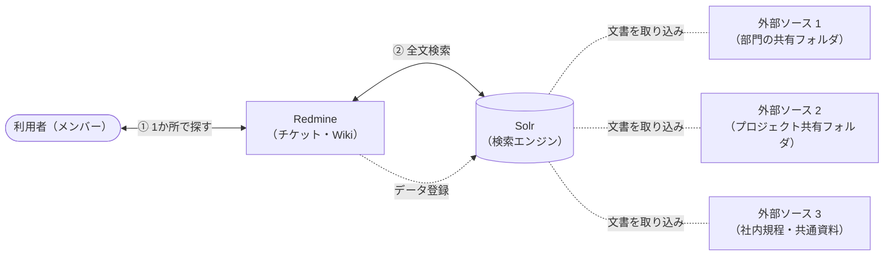

このように、Redmine内のデータだけでなく、複数の外部ソース（共有フォルダなど）の文書もあらかじめSolrに集約（インデックス化）しておくことで、利用者はRedmineの検索画面という「1つの窓口」からすべてを一元的に横断検索できるようになります。

#### 本書で使う言葉

| 言葉 | 意味 |
|---|---|
| **Redmineのデータ** | Redmineの中にあるもの。チケット・注記・Wikiページ・文書と、それらの添付ファイルです |
| **外部の文書** | Redmineの外にある文書そのものです（共有フォルダのWordのファイル、PDFなど）。検索の結果に出る1件1件を指します |
| **外部ソース** | 外部の文書の取り込み元です（共有フォルダの1つのフォルダ、SharePointの1つのサイトなど）。システム管理者が登録し、プロジェクトに紐付ける**設定の単位**です。1つの外部ソースに、たくさんの外部の文書が入ります |
| **インデックス** | 検索のために、Solrに入れておくデータです。検索は、Redmineや共有フォルダを直接見るのではなく、このインデックスを探します（[2.1](#21-インデックスと反映までの時間)） |

本書では、文書そのものを指すときは「外部の文書」、設定の単位を指すときは「外部ソース」（管理ページの「外部ソース」タブで登録するもの）と、言い分けます。

---

### 1.2 できること

- **Redmineのデータの全文検索**：チケット・注記・Wikiページ・文書と、それらの添付ファイルの本文を探せます。結果は、チケットやWikiページなどの単位でまとめて出します（注記で当たっても、検索結果の1件はそのチケットです）。
- **外部の文書を一緒に検索**：共有フォルダなどの文書を、取り込み元（**外部ソース**）ごとにインデックスへ入れておくと、Redmineのデータと一緒に、1つの結果の一覧で探せます。どのプロジェクトでどの外部ソースを探すかは、Redmineの画面で決めます。
- **日本語に向けた探しかた**：語の活用（「確認した」で「確認する」も見つかる）と、複合語の一部（「議事」で「議事録」も見つかる）の両方を扱います。綴りのゆれ（バイオリンとヴァイオリン、霞ケ関と霞ヶ関）や、管理者が登録した同義語（旧称と新称、略語と正式名称）にも広げて探します。
- **Redmineの権限どおりに見せる**：非公開のプロジェクト、プライベートチケット・プライベート注記、ロールの「表示できるチケット」、トラッカー、カスタムフィールドの表示の制限を、そのまま引き継ぎます。検索結果に出るのは、その人がRedmineで見てよいものだけです。
- **絞り込みと並び**：結果の左の欄で、プロジェクト・外部ソース・フォルダ・更新日や、チケットの属性（トラッカー、ステータス、担当者、カスタムフィールドなど）で絞り込めます（ファセット。値ごとの件数つき）。上のフォームの「種類」での絞り込みと、関連度順・更新日時順の並び替えもできます。
- **管理と運用**：管理メニューの「全文検索」で、Solrの状態の確認、インデックスの作り直しの依頼、外部ソースの登録、検索ログの確認、同義語の辞書、結果の並びの調整を行えます。インデックスの更新は、プラグインの定期処理（スケジューラー）が自動で行います。Prometheus・Grafanaでの監視の例も用意しています。

なお、次のことは、本プラグインの対象にしていません。

- **ファイルサーバー側の権限の反映**：共有フォルダなどのファイルごとのアクセス権は、取り込みません。外部の文書を誰に見せるかは、外部ソースとRedmineのプロジェクトとの紐付けで決めます（[2.2](#22-権限の考え方)）。
- **RAG・LLM・ベクトル検索**：語で探す、古典的な全文検索を対象にしています。
- **リアルタイムでのインデックスの作成**：インデックスは定期処理でまとめて更新します。チケットなどを作ったり直したりしてから検索に出るまでに、少し時間がかかります（初期の設定では10分余り。[2.1](#21-インデックスと反映までの時間)）。

---

### 1.3 主な画面と役割

| 画面 | 開く場所 | 主な役割 | 使う人 |
|---|---|---|---|
| **全文検索（全体）** | トップメニューの「全文検索」、またはプロジェクトの外のページ（プロジェクト一覧など）のタブ | 見てよいすべてのプロジェクトのRedmineのデータと、外部の文書を、まとめて探します | メンバー |
| **全文検索（プロジェクトの中）** | プロジェクトのメニューの「全文検索」タブ | そのプロジェクトのRedmineのデータと、そのプロジェクトに紐付いた外部ソースの文書を探します | メンバー |
| **プロジェクトの設定の「全文検索」タブ** | プロジェクト →「設定」→「全文検索」 | このプロジェクトで探す外部ソースを選びます | プロジェクトの管理者 |
| **プラグインの設定** | 管理 →「プラグイン」→ 全文検索の「設定」 | 検索の動き（語の数の上限、1ページの件数、全体検索の利用範囲など）と、定期処理の間隔、添付ファイルの扱いを決めます | システム管理者 |
| **管理ページ（7つのタブ）** | 管理 →「全文検索」 | 「状態」「インデックス」「外部ソース」「検索ログ」「同義語」「詳細調整」「変更の履歴」 | システム管理者 |

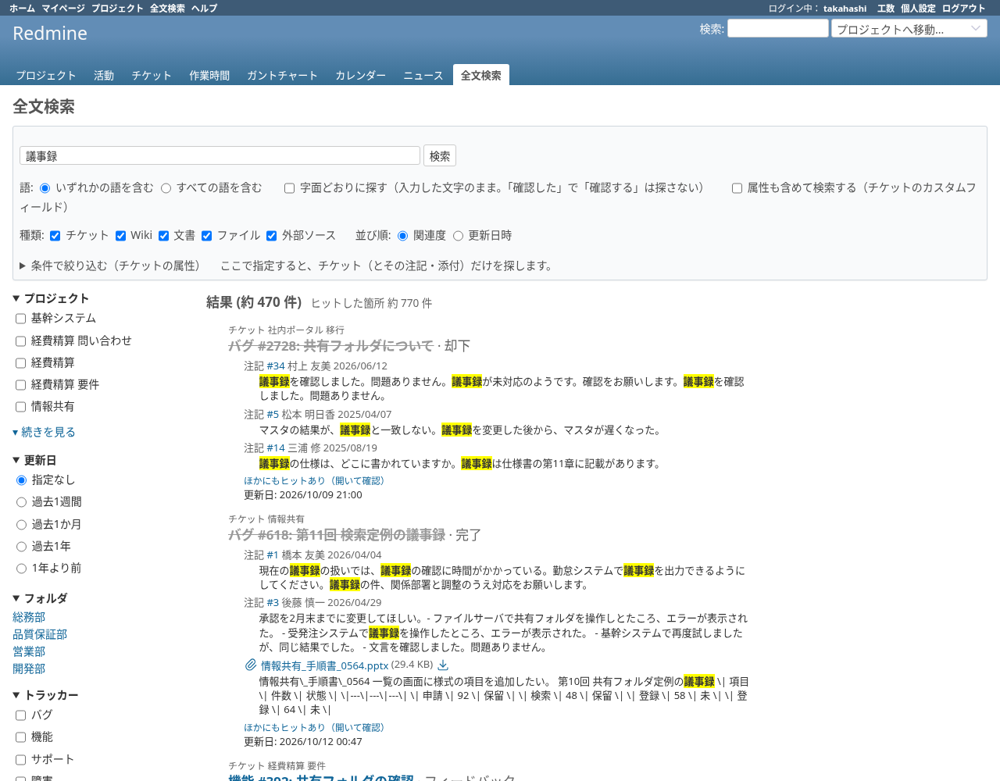  
*画面1-1：全文検索の結果の画面（全体検索。上のフォーム、左の欄の絞り込み、結果の一覧と抜粋の色付け）*

---

### 1.4 構成のパターン

本プラグインは、Redmineのプラグインと、検索エンジンのSolrの組み合わせで動きます。何を探したいか、どこまで止まらずに動かしたいかに合わせて、次の3つの形で組めます。

| パターン | 組み合わせ | 向いている場面 |
|---|---|---|
| **1. 最小構成** | Redmine＋プラグイン、Solr 1台（添付ファイルの本文も探すなら Tika Server） | Redmineのデータだけを探したい。まず試したい |
| **2. 外部の文書の取り込み** | 1に、ManifoldCF と Tika Server を足す | 共有フォルダなどの外部の文書も一緒に探したい |
| **3. フル構成** | Solrを2台以上（SolrCloud。ZooKeeperと振り分けのnginx）にし、Prometheus・Grafanaで監視する | 1台が止まっても検索を続けたい。状態を見張りたい |

- **Tika Server**：添付ファイルや外部の文書（Word・Excel・PDFなど）から本文を取り出す部品です。
- **ManifoldCF**：外部ソース（共有フォルダなど）を定期的に読み、外部の文書をSolrへ送る取り込みの部品です。本プラグインは外部の文書の取り込みそのものは行わず、Solrに入った文書を探す側を受け持ちます。

それぞれの部品のつながりは、[第16章](#第16章仕組みとデータ技術解説)の図を見てください。動作要件と構成の選びかたは[第3章](#第3章動作要件と構成の選びかた)で説明します。

---

## 第2章：仕組みの要点

この章では、メンバーにも知っておいてほしい「なぜそう動くのか」を、3つにしぼって説明します。

### 2.1 インデックスと、反映までの時間

本プラグインは、検索のたびにRedmineのデータベースを探すのではなく、あらかじめSolrに作っておいた**インデックス**（検索用のデータ）を探します。そのため、たくさんのデータからでも速く探せる一方で、Redmineでの変更が検索に出るまでに、少し時間がかかります。

インデックスの更新は、プラグインの**スケジューラー**（定期処理を受け持つ常駐のプロセス）が自動で行います。初期の設定では、次の間隔で動きます。

| 処理 | 何をするか | 初期の間隔 |
|---|---|---|
| 差分の反映 | 前回から作られたもの・変わったものを、インデックスに入れます | 10分ごと |
| 添付ファイル | まだインデックスにない添付ファイルの本文を取り出して、インデックスに入れます | 10分ごと |
| 送り直し | 更新日時が変わらない変更（Wikiページの移動、文書の編集など）を拾うため、Wikiページと文書を送り直します | 1日ごと |
| 突き合わせ | Redmineから消えたものを、インデックスからも消します | 1日ごと |

このため、次のことが起きます。

- **新しく書いたもの・直したものは、すぐには出ません**。初期の設定では、10分余り（10分の間隔と、処理にかかる時間）で出ます。スケジューラーは処理を1つずつ動かすので、インデックスの作り直しなど、ほかの処理が動いているときは、それが終わるまで遅れます。
- **Redmineで消したもの、見られなくなったものは、一覧には出ません**。結果を出す前に、Redmineのデータを読み直し、その人が今見てよいかをRedmineの判定で確かめているためです。ただしインデックスからは、突き合わせ（初期の設定では1日ごと）まで消えないので、それまでは「約 N 件」の件数に数えられ、1ページの件数が少なく見えることがあります。
- **外部の文書は、取り込みの部品が次に外部ソースを調べるまで、元のファイルを消しても出ます**。取り込みの間隔は、外部ソースの運用で決めます。

間隔は、システム管理者がプラグインの設定で変えられます（[第5章](#第5章設定)）。大きな変更（カスタムフィールドの設定の変更など）のあとは、管理ページからインデックスの作り直しを依頼します（[第7章](#第7章インデックスタブ)）。

---

### 2.2 権限の考え方

**検索結果に出るのは、その人がRedmineで見てよいものだけです。** 本プラグインは、チケットやWikiページなどを誰に見せるかを独自に決めず、Redmineでの見え方に従います。

| 対象 | 誰に見せるか |
|---|---|
| チケット・注記 | Redmineのチケットの画面で見られる人と同じです（プロジェクト、プライベートチケット、作成者・担当者、ロールの「表示できるチケット」、トラッカー、プライベート注記） |
| Wikiページ・文書 | そのプロジェクトでWikiや文書を見られる人 |
| 添付ファイル | 添付先（チケット、Wikiページ、文書、プロジェクトのファイルなど）を見られる人 |
| チケットのカスタムフィールド | そのフィールドを見てよい人だけが、その値で探せます |
| **外部の文書** | その外部ソースが紐付いたプロジェクトのメンバー（下の説明） |

外部の文書には、ファイルごとの権限がありません。**外部ソース（取り込み元）を単位に、どのプロジェクトのメンバーに見せるか**を決めます。決めかたは2段です。

1. システム管理者が、その外部ソースの利用を**許可するプロジェクト**を決めます。
2. 許可されたプロジェクトの側で、そのプロジェクトで**探す外部ソース**を選びます（紐付け）。

紐付けたプロジェクトのメンバーが、その外部ソースの文書を見られるようになります。たとえば部門の共有フォルダを、その部門のプロジェクトにだけ紐付ければ、ほかの部門の人の検索には出ません。許可と紐付けの変更は、管理ページの「変更の履歴」タブに残ります。

プロジェクトの中で誰が検索できるか、誰が紐付けを変えられるかは、プロジェクトのモジュールとロールの権限で決めます。これは[第9章](#第9章プロジェクトでの有効化と外部ソースの紐付け)で説明します。

---

### 2.3 外部ソース

**外部ソース**は、外部の文書の取り込み元です（[1.1の「本書で使う言葉」](#本書で使う言葉)）。共有フォルダの1つのフォルダ、SharePointの1つのサイトなどを、1つの外部ソースとして扱います。

- 外部の文書は、外部ソースごとに、Solrの別々のコレクション（名前は `src_` で始めることを勧めます）に入ります。取り込むのはManifoldCFなどの取り込みの部品で、本プラグインは取り込みのしかたを決めません。
- システム管理者が、そのコレクションを管理ページの「外部ソース」タブで登録すると、検索の対象になります。登録のときに、表示の名前や、結果に出す場所（パス）の見せかた、リンクの作りかたも決めます。
- 検索のときは、その人が見てよいRedmineのデータと、見てよい外部ソースの文書を、**1回の問い合わせでまとめて**探し、1つの結果の一覧に出します。結果の左の欄で、外部ソースやフォルダごとに絞り込めます。

外部の文書を取り込む手順と、登録のしかたは[第8章](#第8章外部ソースタブ)で説明します。

---

### 2.4 用語

本マニュアルや画面で使う、主な言葉の一覧です。ふだんの言葉での説明は、[1.1の「本書で使う言葉」](#本書で使う言葉)にもあります。

| 用語 | 意味 |
|---|---|
| **インデックス** | Solrに登録された検索用のデータ群（コレクションの中身）。画面およびマニュアル上は「インデックス」と表記します。 |
| **入れ物（`group_id`）** | 検索結果の1件として表示されるまとまりのこと。チケット（注記や添付ファイルを含む）、Wikiページ、文書、外部文書などが該当します。 |
| **外部ソース** | Redmineの外部にある共有フォルダやファイルサーバーなどの取り込み元。Solr上の1コレクション（`src_<名前>`）に対応します。 |
| **紐付け** | プロジェクトの管理者が、利用を許可された外部ソースの中から、自分のプロジェクトの検索対象にするものを選択して関連付けること。 |
| **権限の `fq`** | 利用者が見てよい文書だけをSolr側で安全に絞り込むためのフィルタークエリ（Filter Query）。 |
| **突き合わせ（`reconcile`）** | Redmine側で削除されたチケットなどを検知し、Solrのインデックスから取り除く定期バッチ処理。 |
| **形態素解析** | 日本語の文を「意味を持つ最小の単語」に分解して基本形に揃える解析方式（Kuromoji）。活用形の揺れや単語一致を的確に捉えます。 |
| **2-gram（バイグラム）** | 文章を2文字ずつの連続する単位に機械的に分解する解析方式。形態素解析の辞書にない未知語や型番を、2文字以上なら部分一致で拾います。 |
| **collapse / expand** | 複数の注記や添付ファイルを、親となるチケット（入れ物）1件に束ねて結果を返すSolrのグルーピング機能。 |
| **tick（ティック）** | 常駐スケジューラーが1分ごとに起床し、実行すべき処理があるかを調査・判定する周期処理の1回分のこと。 |

---

#### ここから先は、ご自身の役割に合わせてお読みください

この先は、使い始める順（導入する → プロジェクトで有効にする → 検索して使う）に並んでいます。ご自身の役割に合わせて、必要な部からお読みください。

| 役割 | 読むところ |
|---|---|
| **システム管理者** | **[第3章：動作要件と構成の選びかた](#第3章動作要件と構成の選びかた)**から（第2部・第3部）。品質手入れと監視は第6部、困ったときと保守は第7部 |
| **プロジェクトの管理者** | **[第9章：プロジェクトでの有効化と外部ソースの紐付け](#第9章プロジェクトでの有効化と外部ソースの紐付け)**（第4部） |
| **メンバー**（検索を使う人） | **[クイックスタート](#クイックスタート)**から（第5部）。すぐに検索を始められます |

---

# 【第2部：システム管理者（導入）】

この部では、プラグインを入れて、最初の検索ができるようになるまでを説明します。運用の準備（管理ページの初期設定）は第3部、品質手入れと監視は第6部、困ったときと保守は第7部です。

## 第3章：動作要件と構成の選びかた

### 3.1 動作要件

| 部品 | 要るか | 対応する版 | 確かめた版・備考 |
|---|---|---|---|
| **Redmine** | 要る | 5.1〜7.x | 6.1.4で開発し、5.1.12・6.0.11・6.1.5・7.0.2で、主な画面・検索・権限が同じに動くことを確かめています。5.0と4.2は対象外です。範囲の外の版では、プラグインが起動のときにエラーにします。gemは要りません |
| **Apache Solr** | 要る | 9.x・10.x（SolrCloudモード） | 9.10.1で開発し、10.1.0でも同じに動くことを確かめています。1台で動かすときも、SolrCloudモード（`solr start -c`。組み込みのZooKeeper）にします。すべてのノードで、モジュール`analysis-extras`を有効にします。7.x・8.xは対象外です（Solr本家のサポートが終わっており、設定の書きかたも違います） |
| **ZooKeeper** | SolrCloudに要る | Solrに合わせる | 2台以上のSolrなら、別に立てます（開発環境は3.9.5×3台）。1台なら、Solrの組み込みのものでかまいません |
| **Apache Tika Server** | 任意 | — | 4.1.0で確かめています。添付ファイルや外部の文書の本文を検索するときに使います。なくても、Redmineのデータ（チケット・注記・Wiki・文書）と、添付ファイルの名前・説明は検索できます |
| **Apache ManifoldCF** | 任意 | — | 2.31で確かめています（Java 25が要ります）。共有フォルダなどの外部の文書を取り込むときに使います |

- データベースは、PostgreSQLで開発し、確かめています（開発環境は17。Ubuntu 24.04の標準の16でも動かしました）。
- メモリの目安：Solr 1台・Tika・Redmine・スケジューラー・PostgreSQLを1台に入れた構成は、サンプルデータで動かして約2GB使いました。データが増える分と余裕を見て、4GB以上を勧めます。SolrCloud（2台）・ManifoldCF・監視まで入れたフル構成は、Solrのヒープが各512MBで約4GB、各2GBで約8GB使いました（どれも開発環境で測った例です。本番の機器では測り直してください）。

---

### 3.2 構成の選びかた

[1.4](#14-構成のパターン)の3つのパターンから、目的に合うものを選びます。

| こうしたい | 選ぶもの |
|---|---|
| まず試したい | 同梱のDocker Composeの`try-minimal`（[3.3](#33-同梱のdocker-compose)）。サンプルデータつきのRedmineまで、まとめて立ち上がります |
| 今動いているRedmineに、検索を足したい | パターン1。Redmineにプラグインを入れ（[第4章](#第4章据え付け)）、Solr（とTika）は、同梱のDocker Composeの`minimal`で立てるか、自分で入れます |
| 共有フォルダの文書も一緒に探したい | パターン2。ManifoldCFとTikaを足します（同梱なら`external`。[第8章](#第8章外部ソースタブ)） |
| Solrが1台止まっても検索を続けたい | パターン3。Solrを2台以上にし、前に振り分けのnginxを置きます（同梱なら`full`）。コレクションは「1シャード×2レプリカ」で作ります |

**Solr 1台の構成について**：動作（状態の表示、インデックスの作成、検索、外部ソースの検索）は確かめていますが、1台が止まると検索も止まります。止まってよい用途か、まず試すときに選んでください。

---

### 3.3 同梱のDocker Compose

Solr・Tika・ManifoldCF・監視などを、Docker Composeでまとめて立てられるよう、設定を同梱しています（`docker/`）。役目ごとにcomposeファイルを1つずつ分けてあり、使う組み合わせを`.env`で選びます。組み合わせは、`env.example.*`をコピーして選びます。

| 組み合わせ | 立ち上がるもの | 向いている場面 |
|---|---|---|
| `try-minimal` | サンプルデータつきのRedmine、Solr 1台、Tika | 手元のPCで試す |
| `try-external` | try-minimalに、ManifoldCF（フォルダを取り込む） | 外部の文書の検索も試す |
| `try-full` | サンプルデータつきのRedmine、SolrCloud（Solr 2台、ZooKeeper 3台、nginx）、Tika、ManifoldCF、監視 | 本番に近い形を試す（約4〜8GB。Solrのヒープの大きさによります） |
| `minimal` | Solr 1台、Tika（Redmineは含まない） | 今動いているRedmineに足す |
| `external` | minimalに、ManifoldCF | 今動いているRedmineに、外部の文書の検索まで足す |
| `full` | SolrCloud、Tika、ManifoldCF、監視（Redmineは含まない） | 今動いているRedmineに、本番に近い形で足す |
| `windows` | サンプルデータつきのRedmine、Solr、Tika（WSL2のDocker）。ManifoldCFはWindowsに直接入れる | WindowsのPCで試す |

使いかたは、どれも同じです。

```sh
cd docker
cp env.example.try-minimal .env   # 使う組み合わせを選ぶ
docker compose up -d
```

**`try-*`と`windows`（Redmineも立ち上がる組み合わせ）**

- 数分でサンプルデータとインデックスができあがり、http://localhost:3000/ に`admin`／`password`でログインして試せます。試すためのものなので、パスワードなどは仮の値です。
- `try-external`・`try-full`に、外部の文書の見本は入っていません。`.env`の`MCF_SOURCE_DIR`に取り込むフォルダを指定してから立ち上げ、`manifoldcf/add-folder.sh`でコレクションとジョブを作り、「外部ソース」タブで登録して紐付けます（[第8章](#第8章外部ソースタブ)）。
- `windows`では、WindowsのManifoldCFから届くよう、SolrとTikaが`0.0.0.0`で待ち受けます。どちらにも認証がなく、ほかのPCからも届きうるので、信頼できるネットワークで、試すときだけ使ってください。

**`minimal`・`external`・`full`（今動いているRedmineに足す組み合わせ）**

- 立ち上がるのは、検索の部品だけです。プラグインの配置、接続先の設定、スケジューラーは、今のRedmineの側で行います（[第4章](#第4章据え付け)）。
- Solrの設定（configset）の登録と、コレクション`redmine`の作成は、自動で行われます。
- Solrは`127.0.0.1:8983`、Tikaは`127.0.0.1:9998`で待ち受けます。**そのままでは、同じマシンのRedmineからしか届きません**。別のマシンのRedmineから使うときは、`.env`の`SOLR_BIND`・`TIKA_BIND`を変えます。どちらにも認証がないので、届く相手を、必ずRedmineのサーバーだけに絞ってください。
- **Linuxでは、Dockerが公開したポートにufwの規則は効きません**。相手を絞るには、iptablesの`DOCKER-USER`チェインに規則を入れるか、サーバーの外のファイアウォールを使います（[Dockerの公式の説明](https://docs.docker.com/engine/network/firewall-iptables/)）。
- Docker Engineが28.0.0より古いと、`127.0.0.1`に公開したポートにも、同じネットワーク（L2）のほかのマシンから届くことがあります。28.0.0以上を使ってください（[Dockerの公式の説明](https://docs.docker.com/engine/network/port-publishing/)）。

組み合わせごとの図、composeファイルごとの中身、設定の項目など、**配布用の構成をもっと詳しく知りたいときは、[同梱のDockerの構成](docker.md)を見てください**。

---

## 第4章：据え付け

ここでは、今動いているRedmineに入れる流れを説明します。Dockerを使わずに、Solr・Tika・スケジューラーをサーバーに直接入れるときの要点は、[4.6](#46-dockerを使わないで入れるときの要点)にまとめています。

| 順 | すること | 同梱のDocker Composeで検索の部品を立てたとき | Solrを自分で入れたとき |
|---|---|---|---|
| 1 | Solrの準備（[4.1](#41-solrの準備configsetの組み立てとアップロードコレクションの作成)） | 要りません（自動です） | 行います |
| 2 | プラグインの配置（[4.2](#42-プラグインの配置とマイグレーション)） | 行います | 行います |
| 3 | 接続先の設定（[4.3](#43-接続先の設定solrtika)） | 行います | 行います |
| 4 | スケジューラー（[4.4](#44-スケジューラーの置き場所)） | 行います（同梱のものは`try-*`と`windows`だけです） | 行います |
| 5 | 初めてのインデックスと確認（[4.5](#45-初めてのインデックスの作成と動作の確認)） | 行います | 行います |

### 4.1 Solrの準備（configsetの組み立てとアップロード、コレクションの作成）

同梱のDocker Composeで立てたSolrでは、この節の作業は要りません（組み立て、アップロード、`redmine`の作成まで自動です）。[4.2](#42-プラグインの配置とマイグレーション)へ進んでください。

プラグインは、Solrに2種類の設定（configset）を使います。

- `redmine`：Redmineのデータのインデックスの設定
- `src`：外部の文書のインデックスの設定（外部ソースを使うときだけ）

どちらも、共通部分（`solr/common/`）と組み合わせて使う作りです。**組み立ててから**ZooKeeperに上げてください。`solr/configsets/redmine/conf/`をそのまま上げると、共通部分が入らず、コレクションが作れません。

```bash
cd solr
for name in redmine src; do
  mkdir -p /tmp/cs/${name}
  cp -r configsets/${name}/conf/. common/. /tmp/cs/${name}/
  solr zk upconfig -n ${name} -d /tmp/cs/${name} -z <ZooKeeperの接続先>
done
```

- アップロードには`solr zk upconfig`を使ってください。認証のないSolrでConfigset APIから上げると、「信頼されないconfigset」になります。
- 次に、Redmineのデータのコレクション`redmine`を作ります。2台以上のSolrなら1シャード×2レプリカ、1台なら`replicationFactor=1`にします。

```
http://<Solrのホスト>:8983/solr/admin/collections?action=CREATE&name=redmine&numShards=1&replicationFactor=2&collection.configName=redmine
```

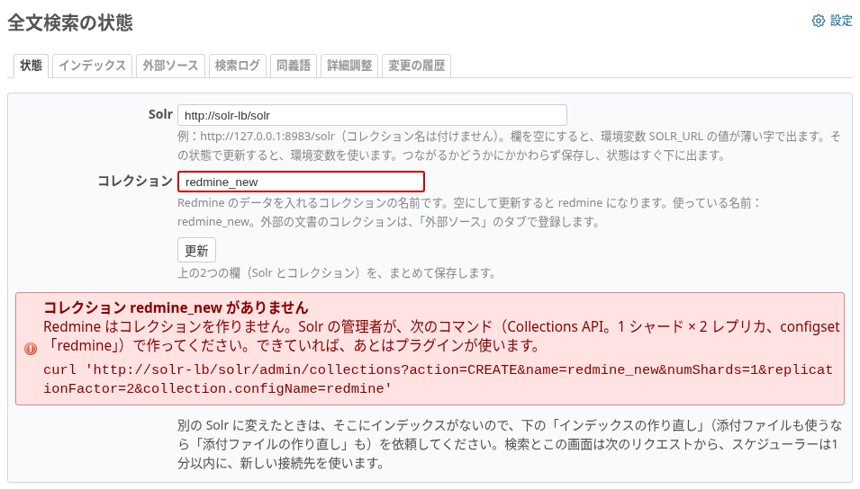  
*画面4-1：コレクションがまだないときの「状態」タブ（赤い帯と、Solrのノードの数に合わせた作成のコマンド）*

コレクションがまだないときは、管理ページの「状態」タブに、Solrのノードの数に合わせた作成のコマンドが出ます。

---

### 4.2 プラグインの配置とマイグレーション

```sh
cd /path/to/redmine/plugins
git clone https://github.com/yoohey/redmine_solr_search.git redmine_solr_search    # フォルダ名は redmine_solr_search にする
cd /path/to/redmine
bin/rake redmine:plugins:migrate RAILS_ENV=production
# Redmine を再起動する
```

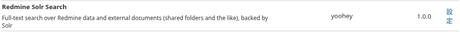  
*画面4-2：管理 →「プラグイン」の一覧に出る「Redmine Solr Search」と版*

- フォルダ名は`redmine_solr_search`にしてください。
- プラグインのテーブル（実行の記録、検索ログ、外部ソース、同義語の辞書など）が作られます。同義語の辞書には、サンプルの言い換えが6組、最初から入ります（組織の言葉に直すか、不要なら空にします。[14.2](#142-同義語タブ)）。
- 再起動のあと、管理 →「プラグイン」に「Redmine Solr Search」が出て、管理メニューに「全文検索」が増えます。

---

### 4.3 接続先の設定（Solr・Tika）

SolrとTikaの接続先は、次のどちらかで教えます。**画面の値が先**で、画面が空なら環境変数を使います。

| 接続先 | 画面で設定する | 環境変数で設定する | どちらもないとき |
|---|---|---|---|
| Solr | 管理 →「全文検索」→「状態」タブの「Solr」の欄 | `SOLR_URL`（例：`http://127.0.0.1:8983/solr`） | 使えません（設定が要ります） |
| Tika | 同じタブの「Tika」の欄 | `TIKA_URL`（例：`http://127.0.0.1:9998`） | `http://tika:9998`（Docker Composeの中でしか通じない名前です） |

- 画面の欄は、[6.1](#61-solrの接続先とコレクション)・[6.2](#62-tikaの接続先)を見てください。
- 画面の値はデータベースに入るので、Redmineとスケジューラーの両方が使います。再起動は要りません。
- 環境変数で教えるときは、**Redmineとスケジューラーの両方**に、同じ値を渡してください。
- 同梱のDocker Composeの検索の部品を、Redmineと同じマシンで動かすなら、Solrは`http://127.0.0.1:8983/solr`、Tikaは`http://127.0.0.1:9998`です（`full`でも同じです。Solrの8983は振り分けのnginxが受けます）。Redmineもコンテナで動いているときは、コンテナの中の`127.0.0.1`はそのコンテナ自身なので、この値では届きません。届く名前かアドレスを入れてください。
- Solrの接続先は、Solrに直接（`http://<ホスト>:8983/solr`）でも、振り分けのnginxでもかまいません。2台以上なら、片方が落ちても使えるよう、振り分けを置いてください。
- **Tikaを使わないとき**は、プラグインの設定で、クロールの「添付ファイル」を無効にしてください。有効のままだと、10分ごとに「Tikaに届かない」失敗として記録されます。

---

### 4.4 スケジューラーの置き場所

インデックスの更新（[2.1](#21-インデックスと反映までの時間)）と、管理ページからの依頼は、**スケジューラー**（`rake redmine:solr_search:scheduler`）が動かします。1分ごとに起きて、間隔の来た処理を1つずつ動かす、常駐のプロセスです。

| 置きかた | 向いている場面 | 注意 |
|---|---|---|
| Docker Composeの`scheduler`サービス | DockerでRedmineを動かしている | Redmineと同じイメージ・環境変数・マウントにします。メモリは約130〜170MBです |
| Redmineのフォルダで、systemdのサービスとして常駐 | Dockerを使わないRedmine | `Restart=on-failure`にし、`MemoryMax=`などで上限を付けます。ユニットの例は[4.6](#46-dockerを使わないで入れるときの要点) |
| cronで、処理ごとのrakeを動かす | 常駐させたくない | プラグインの設定で「スケジューラーを使わない」を入れ、`incremental`・`attachments`・`resend`・`reconcile`・`requests`をcronから動かします。`requests`（管理ページの依頼の実行）は毎分です |

どの置きかたでも、**スケジューラーは、画面を出しているRedmineと「同じRedmine」**（同じ版、同じプラグイン、同じ設定、同じデータベース）で動かしてください。サーバーの時計とタイムゾーンも合わせてください（ずれると、差分の反映で取りこぼします）。どの処理も実行の記録が残り、誰が動かしても同時には1つだけ動きます。

---

### 4.5 初めてのインデックスの作成と、動作の確認

1. **スケジューラーを動かします**（[4.4](#44-スケジューラーの置き場所)）。差分の反映は、まだ成功した回がないときは全件を入れるので、最初のインデックスは自動で作られます（cronで動かすときも同じです）。添付ファイルの本文は別に扱い、10分ごとに少しずつ（1回に200件か180秒まで）入れます。

2. **待たずに入れたいときは、手で動かします**（省いてもかまいません）。

   ```sh
   cd /path/to/redmine
   bin/rake redmine:solr_search:reindex RAILS_ENV=production                    # Redmineのデータ
   bin/rake redmine:solr_search:reindex TYPES=attachment RAILS_ENV=production   # 添付ファイル（件数が多いと時間がかかります）
   ```

   接続先を環境変数で教えているときは、このrakeにも同じ値を渡します。処理は同時に1つだけ動くので、スケジューラーの処理が動いている間は始められません。

3. **状態を確かめます**。管理 →「全文検索」→「状態」タブで、Solrにつながっていること、種類ごとの件数（Redmineの件数とSolrの件数）、スケジューラーが応答していることを見ます（[第6章](#第6章状態タブ)）。

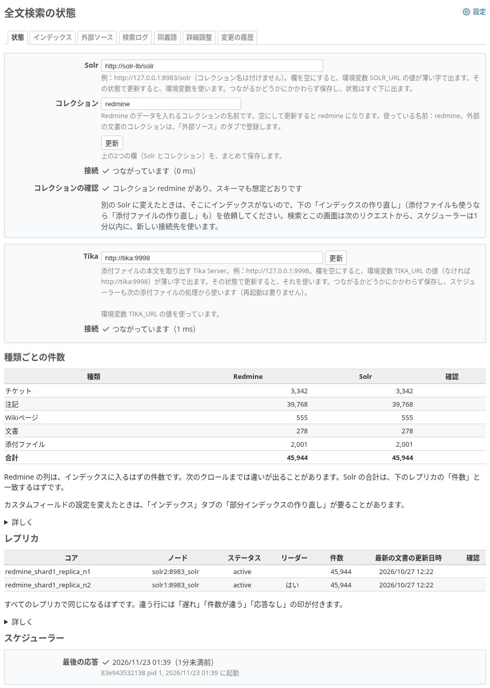  
*画面4-3：作り直しのあとの「状態」タブ（Solrにつながり、種類ごとの件数が並び、スケジューラーが「最後の応答」を出しています）*

4. **検索してみます**。システム管理者で全体検索を開き、Redmineにある語で探して、結果が出ることを確かめます（[クイックスタート](#クイックスタート)）。

5. **プロジェクトで使えるようにします**。プロジェクトの管理者に、モジュールと権限の設定を頼みます（[第9章](#第9章プロジェクトでの有効化と外部ソースの紐付け)）。また、今後作成する新しいプロジェクトで最初から全文検索を有効にしておきたい場合は、管理 → 設定 →「プロジェクト」タブの「新規プロジェクトにおいてデフォルトで有効になるモジュール」で「全文検索」にチェックを入れておきます。

---

### 4.6 Dockerを使わないで入れるときの要点

Dockerを使わずに、Solr・Tika・スケジューラーをサーバーに直接入れることもできます。OSごとの細かい手順は扱いません。ここでは、部品ごとに**用意するもの・設定すること・確かめかた**をまとめます。各部品の入れかたは、それぞれの公式の案内に従ってください。開発のときに、Ubuntu 24.04（systemd）と、Windows 11（タスク スケジューラー）で、この形で動くことを確かめています。

| 部品 | 用意するもの | 設定すること | 確かめかた |
|---|---|---|---|
| **Solr** | [3.1](#31-動作要件)の版のSolrと、それが求めるJava | **SolrCloudモードで起動します**（1台なら`solr start -c`で、組み込みのZooKeeperを使います）。すべてのノードで、モジュール`analysis-extras`を有効にします（環境変数`SOLR_MODULES=analysis-extras`など。ないと、コレクションが読み込めません）。外から使わないなら、`127.0.0.1`で待ち受けます | Collections APIの`action=LIST`が`"status":0`を返す |
| **configsetとコレクション** | このプラグインの`solr/` | [4.1](#41-solrの準備configsetの組み立てとアップロードコレクションの作成)のとおり、configsetを組み立ててアップロードし、Redmineのデータのコレクションを作ります | 「状態」タブの「コレクションの確認」が「想定どおり」 |
| **Tika Server**（任意） | Tika Server（`tika-server-standard`のjar）と、それが求めるJava | 常駐させ、`127.0.0.1:9998`などで待ち受けます | `/version`が版を返し、`/tika`に送った文書の本文が返る。「状態」タブのTikaが「つながっています」 |
| **プラグイン** | Redmineの`plugins/redmine_solr_search` | [4.2](#42-プラグインの配置とマイグレーション)・[4.3](#43-接続先の設定solrtika)のとおり。接続先を環境変数で教えるときは、Redmineとスケジューラーの**両方**に同じ値を渡します | 管理 →「プラグイン」に出る |
| **スケジューラー** | Redmineのフォルダ | 常駐させます（[4.4](#44-スケジューラーの置き場所)）。画面のRedmineと同じユーザー・同じ環境変数で、`RAILS_ENV=production`を付けて動かします | 「状態」タブのスケジューラーの「最後の応答」が1分以内 |
| **ManifoldCF**（任意） | ManifoldCFと、それが求めるJava | 常駐させ、接続とジョブを作ります（[第8章](#第8章外部ソースタブ)） | ジョブが完了し、外部ソースのコレクションに文書が入る |

**常駐のさせかた**：SolrとTikaとスケジューラー（使うならManifoldCFも）を、マシンの起動のときに動かし、落ちたら起動し直すようにします。

- **Linux**：systemdのサービスにします。スケジューラーの例です（パスとユーザーは、環境に合わせます）。

  ```ini
  [Unit]
  Description=Redmine Solr Search scheduler
  After=network.target postgresql.service solr.service

  [Service]
  User=redmine
  WorkingDirectory=/opt/redmine
  # SOLR_URL, TIKA_URL, RAILS_ENV=production: the same values as Redmine's
  EnvironmentFile=/etc/redmine-solr-search.env
  ExecStart=/opt/redmine/bin/rake redmine:solr_search:scheduler
  MemoryMax=512M
  Restart=on-failure
  RestartSec=30
  SuccessExitStatus=143 SIGTERM

  [Install]
  WantedBy=multi-user.target
  ```

- **Windows**：タスク スケジューラーに、起動のときに動くタスクとして登録します（SYSTEMのアカウントなら、だれもログインしていなくても動きます）。既定の「3日で止める」を外してください。タスクの「失敗したら起動し直す」設定は、動いていたプロセスが落ちたときには効かなかったので、起動のときに加えて5分ごとにも起動する（動いていれば新しく起動しない）形にすると、落ちても戻ります。接続先の環境変数は、マシン全体の環境変数にすると、SYSTEMのタスクからも見えます。Windowsには、systemdの`MemoryMax=`にあたる上限はありません。

**止めるとき**：Solrは、プロセスを止めるのではなく、`solr stop`で止めます。スケジューラーは止めてかまいません（そのとき動いていた処理は「失敗」として記録され、次の回でやり直します）。

---

## 第5章：設定

### 5.1 プラグインの設定の画面

管理 →「プラグイン」→ 全文検索の「設定」で開きます。4つの枠に分かれています。

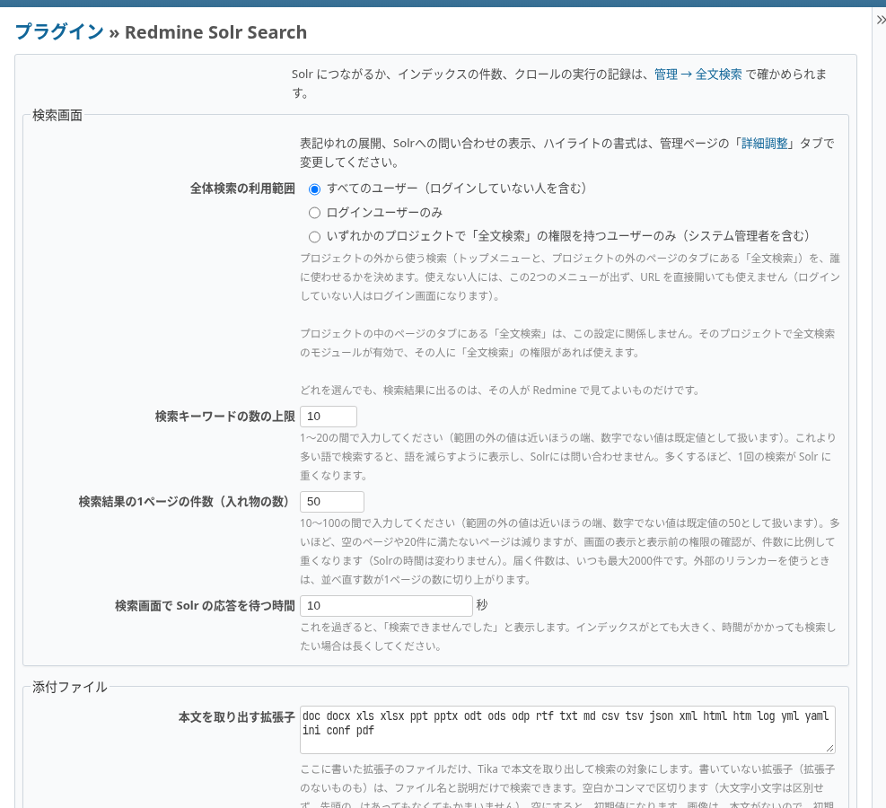  
*画面5-1：プラグインの設定の画面の上の部分（4つの枠「検索画面」「添付ファイル」「クロール」「管理ページ」のうち、上から。続きは画面5-2・5-3）*

| 枠      | 項目                      | 初期の値                    | 内容                                                                                                                             |
| ------ | ----------------------- | ----------------------- | ------------------------------------------------------------------------------------------------------------------------------ |
| 検索画面   | 全体検索の利用範囲               | すべてのユーザー（ログインしていない人を含む） | ほかに「ログインユーザーのみ」「いずれかのプロジェクトで『全文検索』の権限を持つユーザーのみ（システム管理者を含む）」。プロジェクトの外から使う検索（トップメニューなど）を、誰に使わせるかです。どれを選んでも、結果に出るのはその人が見てよいものだけです |
|        | 検索キーワードの数の上限            | 10                      | 1〜20。多くするほど、1回の検索がSolrに重くなります                                                                                                  |
|        | 検索結果の1ページの件数            | 50                      | 10〜100。たどれるのは、いつも上から2,000件までです。多いほど空のページが減りますが、表示と表示前の権限の確認が重くなります                                                             |
|        | 検索画面でSolrの応答を待つ時間       | 10秒                     | これを過ぎると「検索できませんでした」と出ます                                                                                                        |
| 添付ファイル | 本文を取り出す拡張子              | Office系・テキスト系・PDF       | 空白区切り。画像は入れません。圧縮ファイルを入れると、中身を全部読むので重くなります                                                                                     |
|        | 本文を取り出す1ファイルの大きさの上限     | 50MB                    | 1〜500MB。超えたファイルは、名前と説明だけをインデックスに入れます                                                                                           |
|        | 取り出す本文の長さの上限            | 3MB                     | 1〜20MB。超えたところで切ります                                                                                                             |
| クロール   | 差分の反映・添付ファイル・送り直し・突き合わせ | 10分・10分・1日・1日ごと         | 処理ごとに、有効・無効と「数＋単位（分・時間・日）」。「スケジューラーを使わない」を入れると、4つともまとめて無効になります（cronで動かすとき）                                                     |
|        | クロールの実行の記録を残す期間         | 30日                     | 古い記録は、クロールが終わるときに消えます。0は消しません（増え続けるので勧めません）                                                                                    |
| 管理ページ  | 管理ページでSolrの応答を待つ時間      | 5秒                      |                                                                                                                                |

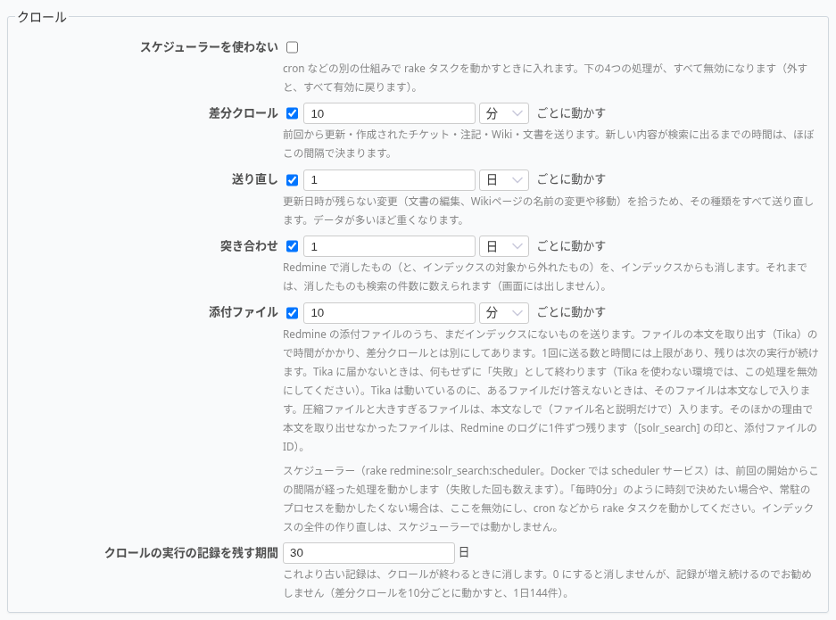  
*画面5-2：プラグインの設定の「クロール」の枠（処理ごとの「☑ 10 分 ごとに動かす」の形と、「スケジューラーを使わない」、実行の記録を残す期間）*

#### 「全文検索」のメニューの出かた（全体検索の利用範囲）

「全文検索」のメニューは2種類あり、出る条件が違います。

| メニュー | 出る場所 | 出る条件 |
|---|---|---|
| **全体検索** | トップメニューの「全文検索」と、プロジェクトの外のページ（プロジェクト一覧、活動など）の「全文検索」タブ | 「全体検索の利用範囲」の設定で決まります（下の表） |
| **プロジェクトの中の検索** | プロジェクトのメニューの「全文検索」タブ | そのプロジェクトで「全文検索」モジュールが有効で、その人のロールに「全文検索」の権限があるとき。システム管理者には、モジュールが有効なら出ます。「全体検索の利用範囲」の設定には関係しません（[第9章](#第9章プロジェクトでの有効化と外部ソースの紐付け)） |

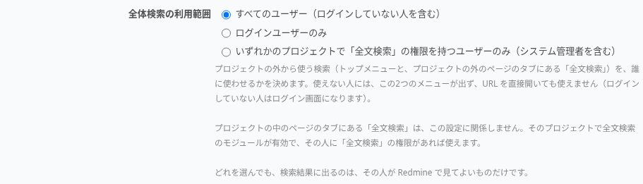  
*画面5-3：プラグインの設定の画面の「全体検索の利用範囲」の3つの選択肢（下の表の行と並びが同じ）*

**全体検索を使える人**（○：メニューが出て使える、—：出ない）。行の並びは、設定の画面の選択肢と同じです。

| 全体検索の利用範囲 | ログインしていない人 | ログインしている人（どのプロジェクトでも「全文検索」の権限がない） | ログインしている人（「全文検索」の権限があるプロジェクトが、1つ以上ある） | システム管理者 |
|---|---|---|---|---|
| 「すべてのユーザー（ログインしていない人を含む）」（初期の値） | ○ | ○ | ○ | ○ |
| 「ログインユーザーのみ」 | — | ○ | ○ | ○ |
| 「いずれかのプロジェクトで『全文検索』の権限を持つユーザーのみ（システム管理者を含む）」 | —（※） | — | ○ | ○ |

- 3つ目の設定の「権限がある」は、**「全文検索」モジュールが有効なプロジェクト**で、その人のロールに「全文検索」の権限がある、という意味です。モジュールが有効なプロジェクトが1つもなければ、システム管理者のほかは誰も使えません。
- ※ ロールの「非メンバー」「匿名ユーザー」も、ロールとして数えます。たとえば公開プロジェクトでモジュールを有効にし、「匿名ユーザー」のロールに「全文検索」の権限を付けると、ログインしていない人も使えるようになります。
- 使えない人には、メニューが出ません。URLを直接開いても使えず、ログインしていない人にはログインの画面、ログインしている人には「403」（このページを見る権限がない）が出ます。
- Redmineの設定で「認証が必要」をオンにしているときは、ログインしていない人は、どの設定でも使えません（Redmineの画面そのものに入れないため）。
- **どの設定でも、検索結果に出るのは、その人がRedmineで見てよいものだけです**。たとえば「すべてのユーザー」でも、ログインしていない人に出るのは、公開プロジェクトの、匿名ユーザーが見てよいものだけです。この設定は「検索の画面を誰に開かせるか」を決めるもので、見せる中身は変えません。
- 外部の文書は、どの設定でも、外部ソースが紐付いたプロジェクトでの権限がある人にだけ出ます（[2.2](#22-権限の考え方)）。

- **拡張子を変えても、すでにインデックスにあるものは変わりません**。入れ直したいときは、管理ページの「インデックス」タブから、添付ファイルの作り直しを依頼します（[第7章](#第7章インデックスタブ)）。
- 綴りのゆれ（ヴ行・バ行、ヶ・ケなど）の扱い、見つかった語の色の付けかた、Solrへの問い合わせの表示は、この画面ではなく、管理ページの「詳細調整」タブにあります（[14.3](#143-詳細調整タブ並びの重み試し検索)）。

---

### 5.2 環境変数

| 名前 | 内容 |
|---|---|
| `SOLR_URL` | Solrの接続先（「状態」タブの値が先。[4.3](#43-接続先の設定solrtika)） |
| `TIKA_URL` | Tika Serverの接続先（「状態」タブの値が先） |
| `SOLR_SEARCH_METRICS_TOKEN` | 監視用の指標の口のトークン。設定しなければ、口は閉じたまま（404）です（[第15章](#第15章変更の履歴と監視)） |
| `RERANKER_API_KEY` | 外部のリランカーのAPIキー。画面にもデータベースにも出しません（[14.4](#144-外部のリランカー)） |

環境変数は、**Redmineとスケジューラーの両方**に渡してください。

---

# 【第3部：システム管理者（運用の準備）】

この部では、検索を使い始めるためにシステム管理者が行う初期設定と確認（管理メニューの「全文検索」にある「状態」「インデックス」「外部ソース」の各タブ）を説明します。どのタブも、システム管理者だけが開けます。どのタブの右上にも、プラグインの設定（[5.1](#51-プラグインの設定の画面)）へのリンクがあります。

| タブ | 主な用途 | 説明 |
|---|---|---|
| 状態 | Solr・Tikaの接続先、つながっているか、件数、スケジューラーの生存 | [第6章](#第6章状態タブ) |
| インデックス | インデックスの作り直しの依頼、定期処理の間隔と実行の記録 | [第7章](#第7章インデックスタブ) |
| 外部ソース | 外部ソースの登録、利用を許可するプロジェクト | [第8章](#第8章外部ソースタブ) |

※日常的な運用の手入れ（検索ログ、同義語、詳細調整）や監視については、メンバーが検索を使えるようにした後の[第6部：システム管理者（品質の手入れと運用監視）](#第6部システム管理者品質の手入れと運用監視)で説明します。

## 第6章：「状態」タブ

管理 →「全文検索」を開くと、最初にこのタブが出ます。**検索の仕組みが動いているかを、1か所で確かめる**ためのタブです。問題があるところは、赤い帯で出ます。

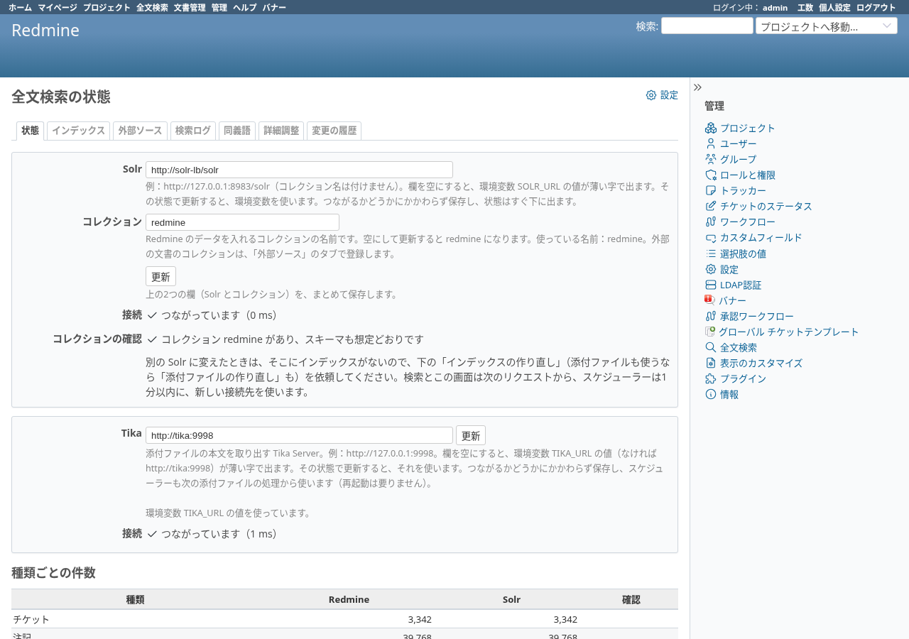  
*画面6-1：「状態」タブの上の部分（Solr・コレクション・Tikaの接続先。続きは画面6-2〜6-6）*

### 6.1 Solrの接続先とコレクション

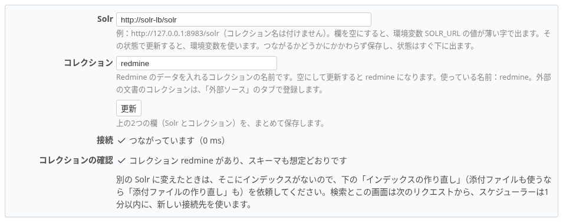  
*画面6-2：「状態」タブの「Solr」と「コレクション」の欄（接続先、どちらの値を使っているか、「更新」ボタン、つながったかの表示）*

- 「Solr」の欄に接続先を、「コレクション」の欄にRedmineのデータのコレクション名（初期の値は`redmine`）を入れて、「更新」を押します。空にして更新すると、環境変数`SOLR_URL`に戻ります。どちらの値を使っているかも出ます。
- 開くたびに、つながるか、コレクションがあるか、スキーマ（フィールドと型）が想定どおりかを確かめます。問題（つながらない、コレクションがない、スキーマが違う）は、赤い帯で出ます。
- **コレクションがないときは、作成のコマンドが出ます**（Solrのノードの数に合わせて、1台なら`replicationFactor=1`）。プラグインはコレクションを作らないので、コマンドをSolrの管理者が実行します。
- つながらない値でも保存できます（あとでSolrを立てる場合のため）。
- **別のSolrや別のコレクションに変えたら、インデックスの作り直しが要ります**（[7.2](#72-インデックスの作り直し)）。接続先とコレクションの変更は、「変更の履歴」タブに残ります。

---

### 6.2 Tikaの接続先

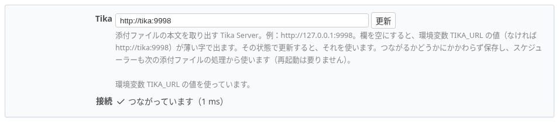  
*画面6-3：「状態」タブの「Tika」の欄（接続先、どの値を使っているか、答えたかの表示）*

- 「Tika」の欄に接続先を入れて「更新」を押します。空にすると、環境変数`TIKA_URL`、それもなければ`http://tika:9998`を使います。どれを使っているかも出ます。
- 開くたびに、Tikaが答えるかを確かめ（待つのは2秒まで）、答えなければ赤い帯が出ます。
- プラグインの設定で添付ファイルのクロールを止めているときは、確かめずに、その旨だけを出します。

---

### 6.3 件数とレプリカの状態

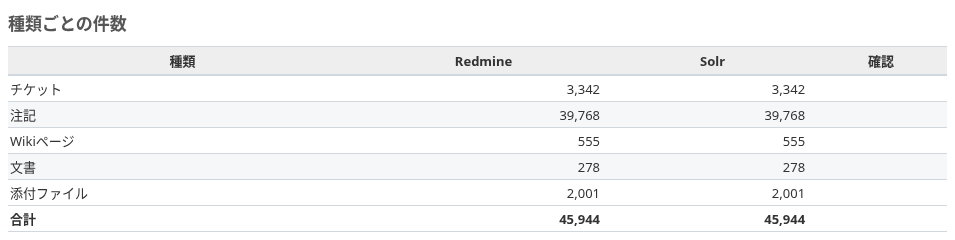  
*画面6-4：種類ごとの件数の表（Redmineの列とSolrの列）*

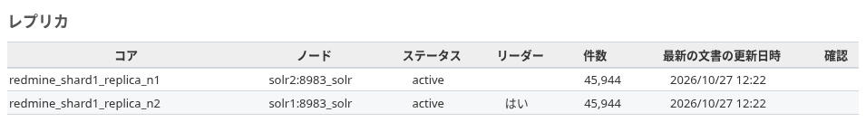  
*画面6-5：レプリカの表（状態、件数、いちばん新しい文書の更新日時）*

- **種類ごとの件数**：チケット・注記・Wikiページ・文書・添付ファイルについて、Redmineの件数とSolrの件数を並べます。違うときは「違いあり」と出ます。少しの違いは、定期処理が追いつくまでの間なら普通です。違いが続くときは、インデックスの作り直しを考えます。
- **Redmineにないカスタムフィールドの値**がインデックスに残っていると、警告が出ます（消しかたは[7.3](#73-部分インデックスの作り直し)）。
- **レプリカの表**：レプリカごとに、状態と、そのレプリカだけで検索したときの件数、いちばん新しい文書の更新日時を出します。
  - ほかより古い文書までしか見えない行に「遅れ」、件数がほかと違う行に「件数が違う」、答えない行に「応答なし」と出ます。
  - 状態が`active`でない行にも、警告の印が付きます。

---

### 6.4 スケジューラーの生存

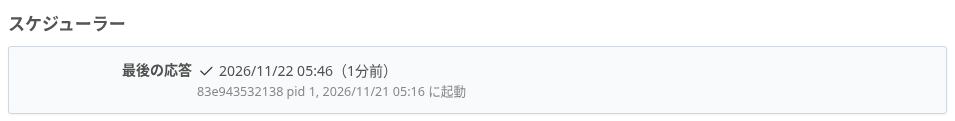  
*画面6-6：スケジューラーの欄（最後の応答の日時、ホストとプロセス、起動した日時）*

- スケジューラーの最後の応答の日時と、動いているホストとプロセス、起動した日時が出ます。
- 最後の応答が5分以上前なら、警告が出ます（スケジューラーが止まっています。[4.4](#44-スケジューラーの置き場所)）。
- プラグインの設定で「スケジューラーを使わない」にしているときは、警告を出さず、「使わない設定」と出ます。

---

## 第7章：「インデックス」タブ

インデックスの作り直しの依頼と、定期処理の実行の様子を見るタブです。

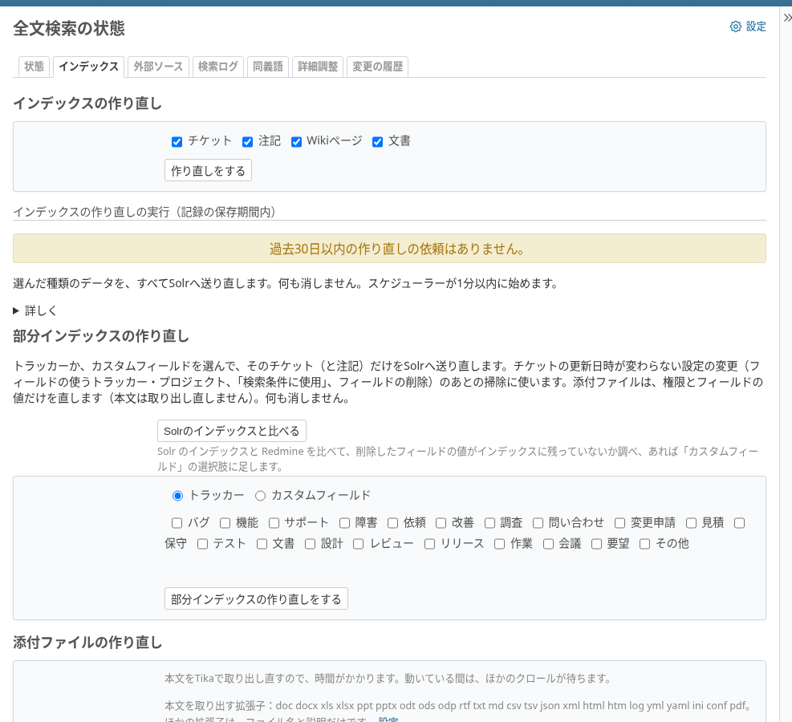  
*画面7-1：「インデックス」タブの上の部分（作り直しの依頼と、部分インデックスの作り直し。続きは画面7-2〜7-5）*

### 7.1 定期的な処理と間隔

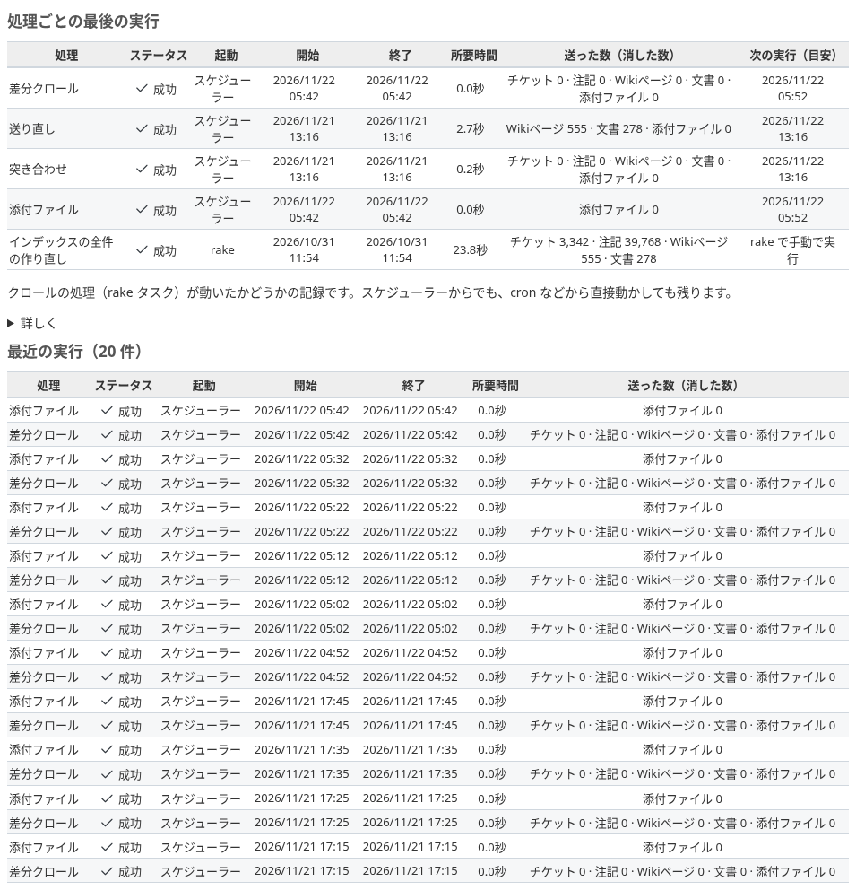  
*画面7-2：「インデックス」タブの、処理ごとの最後の実行の表と、最近の実行（状態、実行元、開始・終了、所要時間、件数、次の実行の目安）*

スケジューラーが動かす処理は、次の4つと、管理ページからの依頼の実行です。

| 処理 | 何をするか | 初期の間隔 |
|---|---|---|
| 差分の反映（`incremental`） | 前回から作られたもの・変わったものを送ります。対象から外れたもの（本文を空にした注記など）は消します | 10分 |
| 添付ファイル（`attachments`） | まだインデックスにない添付ファイルを、Tikaで本文を取り出して送ります。1回に200件か180秒までで、残りは次の回が続けます | 10分 |
| 送り直し（`resend`） | 更新日時が残らない変更（Wikiページの名前の変更や移動、文書の編集、添付ファイルの名前の編集）を拾うため、Wikiページと文書を送り直します | 1日 |
| 突き合わせ（`reconcile`） | Redmineから消えたもの（削除など）を、インデックスから消します | 1日 |
| 依頼の実行（`requests`） | 管理ページからの依頼を、古い順に1件ずつ動かします | 毎分（固定） |

#### 処理の動かされかた

インデックスを作る処理は、どれも次のように動かされます。動かすきっかけは2つです。**設定の間隔が来たとき**と、**管理ページから依頼したとき**です。どちらも、スケジューラーが1分ごとに起きたとき（この1回を「tick」と呼びます）に拾って動かします。

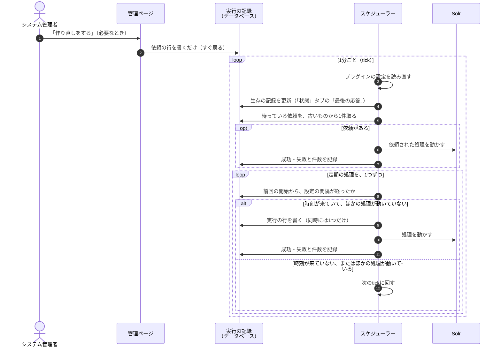

- **間隔は「前回の開始」から数えます**。失敗した回も数えるので、Solrが止まっていても毎分やり直すことはなく、次は間隔のあとです。
- **最初のインデックスも、スケジューラーが作ります**。前に成功した差分の反映か全件の作り直しが1つもないときは、差分の反映の代わりに全件の作り直しを行います。添付ファイルは、添付ファイルのクロールが少しずつ入れます。
- 管理ページの依頼は、tickの最初に1件だけ動きます。依頼の処理が長いと、そのtickの定期処理は、次のtickに回ります。

- 間隔は、プラグインの設定で変えられます（[5.1](#51-プラグインの設定の画面)）。
- どの処理も、誰が動かしても（スケジューラー、cron、管理ページ）実行の記録に残り、**同時には1つだけ**動きます。長い処理があると、ほかの処理は次の回まで待ちます。
- 「実行中」のまま30分進まない処理は、止まったものとして扱い、次の処理を動かせるようにします（プロセスが落ちたときのため）。
- このタブの下のほうに、処理ごとの最後の実行（状態・エラー・実行元・開始と終了・所要時間・件数）、次の実行の目安、最近の実行が出ます。

---

### 7.2 インデックスの作り直し

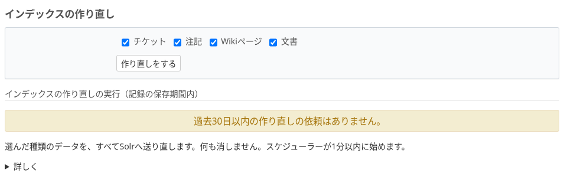  
*画面7-3：インデックスの作り直しの枠（種類のチェック、「作り直しをする」）と、依頼の表（この画面では、依頼はありません）*

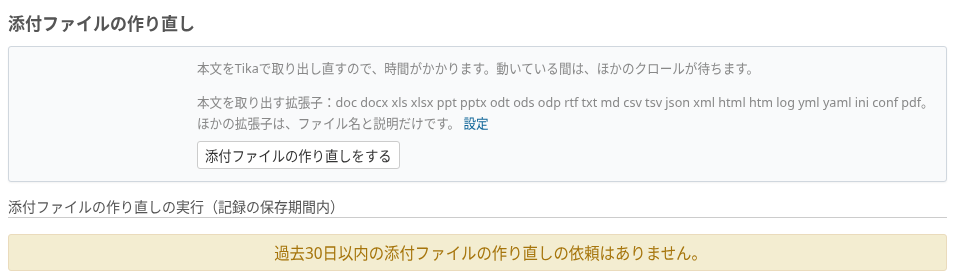  
*画面7-4：添付ファイルの作り直しの枠（「添付ファイルの作り直しをする」と、その実行の表）*

「作り直しをする」で、選んだ種類（チケット・注記・Wikiページ・文書）を、すべてSolrへ送り直します。

- 画面は**依頼を書くだけ**で、すぐに戻ります。実際に動かすのはスケジューラーで、1分ごとに依頼を確かめ、ほかの処理が動いていなければ始めます（動いていれば、それが終わってから。スケジューラーを使わない環境では、`rake redmine:solr_search:requests`）。
- 送り直すだけで、何も消しません。Redmineにもうないものは、次の突き合わせ（初期の設定では1日ごと）で消えます。すぐに消したいときは、`rake redmine:solr_search:reconcile`を動かします。
- 同じ依頼は重ねられません。待っている依頼は、取り消せます。
- **添付ファイルは、別の枠**（「添付ファイルの作り直しをする」）で依頼します。すべての本文をTikaで取り出し直すので重く、動いている間はほかのクロールが待ちます。添付ファイルの拡張子などの設定を変えて、入れ直したいときに使います。

**作り直しが要る場面**

| 場面 | すること |
|---|---|
| Solrの接続先やコレクションを変えた | 「状態」タブで、コレクションとスキーマの確認が通るのを見てから、作り直しをします |
| Solrのスキーマ・設定を変えた | configsetを上げ直し、コレクションをリロードしてから、作り直しをします |
| 添付ファイルの拡張子や上限を変えた | 添付ファイルの作り直しをします |
| 何となくインデックスがおかしい。SQLや別のプラグインで、更新日時を変えずにデータを書き換えた | まず「状態」タブの件数の違いを見て、チケットと注記の作り直しをします |
| インデックスを空から作り直したい | 新しいコレクションを作り、「状態」タブのコレクション名を変えてから、作り直しをします（元のコレクションが残るので、やり直せます） |


---

### 7.3 部分インデックスの作り直し

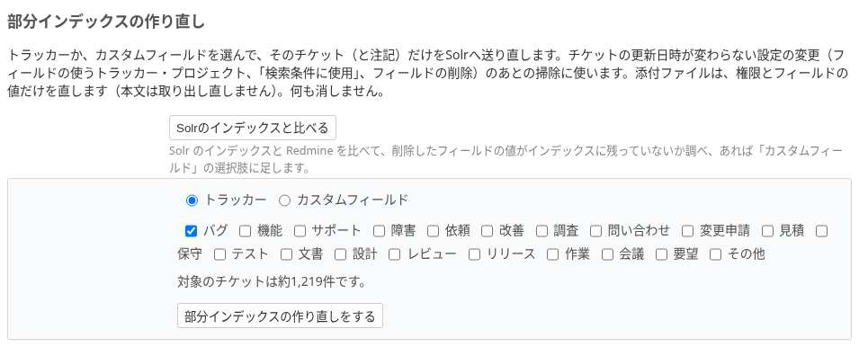  
*画面7-5：部分インデックスの作り直しの枠（「トラッカー」「カスタムフィールド」の選択、「対象のチケットは約N件です。」の表示、「部分インデックスの作り直しをする」）*

  
*画面7-6：「Solrのインデックスと比べる」を押したあと（削除したフィールドの値が残っていないときの表示。残っていれば、「（削除済み）フィールド ID n」が選択肢に足されます）*

チケットのカスタムフィールドやトラッカーの設定を変えたときに、**関係するチケットだけ**を送り直す入口です。

- 「トラッカー」か「カスタムフィールド」のどちらかを選び（複数選べます）、「部分インデックスの作り直しをする」を押します。選ぶたびに「対象のチケットは約N件です。」と出ます。
- 選んだチケットと、その注記を送り直し、添付ファイルは権限とフィールドの値だけを直します（Tikaは使いません）。
- 「Solrのインデックスと比べる」を押すと、Redmineにもうないフィールドの値がインデックスに残っていないかを調べ、残っていれば「（削除済み）フィールド ID n」として選べるようになります。

**いつ要るか**（チケットの更新日時が変わる操作は、差分の反映が追いつくので要りません）

| 何をしたか | 部分インデックスの作り直し |
|---|---|
| チケットのトラッカーを変えた（編集・一括編集・プロジェクトの移動） | 要りません |
| カスタムフィールドの「トラッカー」「プロジェクト」を変えて、使えるチケットが**減った** | そのフィールドを選んで行います（しないと、古い値がその語で当たり続けます） |
| カスタムフィールドを削除した | 「Solrのインデックスと比べる」で出る「（削除済み）フィールド」を選んで行います（検索には当たらないので、急がない掃除です） |
| カスタムフィールドの形式を変えた（スクリプトやSQLで） | そのフィールドを選んで行います |
| 「検索条件に使用」を変えた | そのフィールドを選んで行います |
| 「表示」「ロール」「検索対象」を変えた | 要りません（すぐ効きます） |

#### 部分インデックスの作り直しの動き

**洗い替え（いったん消して入れ直す）ではなく、上書き**です。対象のチケットごとに、今のRedmineの内容で文書を丸ごと作り直して送り、インデックスの中の同じチケットの文書と置き換えます。先に何かを消すことはしません。

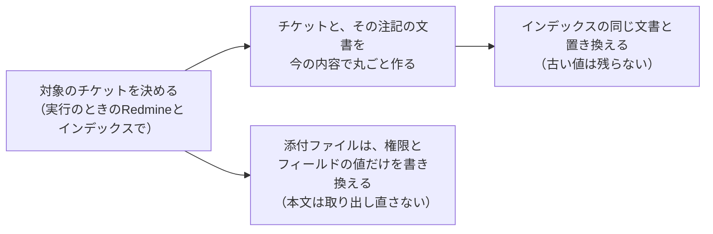

- **対象のチケットの決めかた**
  - **トラッカー**を選んだとき：Redmineで、**今**そのトラッカーになっているチケットです。チケットのトラッカーを変えたあとなら、変えた**先**のトラッカーを選んでください（前のトラッカーを選んでも、もうそのトラッカーではないチケットは対象になりません）。
  - **カスタムフィールド**を選んだとき：インデックスにそのフィールドの値があるチケットと、Redmineにそのフィールドの値があるチケットの**両方**です。外したフィールドの古い値を持つチケットも、新しく値が入るはずのチケットも、どちらも対象になります。
- **置き換えるので、そのチケットについては、きれいになります**。今のRedmineにない値（トラッカーから外したフィールドの値、削除したフィールドの値など）は文書から消え、今の値が入ります。
- **扱わないもの**：Redmineで消したチケットや注記は、ここでは消しません（突き合わせが消します。[7.1](#71-定期的な処理と間隔)）。対象でないチケットにも触りません。
- 対象のチケットは、**依頼を出したときではなく、実行のときに**決めます。依頼から実行までの間に変わったものも、反映されます。
- 部分インデックスの作り直しは、差分の反映の起点にも、定期の処理の時刻にも影響しません。

**例**：カスタムフィールド「顧客名」を、トラッカー「バグ」で使わないようにした（チケットの更新日時は変わらないので、差分の反映は動かない）

| | 作り直しの前 | 「顧客名」を選んで部分インデックスの作り直しをしたあと |
|---|---|---|
| バグのチケット（前に顧客名の値を入れていた） | インデックスに顧客名の値が残っていて、その名前で探すと当たる | 文書が置き換わり、顧客名の値は消える。その名前では当たらない |
| 機能のチケット（顧客名を今も使う） | 顧客名の値がある | 今の値のまま（置き換わるが、中身は同じ） |
| ほかのトラッカーのチケット（顧客名の値を持たない） | 変わらない | 対象にならず、触らない |

コマンドでも行えます：`rake redmine:solr_search:reindex TRACKERS=1,2`、または`FIELDS=9,10`（どちらか片方）。

---

### 7.4 添付ファイル

- 添付ファイルの本文は、Tikaで取り出してインデックスに入れます。取り出す拡張子と上限は、プラグインの設定で決めます（[5.1](#51-プラグインの設定の画面)）。
- 本文を取り出さないもの（設定にない拡張子、大きすぎるファイル）も、**ファイル名と説明**ではインデックスに入ります。
- 新しい添付ファイルは、添付ファイルのクロール（初期の設定では10分ごと）が入れます。
- 添付先の権限が変わったとき（チケットをプライベートにしたなど）は、本文を取り出し直さず、権限の値だけをその場で直します。

---

## 第8章：「外部ソース」タブ

外部ソース（共有フォルダなどの外部の文書）をRedmineに登録し、どのプロジェクトで使えるようにするかを決めるタブです。外部ソースの考えかたは[2.3](#23-外部ソース)、権限は[2.2](#22-権限の考え方)を見てください。

#### 外部ソースの前提と全体の流れ

外部ソースを使うには、**「プラグインの外でSolrにデータを用意する」** ことと、**「Redmine側で登録・紐付けを行う」** ことの2つの準備が必要です。

本プラグインはRedmineのデータの取り込み（クロール）は自動で行いますが、**共有フォルダなどの外部の文書を直接取りに行く機能はありません**。あらかじめ別の処理でSolrに外部文書を入れておき、Redmineからはそれを「呼び出して検索する」という役割分担になっています。

> [!NOTE] 原理：スキーマとコレクション名が合致していれば、どんな手段で投入しても検索できる  
> 本プラグインと外部ソースは、**「共通のスキーマ定義（configset `src`）でコレクションを作ること」** という約束だけで疎結合につながっています。  
> したがって、指定のスキーマに沿ったデータが入ってさえいれば、**どのような方法やツールで投入されたコレクションであっても原理的に検索・表示できます**。後述する Apache ManifoldCF はあくまで代表例（標準の組み合わせ）の1つに過ぎず、自作のPython/Rubyスクリプト、curlによるバッチ投入、Logstashや既存の社内データ連携ツールなど、組織の環境や要件に合わせて自由に外部文書を投入して差し支えありません。

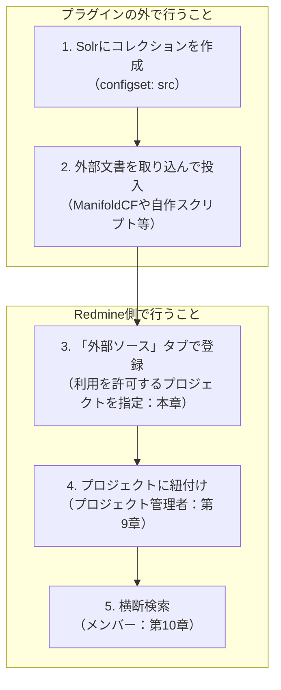

| 手順 | 誰が・どこで | 何をするか |
|---|---|---|
| **1. コレクションの作成** | システム管理者（Solr） | プラグインが提供するスキーマ定義（configset `src`）を使って、Solrに専用のコレクション（名前は `src_<名前>` を勧めます）を作ります |
| **2. 文書の取り込み・投入** | システム管理者（外部処理） | Apache ManifoldCF や自作スクリプト等を使って、共有フォルダなどの文書をそのコレクションへ定期投入します |
| **3. 外部ソースの登録** | システム管理者（Redmine） | 管理 →「全文検索」→「外部ソース」タブで、そのコレクションを登録し、利用を許可するプロジェクトを決めます（**本章**） |
| **4. プロジェクトへの紐付け** | プロジェクト管理者（Redmine） | プロジェクトの設定で、検索対象にする外部ソースを選びます（[第9章](#第9章プロジェクトでの有効化と外部ソースの紐付け)） |
| **5. 検索** | メンバー（Redmine） | 全文検索の画面で、Redmineのデータと一緒にまとめて探せるようになります（[第10章](#第10章検索のはじめかた)） |

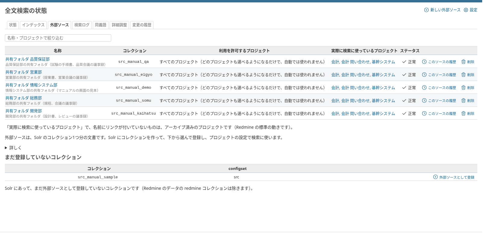  
*画面8-1：「外部ソース」タブ（登録した外部ソースの一覧〈見本の外部ソースだけを表示〉と、まだ登録していないコレクションの一覧）*

### 8.1 外部ソースの準備と取り込み（ManifoldCF・Tika）

Redmineに登録する前に、Solr側のコレクションと文書の投入処理を準備します。

#### (1) Solrにコレクションを作る
- プラグインに同梱されている外部ソース用の設定セット **configset `src`** を使ってコレクションを作成します。
- コレクション名は、**`src_` で始まる名前**（例: `src_share`, `src_design_docs`）にすることを勧めます（Solrの管理画面などで見分けやすいため）。登録の候補になるのは、**configsetが `src` のコレクション**で、名前は問いません（Redmineのデータのコレクション名だけは使えません）。2台以上のSolrなら1シャード×2レプリカで作ります。
- 同梱のDockerでは、`docker/`で`manifoldcf/add-folder.sh <ManifoldCFから見たフォルダ> src_<名前>`を実行すると、コレクションとManifoldCFのジョブをまとめて作れます（[同梱のDockerの構成](docker.md#composemanifoldcfyaml外部文書取り込み)）。

#### (2) 文書を取り込んで投入する
外部の文書をSolrに入れる手段は、組織の環境に合わせて自由に選べます。Solrの標準的な更新API（`/update` 等）に対して、スキーマに沿ったデータを投入できれば何を使っても構いません。以下のような方法を想定しています。
- **Apache ManifoldCF を使う（推奨・標準例）**：共有フォルダ（Windowsファイル共有 / SMB）やファイルシステムを定期的にクロールし、Apache Tika で本文を取り出しながらSolrへ送ります（ジョブの設定は後述）。**ジョブ1つにコレクション1つ**を割り当てます。
- **自作スクリプトやバッチ処理を使う**：Pythonスクリプトやcurl等で、文書の情報を直接Solrの更新API（`/update/json/docs` など）にPOSTして投入することもできます。ファイルサーバー以外の社内データベースや別システムから文書を吸い出して検索させたい場合にも向いています。

#### (3) 投入するデータの約束（スキーマ定義）
外部ソース用のスキーマ（configset `src`）では、取り込む側が送る項目とSolrが自動で付ける項目が分かれています（詳細は[docs/schema.md](schema.md)の4章）。
- **取り込む側が送るもの**：文書のID（`id`。ファイルのURIなど、すべてのソースやRedmineデータと重ならないユニークな値）、題名（`title`。通常はファイル名）、本文（`content`）、更新日時（`updated_at`）、URL（`url`）、場所（`path`。ファイルのパス）
- **Solrが自動で付けるもの**：どの外部ソースの文書か（`source`。コレクション名）、種類（`type`。`file`固定）、グループID（`group_id`。`id`と同じ値）。これらはSolr（configset `src`の更新チェイン）が強制的に上書きして付けるので、取り込む側が偽ることはできません。また、タブ・改行以外の制御文字もSolr側で取り除かれます。

#### ManifoldCFとTikaを使う場合の注意点

- **Tikaに渡すものを、ManifoldCFのジョブで絞ってください**。音楽・写真・バイナリの混じった実際のファイル共有では、絞らないとManifoldCFのTikaの接続が詰まり、取り込みが止まることがありました。ジョブのパイプラインで、Tikaの前に「Allowed documents」の変換を置き、許す拡張子と大きさの上限で絞ります。
- **ジョブで除いたファイルや、Tikaが読めなかったファイル**（パスワード付きのPDFなど）は、名前もインデックスに入りません（Redmineの添付ファイルとは違います）。
- **取り込み元が読めなくなると、その外部ソースのインデックスが消えます**。ManifoldCFのファイルシステムのジョブは、始点のフォルダが読めない（共有の停止、ネットワークの断、権限の変更）と、エラーにならずに完了し、入れた文書をすべてインデックスから消します。処理済みの数が急に0になったら、取り込み元が読めているかを確かめてください。

ジョブは、同梱のスクリプトで作れます（Dockerでは[同梱のDockerの構成](docker.md#composemanifoldcfyaml外部文書取り込み)の`add-folder.sh`、Windowsに直接入れたManifoldCFでは`windows/add-folder.ps1`）。どちらも、下の表と同じ形の接続とジョブを作ります。

#### ManifoldCFの画面で作るときの要点

ManifoldCF 2.31で確かめた形です。名前は例です。

| 種類 | コネクションタイプ | 役目と、設定の要点 |
|---|---|---|
| 出力コネクション | Solr | 外部ソースのコレクションへ送ります。「シングルサーバー」を選び、Solrのノードに直接送ります（ZooKeeper経由にしません）。「スキーマ」タブは、IDフィールド名`id`、更新日付フィールド名`updated_at`、ファイル名称フィールド名`title`、Content field name`content`にし、**ほかの欄は空にします**（スキーマにない欄の名前が入っていると、Solrが文書を断ります）。「Use the Extract Update Handler」の印を外します（本文はTikaが取り出します） |
| 変換コネクション | Allowed documents | Tikaに渡すファイルを、拡張子・MIMEタイプ・大きさで絞ります（中身はジョブの側で決めます） |
| 変換コネクション | Tika external content extractor | Tika Serverで本文を取り出します。「Tika content extractor」（ManifoldCFの中のTika）とは別のものです。最大コネクション数は`4`ほどにします（一度に多く送ると、Tika Serverが断ります） |
| 変換コネクション | Content limiter | 長すぎる本文を切ります |
| 変換コネクション | Metadata adjuster | 検索結果のリンクとフォルダの絞り込みに使う欄を作ります：`url`に`file:${uri}`、`path`に`${uri}` |
| リポジトリコネクション | File system | 取り込み元のフォルダを読みます。ManifoldCFを動かすユーザーが読めるフォルダを指定します |

- **ジョブのパイプライン**は、上から「リポジトリ → Allowed documents → Tika → Content limiter → Metadata adjuster → 出力（Solr）」の順にします。画面では、先に出力を足し、その前に変換を1つずつ挿入していきます。
- ジョブの「リポジトリパス」に取り込み元のフォルダを入れ、「スケジュール」で定期的に取り込む間隔を決めます。
- **ManifoldCF 2.31の不具合**：Tikaの接続の画面（保存の直後の表示、「表示」「編集」）を開くと、ジョブの最初の文書が15分止まることがあります。接続とジョブを作り終えたら、ジョブを動かす前にManifoldCFを起動し直してください。
- 取り込めたかは、Solrの外部ソースのコレクションの件数（`select?q=*:*&rows=0`の`numFound`）で確かめます。ManifoldCFの「処理済み」の数は、フォルダの分も数えます。

登録したあとに行うことは、[8.2](#82-登録と利用を許可するプロジェクト)と[9.3](#93-外部ソースの紐付けプロジェクトの設定の全文検索タブ)です。

---

### 8.2 登録と、利用を許可するプロジェクト

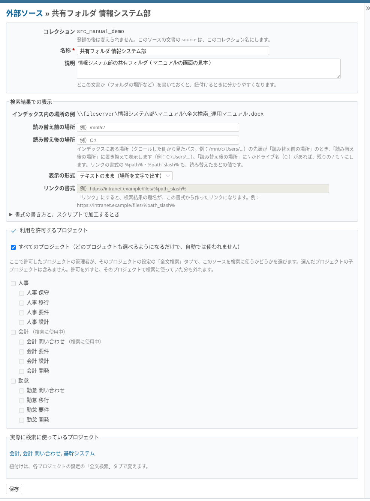  
*画面8-2：外部ソースの登録・編集の画面（名前、説明、検索結果での表示、利用を許可するプロジェクト。プロジェクトは一部だけを表示）*

- 「まだ登録していないコレクション」に、Solrにあって、まだ登録していないコレクションが出ます。configsetが`src`でないものは、登録できません。
- 「外部ソースとして登録」で、名前（検索の画面に出る名前）、説明、検索結果での表示（[8.3](#83-場所の見せかた表示の形式リンクの書式場所の読み替え)）、**利用を許可するプロジェクト**を決めます。
  - 「すべてのプロジェクト」を選ぶと、どのプロジェクトも紐付けを**選べる**ようになります（自動では使われません）。
  - プロジェクトを選ぶと、そのプロジェクトだけが選べます。許可を外すと、そのプロジェクトの紐付けも外れます。
- 一覧には、外部ソースごとに、コレクションの状態（「正常」「無効：コレクションがありません」など）、文書の数、最終更新、利用を許可するプロジェクト、実際に検索に使っているプロジェクトが出ます。
- **消すときの順番**：Redmineの外部ソース（紐付けも一緒に消えます）→ ManifoldCFのジョブ → Solrのコレクション、の順にしてください。逆にすると、ManifoldCFが消えたコレクションへ書き続けて失敗します。

---

### 8.3 場所の見せかた（表示の形式、リンクの書式、場所の読み替え）

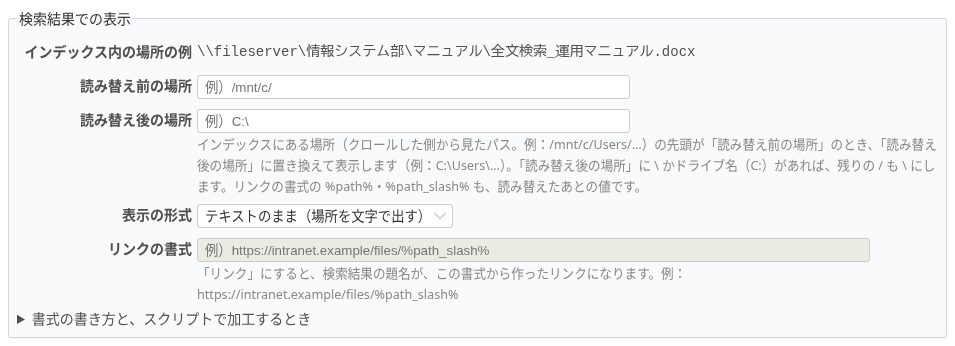  
*画面8-3：外部ソースの編集の画面の「検索結果での表示」（「テキストのまま」「リンク」の選択、リンクの書式、場所の読み替え、「インデックス内の場所の例」）*

外部の文書は、検索結果に**場所（パス）**を出します。どう出すかを、外部ソースごとに決めます。

- **「テキストのまま（場所を文字で出す）」**（初期の値）：場所を文字で出します。共有フォルダのパスを、利用者がコピーして開く使いかたです。
- **「リンク（書式から作る）」**：検索結果の題名が、書式から作ったリンクになります。例：`https://intranet.example/files/%path_slash%`。社内の閲覧システムで開く使いかたです。書式の書きかたは、画面の「書式の書き方と、スクリプトで加工するとき」にあります。
- **場所の読み替え**：インデックスの中の場所の頭を、別の文字に読み替えて見せます。例：取り込んだときの`/mnt/c/`を、利用者が開ける`C:\`に読み替える。画面の「インデックス内の場所の例」で、実際の文書の場所での見えかたを確かめられます。

---

### 8.4 リンクを自分で作り換える（View Customize）

管理画面の「リンクの書式」だけでは足りない場合（複雑なロジックで社内WebシステムのURLを組み立てたい、パスをクリップボードにコピーするボタンを横に付けたいなど）は、Redmineプラグイン [View Customize](https://github.com/onozaty/redmine-view-customize) などのJavaScriptスクリプトを使って、画面上のリンクを自由に加工・作成できます。

#### 画面上での見え方とデフォルトのHTML構造

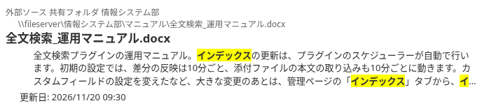  
*画面8-4：外部ソースの検索結果の表示例（上段の種別・ソース名・パス、見出しの題名、抜粋スニペット）*

##### 実際に出力されるHTMLコード（デフォルトの例）
検索結果リスト全体は `<dl id="search-results" class="solr-search-results">` で構成され、外部ソースの文書1件ごとに `<div class="solr-search-external-hit">` で囲まれます。

```html
<dl id="search-results" class="solr-search-results"
    data-solr-log="123" data-solr-token="abc..." data-solr-click-url="/solr_search/click">

  <!-- 外部文書1件ごとの枠（classとdata-solr-*属性が付く。個別のid属性はありません） -->
  <div class="solr-search-external-hit"
       data-solr-group="file://fileserver/情報システム部/マニュアル/全文検索_運用マニュアル.docx"
       data-solr-rank="1"
       data-solr-source="src_manual_demo"
       data-solr-source-name="共有フォルダ 情報システム部"
       data-solr-id="file://fileserver/情報システム部/マニュアル/全文検索_運用マニュアル.docx"
       data-solr-title="全文検索_運用マニュアル.docx"
       data-solr-url="file://fileserver/情報システム部/マニュアル/全文検索_運用マニュアル.docx"
       data-solr-path="\\fileserver\情報システム部\マニュアル\全文検索_運用マニュアル.docx"
       data-solr-indexed-path="\\fileserver\情報システム部\マニュアル\全文検索_運用マニュアル.docx">
    <dt>
      <!-- 上段：種別、ソース名、場所（パス）のエリア -->
      <div class="solr-search-location">
        <span class="solr-search-type">外部ソース</span>
        <span class="solr-search-source-name">共有フォルダ 情報システム部</span>
        <span class="solr-search-external-path">\\fileserver\情報システム部\マニュアル\全文検索_運用マニュアル.docx</span>
      </div>

      <!-- 中段：見出し（題名）エリア。class="solr-search-title-external" で特定できます（idはありません）。
           「テキストのまま」（画面8-4）では、題名の文字だけが入ります -->
      <div class="solr-search-title solr-search-title-external">全文検索_運用マニュアル.docx</div>

      <!-- ※「リンク（書式から作る）」を設定している場合は、題名がaタグになります（hrefは「リンクの書式」から作られます）:
      <div class="solr-search-title solr-search-title-external">
        <a class="solr-search-external-link" href="https://intranet.example/files/..."
           target="_blank" rel="noopener noreferrer" title="新しいタブで開く"
           aria-label="全文検索_運用マニュアル.docx (新しいタブで開く)">全文検索_運用マニュアル.docx</a>
      </div>
      題名に検索語が含まれるときは、題名の中にも <span class="highlight token-0"> が入ります -->
    </dt>

    <dd>
      <!-- 下段：本文の抜粋（ヒットした箇所ごとに div.solr-search-hit が並びます） -->
      <div class="solr-search-hit">
        <div class="solr-search-snippet description">全文検索プラグインの運用マニュアル。<span class="highlight token-0">インデックス</span>の更新は、プラグインのスケジューラーが自動で行います。……管理ページの「<span class="highlight token-0">インデックス</span>」タブから、<span class="highlight token-0">インデックス</span>の作り直しを依頼します。</div>
      </div>

      <!-- 更新日時 -->
      <span class="author">更新日: 2026/11/20 09:30</span>
    </dd>
  </div>

</dl>
```

##### タグ名とID・クラス名の仕様
- **ID属性の有無**:
  - 全体のリスト親要素には `<dl id="search-results">` が付きます。
  - 各文書の `<div class="solr-search-external-hit">` や見出しの `<div>` には **個別の `id` 属性はありません**。文書の一意な特定には `data-solr-id` 属性を、要素の特定にはクラス名を使用します。
- **見出し（題名）の要素**:
  - `<div class="solr-search-title solr-search-title-external">` で特定できます。JavaScriptでリンクを追加・差し替える際や、横にボタンを足す際のターゲットになります。
  - 題名が検索語にマッチした場合は、内部に `<span class="highlight">` が入ります。プレーンな題名文字列を取得したい場合は、タグ内のテキストではなく `data-solr-title` 属性から読むのが安全です。
- **パス表示の要素**:
  - `<span class="solr-search-external-path">` に場所の読み替え後のパス文字列が入っています。
- **抜粋スニペットの要素**:
  - `<div class="solr-search-snippet description">` に抜粋が入ります。スタイルとして3行で省略（`-webkit-line-clamp: 3`）表示されます。

各 `data-solr-*` 属性には次の情報が入っています。表示の形式が「テキストのまま」であっても「リンク」であっても、これらの属性は必ず出力されます。

| 属性名 | 中身 | 説明 |
|---|---|---|
| `data-solr-source` | コレクション名 | Solrのコレクション名（例: `src_manual_demo`） |
| `data-solr-source-name` | ソースの表示名 | Redmineの管理ページで登録した外部ソースの名称（例: `共有フォルダ 情報システム部`） |
| `data-solr-id` | 文書のID | Solrの `id`（ファイルのURI等） |
| `data-solr-title` | 文書の題名 | ファイル名（ハイライト等のHTMLタグを含まない生の文字列） |
| `data-solr-path` | 表示用パス | 場所の読み替え（[8.3](#83-場所の見せかた表示の形式リンクの書式場所の読み替え)）を適用した後のパス（例: `\\fileserver\情報システム部\マニュアル\全文検索_運用マニュアル.docx`） |
| `data-solr-indexed-path` | クロール時パス | 読み替え前の、Solrインデックスに直接入っている元のパス（読み替えを設定していなければ、`data-solr-path`と同じ） |
| `data-solr-url` | 文書のURL | クロール時に送られたURL（Webアドレスなど） |
| `data-solr-group` | グループID | 文書のグループID（外部文書は `id` と同じ） |
| `data-solr-rank` | 表示順位 | 検索結果の中での表示順序（1始まりの連番） |

#### スクリプトの書きかたと注意点

JavaScriptからは、次のように要素を取得して加工します。View Customizeでは、「パスのパターン」を`/solr_search$`（全体検索とプロジェクトの中の検索の両方に合います）、「挿入位置」を「ページの末尾」、「種類」を`JavaScript`にして登録します（View Customize 3.6.0、Redmine 6.1.4で確かめています）。

1. **要素の取得**: `document.querySelectorAll('.solr-search-external-hit')` で外部文書の要素をループ処理します。
2. **情報の読み取り**: `hit.getAttribute('data-solr-path')` などでパスやURLを取得します。
3. **リンクやボタンの追加**: 題名部分の `.solr-search-title-external` 要素を取得し、内部に作成したリンク `<a>` やコピー用ボタン `<button>` を差し込みます（すでにリンクがある場合はスキップする判定を入れてください）。
4. **非同期更新イベントの監視**: 検索画面は、左の欄の絞り込み操作やページ送りの際に、ページを再読み込みせず**結果部分だけを非同期に差し替えます**。差し替え完了時に `document` へカスタムイベント **`solr-search:updated`** が送られますので、初回読み込み時だけでなく、このイベントのリスナーでも同じ処理を実行してください。

```javascript
// 例1: 共有フォルダのパスから、社内の閲覧用WebシステムのURLを作ってリンクにする
// 例2: パスをコピーするボタンを足す
// VIEWER と ROOT は、自分のものに書き換える。題名・パス・URLは文書を作った人が決めるので、
// リンクにするのは https:// か http:// で始まるものだけにする。
(function () {
  var VIEWER = 'https://docs.example.test/view?path='; // the viewer of the internal web system (made up)
  var ROOT = '\\\\fileserver\\';                        // the shared folder, as the source shows it (display path)

  function safeHttp(url) {
    return /^https?:\/\//i.test(url);
  }

  function run() {
  document.querySelectorAll('.solr-search-external-hit').forEach(function (hit) {
    var path = hit.getAttribute('data-solr-path') || '';
    var title = hit.querySelector('.solr-search-title-external');
    if (!title || title.querySelector('a')) return; // the source already makes a link

    // (1) a path of the shared folder -> the viewer's address
    var href = null;
    if (path.indexOf(ROOT) === 0) {
      href = VIEWER + encodeURIComponent(path.slice(ROOT.length).replace(/\\/g, '/'));
    } else if (safeHttp(hit.getAttribute('data-solr-url') || '')) {
      href = hit.getAttribute('data-solr-url'); // a web address that the crawler saw
    }
    if (href && safeHttp(href)) {
      var a = document.createElement('a');
      a.href = href;
      a.target = '_blank';
      a.rel = 'noopener noreferrer';
      a.className = 'vc-external-link';
      while (title.firstChild) a.appendChild(title.firstChild);
      title.appendChild(a);
    }

    // (2) a button that copies the path (to paste it into the file explorer)
    if (path && navigator.clipboard) {
      var b = document.createElement('button');
      b.type = 'button';
      b.className = 'vc-copy-path';
      b.textContent = 'Copy path';
      b.addEventListener('click', function () { navigator.clipboard.writeText(path); });
      title.appendChild(b);
    }
  });
  }
  run();
  document.addEventListener('solr-search:updated', run);
})();
```

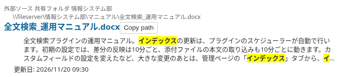  
*画面8-5：View Customizeでリンクとコピーボタンを作り換えたときの表示例（題名が社内ビューアへのリンクになり、その横に「Copy path」ボタンが出ます）*

##### （参考）属性を確認するためのデバッグ用コード

実際にどのような属性値が入っているかを確認しながらスクリプトを作成したいときは、次のデバッグ用コードを一時的にView Customizeに登録するか、ブラウザの開発者ツールのコンソールで実行してみてください。各文書の題名の横に「Inspect attrs」ボタンが追加され、クリックするとその文書が持っているすべての `data-solr-*` 属性の一覧をアラートで確認できます（開発者ツールのコンソールにも表形式で出力されます）。

```javascript
function addDebugButtons() {
  document.querySelectorAll('.solr-search-external-hit').forEach(function (hit) {
    var title = hit.querySelector('.solr-search-title-external');
    if (!title || title.querySelector('.solr-debug-btn')) return;

    var btn = document.createElement('button');
    btn.type = 'button';
    btn.className = 'solr-debug-btn';
    btn.textContent = 'Inspect attrs';
    btn.style.marginLeft = '8px';
    btn.style.fontSize = '0.8em';

    btn.addEventListener('click', function (e) {
      e.preventDefault();
      var data = {};
      var lines = [];
      Array.from(hit.attributes).forEach(function (attr) {
        if (attr.name.indexOf('data-solr-') === 0) {
          data[attr.name] = attr.value;
          lines.push(attr.name + ':\n  ' + attr.value);
        }
      });
      console.table(data); // 開発者ツールのコンソールに表形式で出力
      alert('[External Document Attributes]\n\n' + lines.join('\n\n'));
    });

    title.appendChild(btn);
  });
}

addDebugButtons();
document.addEventListener('solr-search:updated', addDebugButtons);
```

- **リンクの安全性について**：スクリプト側で独自に生成したリンクに対して、プラグイン側での検証やサニタイズ等のゲートは設けていません。パス・題名・URLは文書を作った人が決めるので信用せず、リンクにするのは`https://`か`http://`で始まるものだけにしてください（`javascript:`や`file://`をリンクにすると、スクリプトの実行や、意図しないファイルへの遷移になりえます）。

---

# 【第4部：プロジェクトの管理者】

この部では、各プロジェクトで全文検索を使うための設定と、外部ソース（共有フォルダや部門の文書）の紐付け手順を説明します。

## 第9章：プロジェクトでの有効化と外部ソースの紐付け

### 9.1 「全文検索」モジュールを有効にする

プロジェクト内で全文検索機能を使うには、まずプロジェクトのモジュールを有効にします。

1. プロジェクトのメニューから **「設定」** を開きます。
2. **「モジュール」** タブを開きます。
3. 一覧にある **「全文検索」** にチェックを入れて、画面下の「保存」を押します。

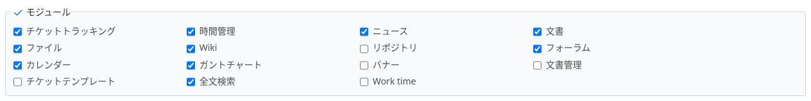  
*画面9-1：プロジェクトの設定の「モジュール」タブ（「全文検索」にチェックを入れたところ）*

有効にすると、プロジェクトのメニューに **「全文検索」** タブが追加され、そのプロジェクトと子プロジェクトの中を対象とした検索画面が開けるようになります。

> [!TIP]
> 今後作成する新しいプロジェクトで最初から全文検索を有効にしたい場合は、システム管理者に依頼して、管理 → 設定 →「プロジェクト」タブの「新規プロジェクトにおいてデフォルトで有効になるモジュール」で「全文検索」にチェックを入れてもらってください（システム管理者の導入手順は [4.5](#45-初めてのインデックスの作成と動作の確認) を参照）。

---

### 9.2 3つの権限

本プラグインを導入すると、Redmineの **管理 →「ロールと権限」** に、全文検索に関する3つの権限が追加されます。システム管理者にあらかじめロールへ権限を付与してもらい、プロジェクトの管理者はメンバーに適切なロールを割り当ててください。

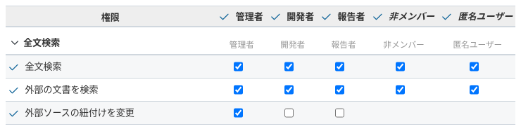  
*画面9-2：管理 →「ロールと権限」→「権限レポート」の「全文検索」の3つの権限（ロールは一部だけを表示）*

| 権限名（内部名） | 対象ロール | できること |
|---|---|---|
| **全文検索**<br>（`use_solr_search`） | すべてのロール<br>（非メンバー・匿名含む） | プロジェクトのメニューにある「全文検索」タブを開き、チケットやWiki・添付ファイルを検索・閲覧します。プロジェクト内で検索を使うための基本権限です。 |
| **外部の文書を検索**<br>（`search_external_sources`） | すべてのロール<br>（非メンバー・匿名含む） | プロジェクトに紐付けられた外部ソース（共有フォルダなどの文書）を検索対象に含め、結果を表示します。**「全文検索」権限と両方持っているときだけ有効**になります。 |
| **外部ソースの紐付けを変更**<br>（`manage_solr_search_sources`） | **メンバーのロールのみ**<br>（管理者・リーダー等） | プロジェクトの設定画面に「全文検索」タブを表示し、どの外部ソースをこのプロジェクトで検索対象にするかを紐付ける設定権限です。 |

- **安全のためのルール**：3つの権限はすべて、**「全文検索」モジュールが有効になっているプロジェクトでのみ**効きます。モジュールが無効なプロジェクトでは、権限があってもプロジェクト検索や外部文書の閲覧はできません。
- **全体検索との関係**：トップメニューの「全文検索」（全体検索）を誰が使えるかは、システム管理者が決める「全体検索の利用範囲」（[5.1](#51-プラグインの設定の画面)）に従います。全体検索に出るRedmineのデータ（チケットやWikiなど）は、Redmineの閲覧の権限で決まり、このモジュールが無効なプロジェクトのものも出ます。外部ソースの文書は、全体検索でも、モジュールが有効で2つの権限があるプロジェクトに紐付いたものだけが出ます。

---

### 9.3 外部ソースの紐付け（プロジェクトの設定の「全文検索」タブ）

システム管理者が登録・許可した外部ソース（共有フォルダやファイルサーバーなど）をプロジェクトに紐付けることで、そのプロジェクトのメンバーが外部の文書もあわせて横断検索できるようになります。

「外部ソースの紐付けを変更」権限を持つユーザーで操作します。

1. プロジェクトのメニューから **「設定」** を開きます。
2. **「全文検索」** タブを開きます。
3. このプロジェクトでの利用が許可されている外部ソースの一覧が表示されます。検索対象に含めたい外部ソースのチェックボックスをオンにして、「保存」を押します。

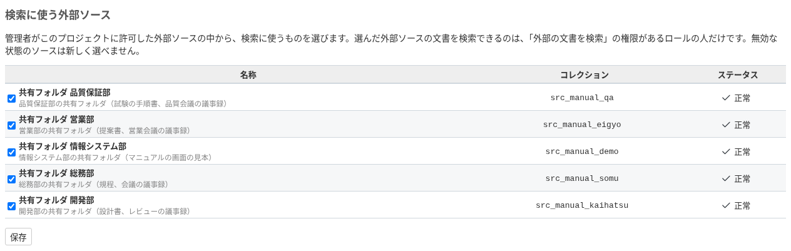  
*画面9-3：プロジェクトの設定の「全文検索」タブ（許可された外部ソースの一覧、チェックボックス、状態。見本の外部ソースだけを表示）*

- **表示されない外部ソースがある場合**：システム管理者が、管理ページの「外部ソース」タブで「このプロジェクトでの利用」をまだ許可していません。システム管理者に利用許可を依頼してください（[8.2](#82-登録と利用を許可するプロジェクト)）。
- **状態が「正常」でない場合**：状態は、この画面を開いたときのSolrの様子です。「無効：コレクションがありません」「無効：configset が違います」「確かめられません（Solr が答えません）」のときは、新しくチェックを入れることはできません（すでに選んでいるものは、外せます）。システム管理者に確かめてもらってください（[8.2](#82-登録と利用を許可するプロジェクト)）。
- **変更の記録**：外部ソースの紐付けを追加・解除すると、システム管理者の管理ページにある「変更の履歴」タブ（[15.1](#151-変更の履歴タブ)）に「誰が・いつ・どのプロジェクトで紐付けを変えたか」が記録されます。

---

# 【第5部：メンバー】

この部では、検索のしかたを説明します。画面の文言は、画面に出るとおりに「」で囲んで書きます。例に使う語（「議事録」「東京」など）は、サンプルデータで確かめたものです。件数は、データによって変わります。

## 第10章：検索のはじめかた

#### クイックスタート

まずは、1つ検索してみましょう。下の画面の番号と、手順の番号が対応しています。

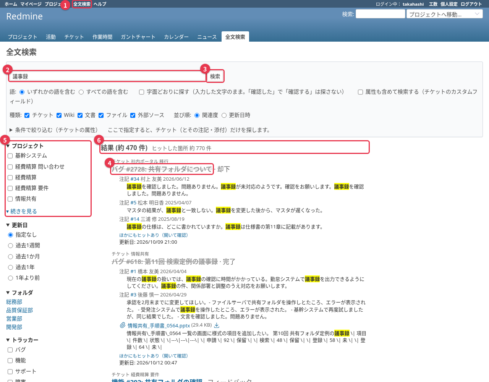  
*画面10-1：「議事録」で全体検索した結果の画面（番号は下の表と対応しています）*

| 番号 | 画面の場所 | すること・分かること |
|---|---|---|
| ① | トップメニューの「全文検索」 | 検索の入口です。押すと、この画面が開きます（プロジェクトの中から探すときは、プロジェクトのメニューの「全文検索」タブ。[10.1](#101-全体検索とプロジェクトの中の検索)） |
| ② | 語の欄 | 探したい語を入れます。複数の語は、スペースで区切ります（[第11章](#第11章語の入れかた)） |
| ③ | 「検索」ボタン | 押すと検索します。語の欄で Enter キーを押しても同じです |
| ④ | 結果の題名 | 押すと、そのチケット・Wikiページ・文書・添付ファイル・外部の文書が開きます。題名の下には、語が当たった箇所の前後の文が、語に色を付けて並びます（[10.2](#102-結果の画面の見かた)） |
| ⑤ | 左の欄 | 結果が多すぎるときに、プロジェクト・更新日・ステータスなどで絞り込みます。チェックを入れると、すぐに検索し直します（[第12章](#第12章絞り込みと並び)） |
| ⑥ | 「約 N 件」 | 見つかった件数の目安です |

#### 結果のチューニング

思いどおりの結果にならないときは、次の順に試してください。

- **多すぎるとき**：左の欄で絞り込む、語を足して「すべての語を含む」にする、「種類」を絞る（[第12章](#第12章絞り込みと並び)、[11.1](#111-複数の語)）。
- **関係のないものが混ざるとき**：「字面どおりに探す」を入れる（[11.3](#113-字面どおりに探す)）。
- **少なすぎるとき**：「いずれかの語を含む」にする、「字面どおりに探す」を外す、「属性も含めて検索する」を入れる、別の言い方の語でも探す（[第11章](#第11章語の入れかた)）。
- **並びを変えたいとき**：「並び順」を「更新日時」にすると、新しいものから並びます（[12.3](#123-並び順)）。
- **出てほしいものが出ないとき**：権限、反映までの時間、添付ファイルの種類などを確かめてください（[第13章](#第13章見つからない見えないとき)）。

---

### 10.1 全体検索とプロジェクトの中の検索

「全文検索」は、次の2種類の場所にあります。

| 場所 | 探す範囲 |
|---|---|
| **トップメニュー**の「全文検索」と、プロジェクトの外のページ（プロジェクト一覧、活動など）の「全文検索」タブ | 見てよいすべてのプロジェクト（全体検索） |
| **プロジェクトのメニュー**の「全文検索」タブ | そのプロジェクトと、その子プロジェクト。そこから「すべてのプロジェクトで検索」で、全体検索に移れます |

  
*画面10-2：「全文検索」のある場所（①トップメニューの「全文検索」、②プロジェクトのメニューの「全文検索」タブ）*

- 全体検索で、検索の前に左の欄のプロジェクトの一覧から選ぶと、選んだプロジェクト（と、その子プロジェクト）の中だけを探せます。
- メニューに「全文検索」が出ないときは、システム管理者が全体検索を使える人を絞っている（[5.1](#51-プラグインの設定の画面)）か、そのプロジェクトで全文検索が有効になっていません（[第9章](#第9章プロジェクトでの有効化と外部ソースの紐付け)）。プロジェクトの管理者かシステム管理者に聞いてください。
- 語の数には上限があります（初期の設定では10個。システム管理者が1〜20個の間で変えられます。[5.1](#51-プラグインの設定の画面)）。超えると「検索キーワードが多すぎます。10個までにしてください。」と出るので、語を減らしてください。

---

### 10.2 結果の画面の見かた

画面の各部の場所は、[クイックスタート](#クイックスタート)の画面10-1を見てください。

検索結果の1件は、チケット、Wikiページ、文書、プロジェクトやバージョンの「ファイル」、外部の文書の**1つ**です。チケットの注記や添付ファイルで語が当たったときも、検索結果の1件はそのチケットで、その下に当たった箇所が並びます。

- 検索結果の題名の下に、**どこで当たったか**（件名・説明、注記、添付ファイル）と、当たった箇所の前後の文（以下、**抜粋**）が並びます。抜粋の中の見つかった語には、色が付きます。
- 1件の検索結果の下に出す箇所は、3件までです。それより多いときは「ほかにもヒットあり（開いて確認）」と出るので、題名を押して開き、確かめてください。
- 一覧の上の「約 N 件」は検索結果の数、「ヒットした箇所 約 N 件」は当たった箇所の数の目安です。
- 検索結果の種類は、ラベルで分かります（チケット、Wiki、文書、添付ファイル、外部ソース）。チケットのプライベートな注記には、Redmineと同じ「プライベート」のしるしが付きます。
- **プライベートなチケットと注記も、見てよい人には出ます**。Redmineのチケットの画面と同じ判定なので、**自分が書いたプライベートな注記**も探せます（Redmineの標準の検索では、「プライベート注記の閲覧」の権限がないと、自分が書いたものでも探せません）。
- 外部の文書には、その文書の場所（フォルダのパス）が出ます。リンクになるかどうかやリンクの飛び先は、システム管理者による外部ソースの設定によります（[8.3](#83-場所の見せかた表示の形式リンクの書式場所の読み替え)）。

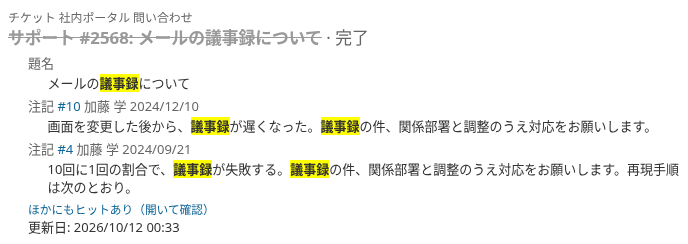  
*画面10-3：1件の検索結果の拡大（チケットの件名の下に、題名と注記で当たった箇所が抜粋つきで並び、「ほかにもヒットあり（開いて確認）」が出ています）*

---

## 第11章：語の入れかた

### 11.1 複数の語

語をスペースで区切って入れると、語の横の選択で、探しかたを決められます。

- **「いずれかの語を含む」**（初期の値）：どれかの語があれば当たります。
- **「すべての語を含む」**：すべての語が、**同じ箇所**（チケットの件名と説明、注記1件、添付ファイル1つなど）にあるものだけが当たります。チケットの件名に「東京」、注記に「新宿」とあるだけでは、当たりません。

例：「東京 新宿」は、「いずれかの語を含む」では多く当たり、「すべての語を含む」では絞られます。

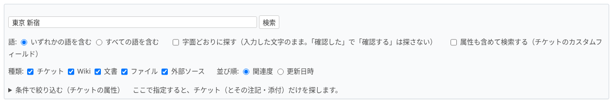  
*画面11-1：上のフォームの拡大（「東京 新宿」を入れたところ。語の欄、「いずれかの語を含む」「すべての語を含む」の選択、「字面どおりに探す」「属性も含めて検索する」のチェック）*

---

### 11.2 日本語の探されかた

ふだんは、日本語の語を**言葉の形をそろえて**探します。

- **活用形**：「確認する」で「確認した」も見つかります。
- **語の一部**：複合語（「形態素解析」）は、分けた語（「形態素」「解析」）でも当たります。
- **ヴ行とバ行**：「ヴァイオリン」と「バイオリン」を、同じものとして探します。
- **小さいかな**：「霞ケ関」で「霞ヶ関」も、「茅ヶ崎」で「茅ケ崎」も見つかります（漢字のあとの「ケ」と「ヶ」、「カ」と「ヵ」）。
- **全角と半角、大文字と小文字**は区別しません（「Solr」と「ｓｏｌｒ」は同じです）。

ヴ行・バ行と小さいかなの扱いは、システム管理者が設定で止めていることがあります（[14.3](#143-詳細調整タブ並びの重み試し検索)）。

---

### 11.3 「字面どおりに探す」

チェックを入れると、**入力した文字のまま**探します。

- 「確認する」で「確認した」は探しません。ヴ行・バ行、「ケ」と「ヶ」を同じに扱うこと、同義語に広げること（[11.5](#115-表記ゆれと同義語)）も、しません。
- 東京メトロの「霞ケ関」と東武東上線の「霞ヶ関」のように、綴りで別のものを区別して探したいときや、語の一部で関係のない文書まで当たる（雑音が多い）ときに使います。
- 2文字以上の語は、Redmineの標準の検索と同じく、その文字列を含むものを探します。
- **1文字の語は見つかりません**（[13.4](#134-1文字の語語の一部)）。

---

### 11.4 「属性も含めて検索する」

チェックを入れると、**チケットのカスタムフィールド**の値も探します。探すのは、システム管理者が「検索対象」にしたフィールドで、あなたが見てよいものだけです。抜粋には、フィールドの名前が出ます。

  
*画面11-2：カスタムフィールドの値で当たった抜粋（フィールドの名前つき）*

語が多いときは、カスタムフィールドを探さずに検索することがあります。そのときは「語が多いので、カスタムフィールド（属性）は探さずに検索しました。語を減らすと、属性も探せます。」と出ます（語の数と、Solrが1回に扱える条件の数の関係です。[18.3](#183-既知の制約)）。

---

### 11.5 表記ゆれと同義語

システム管理者が**同義語の辞書**に言い換えを登録していれば、その語でも探します（例：「在宅勤務」で「テレワーク」も探す）。旧称と新称、略語と正式名称、部署ごとの言い回しなどを、どちらで探しても見つかるようにするためのものです。

- 入れた語が、登録された語と**全体で同じとき**だけ広がります。「PC」が登録されていても、「PC管理」は広がりません。
- 「字面どおりに探す」では、広がりません。
- 「この言い換えも探してほしい」というものがあれば、システム管理者に伝えてください（[14.2](#142-同義語タブ)）。

---

## 第12章：絞り込みと並び

### 12.1 左の欄での絞り込み（種類・プロジェクト・ソース・フォルダ・更新日）

#### 種類（上のフォーム）

上のフォームの「種類」で、チケット、Wiki、文書、添付ファイル、外部ソースから選べます。何も選ばなければ、すべてを探します。チェックの上にマウスを置くと、その種類にしたときの件数が出ます。

#### 結果の左の欄（ファセット）

検索したあとに、その検索で見つかったものから選んで絞れます（いわゆるファセットです）。チェックを変えると、すぐに検索し直します。それぞれの値にマウスを置くと、その値を選んだときの件数が出ます。長い一覧は、先頭の5件と選んだ項目だけを出し、残りは下の「続きを見る」で、その場に開きます。

| 項目 | 内容 |
|---|---|
| **プロジェクト** | 見つかったプロジェクトが、多い順に並びます（全体検索のとき）。外部の文書は、その外部ソースを紐付けているプロジェクトに数えます |
| **ソース** | プロジェクトの中で探したとき（またはプロジェクトを選んだとき）に、Redmineのデータと外部ソースのうち、どれに絞るかを選べます |
| **更新日** | 「過去1週間」「過去1か月」「過去1年」「1年より前」 |
| **フォルダ** | 外部の文書のフォルダです。選ぶと、その下のフォルダが出ます。一覧の上に、選んだフォルダまでの道筋（パンくず。例：「すべてのフォルダ › 会議 › 2026」）が出て、途中のフォルダを押すとそこまで戻れます。「すべてのフォルダ」を押すか、結果の上の札を×で外すと、フォルダの絞り込みが外れます |
| **トラッカー**・**ステータス** | チケットの絞り込みです。選ぶと、チケットでないもの（Wiki・外部の文書など）は出なくなります |
| **作成者**・**担当者**・**優先度**・**対象バージョン**・**カテゴリ** | 同じくチケットの絞り込みです。はじめは畳まれていて、見出しを押すと開きます |
| **ファイルの種類** | 添付ファイルと外部の文書の拡張子（PDF・DOCXなど）です |
| **カスタムフィールド** | システム管理者が「検索条件に使用」にしたチケットのカスタムフィールドが、フィールドごとに出ます。リストは値を選び、数値は最小・最大、日付は開始・終了を入れます。見てよいフィールドだけが出ます |

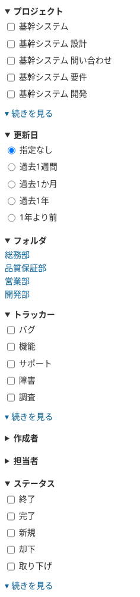  
*画面12-1：左の欄（絞り込み）の上の部分。長い一覧の下に「続きを見る」が出ます*

選んでいる条件は、結果の上に小さな札で並びます。×で1つずつ、「すべて解除」でまとめて外せます。

  
*画面12-2：選んでいる条件の札と「すべて解除」（プロジェクトを1つと「過去1年」を選んだところ）*

  
*画面12-3：外部の文書のフォルダでの絞り込み（「総務部」を選んだところ。上のパンくずと、その下のフォルダの一覧）*

---

### 12.2 「条件で絞り込む（チケットの属性）」

上のフォームの中の、畳まれた欄です。Redmineのチケット一覧の「フィルタ」と同じ部品で、条件を組み合わせます。

- 使える項目：ステータス・トラッカー・優先度・作成者・担当者・対象バージョン・カテゴリ・更新日・作成日・終了日・開始日・期日と、「検索条件に使用」のカスタムフィールド。
- 「等しい」「等しくない」「以上」「範囲」「今週」などの演算子で指定します。
- **指定すると、チケット（と、その注記・添付ファイル）だけを探します**。件名・説明・コメントの中身は、検索の語で探してください。
- 更新日は、当たった箇所（チケット・注記・添付ファイル）の更新日で見ます。

  
*画面12-4：「条件で絞り込む（チケットの属性）」を開き、条件を2つ（ステータスが「等しい」「新規」、期日が「今週」）入れたところ*

---

### 12.3 並び順

上のフォームの「並び順」で選びます。

- **「関連度」**（初期の値）：語がよく当たるものが先に並びます。
- **「更新日時」**：新しいものが先に並びます。チケットなどは、その中の**当たった箇所のうち、いちばん新しいもの**の日時で並びます。古い注記だけで当たったチケットが、新しいものの間に入ることがあります。

「関連度」の順では、Redmineのデータが先に並び、外部の文書は後ろに回りやすくなります（語の珍しさを、Redmineのデータと外部ソースで、それぞれ別に数えるためです）。外部の文書を見たいときは、左の欄の「種類」を「外部ソース」だけにするか、「フォルダ」で絞って探してください。

---

### 12.4 ページ送りと件数の表示

- 1ページには、検索結果を50件出します（システム管理者が10〜100件の間で変えられます。[5.1](#51-プラグインの設定の画面)）。
- たどれるのは、上から2,000件までです（1ページ50件なら40ページ目まで）。それより先を見たいときは、絞り込んでください。
- 表示の前に、見てよいかをRedmineでもう一度確かめて外したものは、補いません。そのため、1ページの件数が少ないページや、空のページがあることがあります。空のページには、その旨の案内が出ます。
- 左の欄の操作とページ送りは、ページ全体を読み込み直さず、左の欄と結果の部分だけを入れ替えます。左の欄の開け閉めは、次に検索するまで保ちます。

---

## 第13章：見つからない・見えないとき

### 13.1 権限で見えないもの

**探せるのは、Redmineで見てよいものだけです。** プライベートなチケットや注記は、見てよい人にだけ出ます。ログインしていない人には、公開されたプロジェクトのものだけが出ます。ほかの人に見えて自分に見えないものがあるのは、権限によるものです。

外部の文書は、その外部ソースが紐付いたプロジェクトのメンバーで、プロジェクトの設定で外部の文書を探せるようになっている人に出ます。出てほしいのに出ないときは、プロジェクトの管理者に相談してください（設定のしかたは[第9章](#第9章プロジェクトでの有効化と外部ソースの紐付け)）。

---

### 13.2 新しいものが出ない、消したものが出る

- **新しく作った・直したものが出ない**：インデックスは定期的に更新します（初期の設定では10分ごとで、更新の処理の時間を足すと10分余り）。しばらく待ってください。急ぐときは、システム管理者に相談してください（システム管理者は、管理ページの「インデックス」タブから、インデックスの作り直しを依頼できます。種類ごと、またはトラッカー・カスタムフィールドで絞って作り直すので、データが多いと時間がかかります。[第7章](#第7章インデックスタブ)）。
- **Redmineで消したチケットなど**：表示の前にRedmineで確かめるので、画面には出ません。ただし、しばらくは「約 N 件」に数えられ、1ページの件数が少なく見えることがあります。
- **外部の文書で、元のファイルを消したのに出る**：取り込みの部品が、次に外部ソースを調べるまで残ります。取り込みの間隔は、外部ソースの運用で決めます。

---

### 13.3 添付ファイルの中身で探せない

添付ファイルの本文は、**種類を限って**インデックスに入れています。

- 初期の設定で入るのは、Office系（Word・Excel・PowerPointなど）、テキスト系（txt・csv・html・xmlなど）、PDFです。
- 画像と、圧縮ファイル（zipなど）の中身は探せません。システム管理者が設定で対象の拡張子を変えていることもあります（[5.1](#51-プラグインの設定の画面)）。
- 大きすぎるファイルは、本文を入れません（初期の設定では50MBまで）。
- 本文が入っていなくても、**ファイル名と説明**では探せます。
- PDFでも、画像を貼っただけのもの（スキャンしたもの）は、本文がないので、中身では見つかりません。
- 添付したばかりのファイルは、本文を取り出すまで、中身では見つかりません（初期の設定では10分余り）。

---

### 13.4 1文字の語、語の一部

- **1文字の語**（「株」「鍵」など）は、「字面どおりに探す」では見つかりません。ふだんの探しかたでは、言葉として切れたときだけ当たり、抜粋が出ないことがあります。2文字以上の語にして探してください。1文字の絵文字（🙏など）も同じです。
- **「京都」で「東京都」が当たる**ことがあります（2文字ずつに切って探すためです）。順位は下がります。
- **見た目が似ていても別の文字の記号**は、見つかっても当たった箇所の抜粋が出ないことがあります。たとえば「10〜20」の「〜」（波ダッシュ、U+301C）と、「10～20」の「～」（全角のチルダ、U+FF5E）は、見た目は似ていますが別の文字で、そろえて扱えません。どちらで探しても両方の文書が見つかりますが、自分が入れたのと違うほうの文書には、抜粋が出ないことがあります。

---

### 13.5 「検索できませんでした」と出たとき

検索の基盤（Solr）が答えていません。画面には「検索できませんでした。しばらくしてからやり直すか、管理者に連絡してください。」と出ます。続くときは、システム管理者に、日時と、入れた語と、ログイン名を伝えてください（システム管理者は「状態」タブなどでSolrの稼働状況を確認できます。[第6章](#第6章状態タブ)）。

絞り込みを入れすぎて「見つかりませんでした」になったときは、画面に出るヒントのとおりに、条件を広げてください（「いずれかの語を含む」にする、「字面どおりに探す」を外す、「種類」のチェックを増やす、「すべてのプロジェクト」で探す、「属性も含めて検索する」を入れる）。

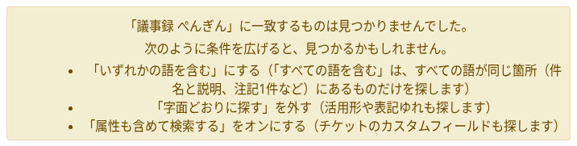  
*画面13-1：「見つかりませんでした」と、条件を広げるヒントの一覧*

---

### 13.6 検索の記録について

検索の品質をよくするために、**検索のたびに、日時・ログイン名・入れた語・絞り込みの条件・件数・かかった時間と、結果から開いたもの**を記録しています。記録を見られるのはシステム管理者だけです。品質の集計（0件の割合など）には、語もログイン名も出ません。記録を残す期間は、組織で決めます（決めていなければ、消すまで残ります）。気になるときは、システム管理者に聞いてください（ログの確認や保持期間の設定は[14.1](#141-検索ログタブ)）。

---

# 【第6部：システム管理者（品質の手入れと運用監視）】

この部では、検索が利用されるようになってからの日常的な運用の手入れ（管理ページの「検索ログ」「同義語」「詳細調整」「変更の履歴」の各タブ）と、外部監視（Prometheus / Grafana）について説明します。

| タブ・機能 | 主な用途 | 説明 |
|---|---|---|
| 検索ログ | 何が検索され、何が開かれたか、0件の検索の発見 | [14.1](#141-検索ログタブ) |
| 同義語 | 組織の用語や言い換えの辞書 | [14.2](#142-同義語タブ) |
| 詳細調整 | 結果の並びの重み、表示と動作、外部のリランカー、正解つき検索 | [14.3](#143-詳細調整タブ並びの重み試し検索)・[14.4](#144-外部のリランカー)・[14.5](#145-正解つきの検索で品質を測る上級者専門家向け) |
| 変更の履歴 | 外部ソース・許可・紐付けと、接続先の変更の記録 | [15.1](#151-変更の履歴タブ) |
| 監視 | Prometheus・Grafanaによるメトリクス監視、Solrの確認事項 | [15.2](#152-監視prometheusgrafana)・[15.3](#153-solrについて見てほしいこと) |

---

## 第14章：検索の品質の手入れ

検索ログで「探されたのに見つからなかったもの」を見つけ、同義語の辞書や並びの重みで手当てし、試し検索で確かめる、という流れで使います。

### 14.1 「検索ログ」タブ

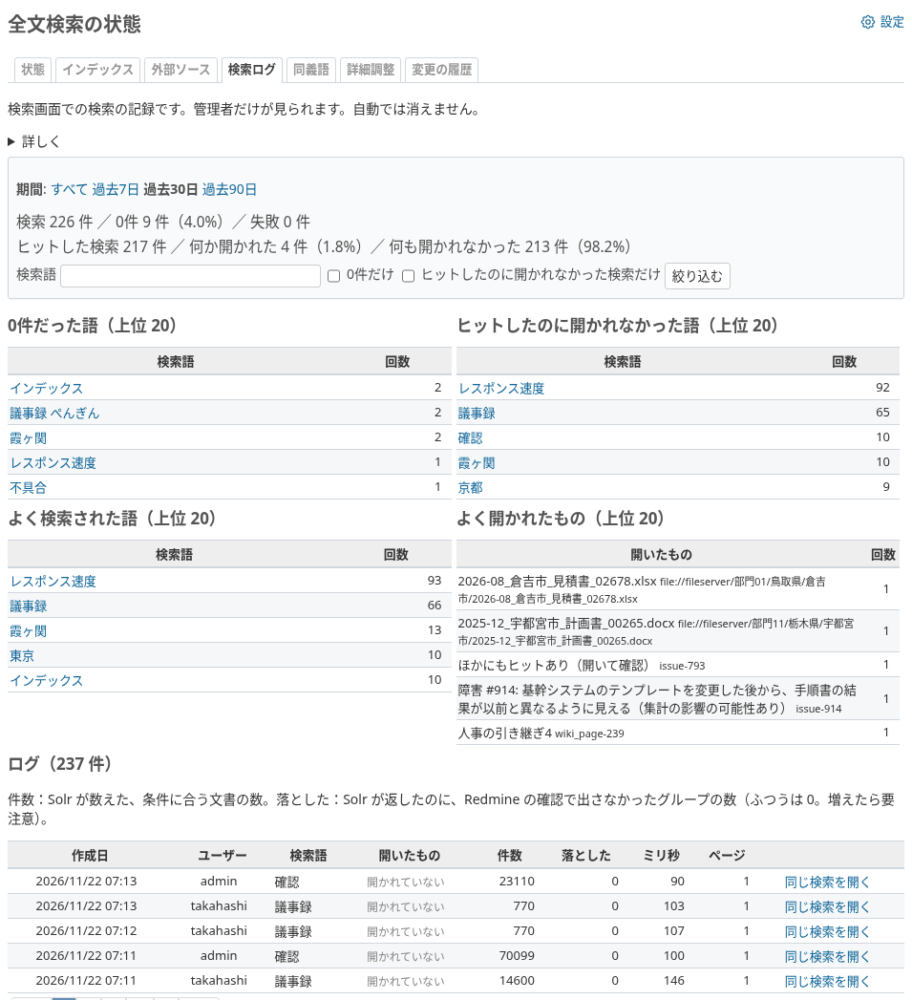  
*画面14-1：「検索ログ」タブ（集計の行、0件だった語・開かれなかった語の上位、ログの一覧。表は先頭の5行だけを表示）*

- **検索のたびに1行**（日時、利用者、検索語、件数、表示の前に落とした数、かかった時間）と、**結果から開いたもの**（何番目を開いたか）が記録されます。
- 絞り込み：期間、「0件だけ」、「ヒットしたのに開かれなかった検索だけ」（役に立たなかった検索の目印）、検索語。
- 上位の一覧：「0件だった語」「ヒットしたのに開かれなかった語」「よく検索された語」「よく開かれたもの」。同義語の辞書に何を書くかの手がかりになります。
- 「同じ検索を開く」で、その検索を同じ条件で開き直せます。
- **「ZIP（CSV）をダウンロード」**：今の絞り込みに合う、すべての検索とクリックを、CSV（BOMつきUTF-8。Excelでも開けます）とREADMEのZIPで落とします。
- **ログは、消さない限り残ります**。「この日より前を消す」「すべて消す」で消せます（元に戻せません）。

**個人情報について**：ログには、検索語と利用者のログイン名が入ります。導入する組織で、**残す期間と、利用者への周知**（検索が記録されること）を決めてください。期間で消すなら、「この日より前を消す」を定期的に行います（消す前にZIPで取っておけます）。監視の集計（0件の割合など）には、語もログイン名も出ません。

ログインしていない人の検索を許している（全体検索の利用範囲が「すべてのユーザー」）ときは、繰り返しの検索でログが増えることがあります。入口のリバースプロキシで、検索の口（`/solr_search`）の頻度を制限することを勧めます。nginxの例です（値は利用者の数に合わせてください。`proxy_pass ...`の中身は環境によります）。

```nginx
# in http { ... }
limit_req_zone $binary_remote_addr zone=solr_search:10m rate=5r/s;
# in server { ... }; /solr_search/click is under the same path
location ^~ /solr_search { limit_req zone=solr_search burst=20 nodelay; proxy_pass ...; }
```

監視用の`/solr_search/metrics`を外へ通さないときは、別の`location ^~ /solr_search/metrics`で止めます（長いほうが選ばれるので、書く順序は関係ありません）。

---

### 14.2 「同義語」タブ

検索語を、同じ意味の言い方にも広げる**辞書**です。旧称と新称、略語と正式名称、部署ごとの言い回しなどを書いておくと、どちらで探しても、どちらで書かれた文書も見つかります。

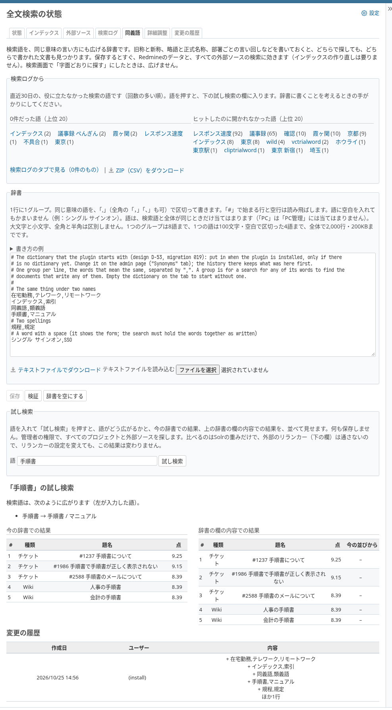  
*画面14-2：「同義語」タブ（「検索ログから」の語、辞書の欄、「手順書」の試し検索の結果。表は先頭の5行だけを表示）*

- **書きかた**：1行に1つのグループを、「,」で区切って書きます。例：`在宅勤務,テレワーク,リモートワーク`
- **広がりかた**：検索語が、辞書の語と**全体で同じとき**だけ、グループの語すべてで探します（「PC」と書いても「PC管理」は広がりません）。「字面どおりに探す」では使いません。
- **保存するとすぐ**、全員の検索に効きます。インデックスの作り直しは要りません。保存ボタンは、欄を直すまで押せません。
- **「検索ログから」**：直近30日の、0件だった語・開かれなかった語が出ます。語を押すと、試し検索の欄に入ります。
- **試し検索**：語がどう広がるかと、今の辞書での結果、欄の内容での結果を並べて見せます。何も保存しません。
- **確かめる**：保存せずに、使えない行と、区切りの間違いらしいもの・同じ語の重複などの注意を調べます。使えない行があると、保存できません。
- テキストファイルでダウンロード・読み込みができます（別のRedmineへの移行や、手元での編集に）。
- 保存のたびに履歴が残ります。「辞書を空にする」で、辞書を使わない状態にできます。
- 導入したときは、サンプルの言い換えが6組入っています（在宅勤務／テレワーク、インデックス／索引など）。組織の言葉に直すか、不要なら空にしてください。

この辞書は、Solrの設定の中の同義語の一覧（`synonyms-ja.txt`）とは別のものです。ふだんは、この画面の辞書を使ってください。

---

### 14.3 「詳細調整」タブ（並びの重み、試し検索）

検索結果の**並び順**を調整する、詳しい人向けのタブです。**普段は変えなくてかまいません**（初期の値のままで足りることを確かめています）。並びに困ったことがあるときだけ動かしてください。

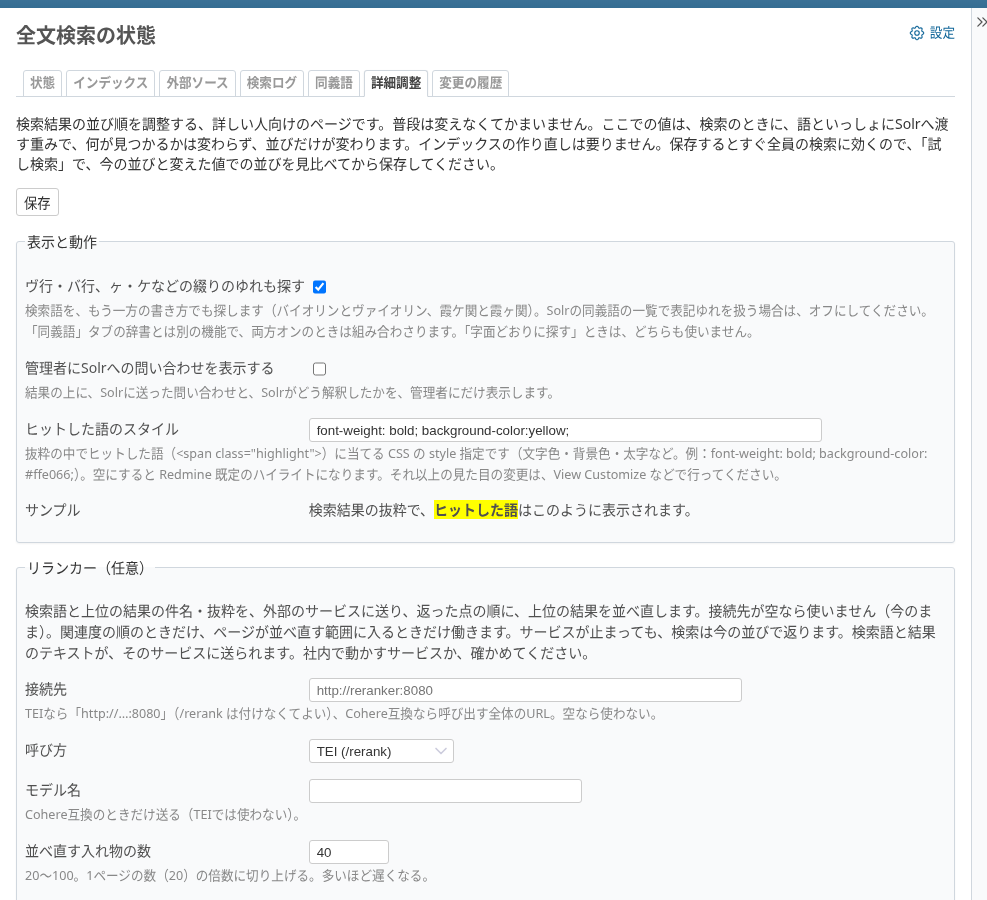  
*画面14-3：「詳細調整」タブの上の部分（表示と動作、リランカー。続きは画面14-4〜14-6）*

#### 表示と動作

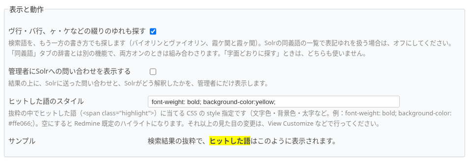  
*画面14-4：「詳細調整」タブの「表示と動作」の欄（綴りのゆれ、ヒットした語のスタイルと「試し表示」、Solrへの問い合わせの表示）*

| 項目 | 初期の値 | 内容 |
|---|---|---|
| ヴ行・バ行、ヶ・ケなどの綴りのゆれも探す | オン | 検索語を、もう一方の書き方でも探します（バイオリンとヴァイオリン、霞ケ関と霞ヶ関）。「字面どおりに探す」では使いません |
| ヒットした語のスタイル | 太字・黄色の背景 | 抜粋の中の見つかった語に付けるCSS。「試し表示」で見た目を確かめられます |
| 管理者にSolrへの問い合わせを表示する | オフ | オンにすると、システム管理者の検索画面に、Solrへ渡した問い合わせと重みが出ます。内部のURLやプロジェクトのIDが出るので、調べるときだけオンにします |

#### 並びの重み

ここの値は、**何が見つかるかは変えず、並び順（表示順）だけを変えます**。保存するとすぐ全員の検索に効き、インデックスの作り直しは要りません。

##### 検索順（スコア）と重みの考え方

検索結果が「関連度」で並ぶとき、Solrは検索語に当たった文書（ヒットした文書）に対して**点数（スコア）**を計算し、点数が高い順に並べています。

1. **基本の点数づけ（SolrのBM25アルゴリズム）**
   - **語が多く含まれている文書**ほど高得点になります。
   - 文書全体の中で**珍しい語**（出現頻度が低い専門用語など）で一致するほど高得点になります（どの文書にもよく出てくる一般的な語は低得点になります）。
   - **短く密度が高い文書**ほど高得点になります（何万文字もある長い文書に1回だけ登場するよりも、短い文章の中でピンポイントに言及されている文書が高く評価されます）。

2. **どこで・どう当たったかの重み付け（フィールドと一致方法）**
   - **件名か本文か**：本文よりも「件名（タイトル）」に語が含まれているほうが、その文書の主題である可能性が高いため、初期の値では、日本語の語で当たったとき、件名に3、本文に2を掛けています。
   - **単語一致か部分一致か**：日本語の単語（形態素解析）として綺麗に一致したほうが、2文字ずつの部分一致（2-gram）よりも高く評価されるように重み付けしています（初期の値では、日本語の語が3と2、2文字ずつは件名・本文とも1）。
   - **語どうしの距離（フレーズ加点）**：複数の語で探したとき、語と語が離れて散らばっているよりも、隣り合って並んでいる文書に加点できます（初期の値は0で、加点していません）。

3. **文書の種類や新しさによる補正**
   - 文書の種類（チケット、Wiki、外部ソースなど）ごとの掛け率や、更新日が新しい文書への加点（新しさブースト）を組み合わせて、最終的な総合得点が決まります（初期の値は、係数がすべて1、新しさの強さが0で、どちらも補正していません）。

##### なぜ「何がベストな調整か」は一概に言えないのか

画面上のつまみ（数字）を変えると、これらの掛け算の倍率を自由に調整できます。しかし、**すべての検索において完璧な「黄金比」は存在しません**。

- ある検索語では「件名の重みを上げたほうが綺麗に上位に来る」としても、別の検索語では「本文に重要な知見が詳しく書かれた文書が下位に沈んでしまう」ことがあります。
- 外部ソースの係数を少し上げただけで、チケットよりも外部文書ばかりが上位を占めてしまい、かえって日常のチケットが探しにくくなることもあります。

初期値は、手元の環境である程度バランスを見ながら設定しています。ふだんは無理にいじる必要はありませんが、もし「特定の種類の文書を上位に出したい」「最近の更新を重視したい」といった要望が出てきたときは、後述の「試し検索」で前後の並びを見比べながら、少しずつ（1割程度ずつ）調整してみてください。

| つまみ | 初期の値（範囲） | 何をするか |
|---|---|---|
| 検索する項目の重み（件名・本文 × 日本語の語・2文字ずつ） | 3・2・1・1（0〜20） | その項目で語が当たったときの点に掛けます。項目どうしの比だけが効きます。0にすると、その項目では探しません（4つとも0にはできません） |
| 語が隣り合っているときの加点 | 0（0〜20） | 複数の語で探したとき、語が隣り合って並んでいる文書に点を足します |
| 種類ごとの係数（チケット・Wikiページ・文書・添付ファイル・外部ソース） | 1（0.1〜10） | その種類の文書の点に掛けます。たとえば外部ソースを1.2にすると、外部の文書が前に出やすくなります |
| 外部ソースごとの係数 | 1（0.1〜10） | その外部ソースの文書の点に掛けます |
| 新しさ（強さ・半減期） | 0・180日（0〜5・7〜3650日） | 更新日が新しいほど点を増やします。強さ1・半減期180日なら、今日のものは2倍、180日前のものは1.5倍です |

**動かすときの注意**

- 順位は、ほかの文書の点との並びで決まります。係数を2倍にしても、順位が2倍になるわけではありません。
- **種類や外部ソースの係数は、効き方が急になることがあります**。少しの違いで、先頭の何件かが一斉にその種類に入れ替わることがあります。**1.0から1割ずつ**動かしてください。
- 「外部の文書とRedmineの文書を混ぜて出す」ことは、係数ではうまくできません（片方が全部上か、全部下になりやすい）。外部の文書を見たい人には、左の欄で外部ソースに絞る使いかたを案内してください。
- 新しさを強くしすぎると、古くても内容のぴったりした文書（規程など）が埋もれます。強さは1前後から試してください。

**変えたら確かめる**

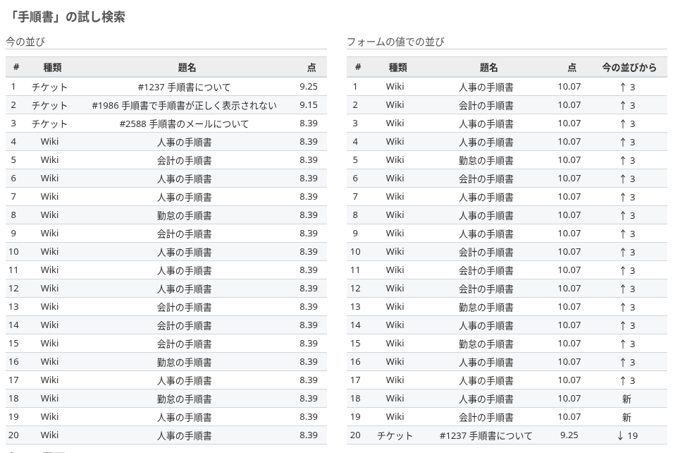  
*画面14-5：Wikiページの係数を1.2にしたときの試し検索の結果（「今の並び」と「フォームの値での並び」の2列、点、「今の並びから」の動き。Wikiページが一斉に上がります）*

1. **「試し検索」**：日ごろ使う語を何種類か入れて、「今の並び」と「フォームの値での並び」を見比べます（保存の前に見られます。点つき）。1つの語だけで決めず、件名に出る語、本文にしか出ない語、複数の語で見てください。
2. 保存のたびに履歴が残ります。うまくいかなければ、「重みを既定に戻す」で、調整していない状態に戻ります。

形態素解析の辞書、Solrの同義語の一覧、BM25の`k1`・`b`などは、この画面では動かせません（Solrの設定の変更と、インデックスの作り直しが要ります）。

---

### 14.4 外部のリランカー

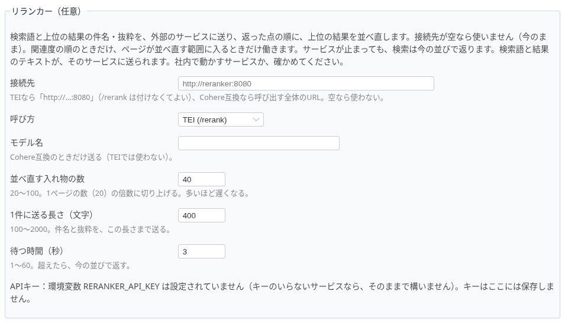  
*画面14-6：「詳細調整」タブの「リランカー（任意）」の欄（接続先、呼び方、モデル名、並べ直す数、送る長さ、待つ時間）*

検索結果の上位を、外部のサービス（**リランカー**。文の意味の近さで点を付けるモデル）の点で並べ直す、任意の機能です。「詳細調整」タブの「リランカー（任意）」の欄で設定します。**接続先が空（初期の値）なら、何も変わりません**。サービスは本プラグインに入っていないので、別途用意をしてください。

| 項目 | 初期の値 | 内容 |
|---|---|---|
| 接続先 | 空 | リランカーのサービスのURL |
| 呼び方 | TEI | TEI（HuggingFaceのText Embeddings Inference）か、Cohere互換（Cohere・Jina・Infinity・vLLMなど） |
| モデル名 | 空 | Cohere互換のときだけ |
| 並べ直す入れ物の数 | 40 | 1ページの件数の倍数に切り上げます（1ページ50件なら50件） |
| 1件に送る長さ（文字） | 400 | |
| 待つ時間（秒） | 3 | |

- APIキーが要るサービスは、環境変数`RERANKER_API_KEY`に入れます。
- **働くのは**、並び順が「関連度」で、並べ直す範囲（上位N件）のページだけです。件数とファセットは変わりません。
- **止まったときは**（つながらない、時間切れ、読めない応答）、Solrの並びで返します。検索は止まりません。
- **検討するときの注意**
  - **速さ**：初期の値はGPUのサービスを前提にしています。CPUのサービスでは遅く（開発環境で、40件×400文字が約9秒）、初期の値のままだと時間切れになります。
  - **送られるもの**：検索語と、上位の結果の題名・抜粋が、サービスに送られます。社外のサービスにするなら、部門の文書を外に出してよいかを先に決めてください。`http://`の接続先では、暗号化されずに流れます。
  - **効くか**：並びが入れ替わることは確かめていますが、**良くなるかは、その組織の文書と検索で確かめないと分かりません**。良くならなければ、接続先を空にすれば元に戻ります。

**呼び出しの形**は、次の2つです。

| 呼び方 | 送るもの | 返るもの | 接続先に入れるURL |
|---|---|---|---|
| TEI | `POST <URL>/rerank`、`{"query": …, "texts": […], "truncate": true}` | `[{"index": 0, "score": 0.9}, …]` | `http://…:8080`まで（`/rerank`は付けなくてかまいません） |
| Cohere互換（`/v2/rerank`の形） | `POST <URL>`、`{"model": …, "query": …, "documents": […], "top_n": n}` | `{"results": [{"index": 2, "relevance_score": 0.84}, …]}` | 呼び出すURLの全体 |

- APIキーは`Authorization: Bearer`で送ります。`http://`の接続先では、キーも暗号化されずに流れます。キーを使うなら`https://`にするか、閉じたネットワークの中だけで使ってください。
- TEIは1回の要求を32件までしか受けないので、プラグインが32件ずつに分けて送ります。
- CPUのサービスで試すなら、並べ直す数20・長さ200・待つ時間10秒ほどにします（開発環境で、20件×200文字が約3秒）。モデルのサービスは、モデルの大きさ以上のメモリを使います（試した306MBのモデルで約5.7GB）。
- 同点の文書が多い環境では、並べ直した並びが、ページの間で少しずれることがあります。

---

### 14.5 正解つきの検索で品質を測る（上級者・専門家向け）

重みや辞書を変えたときに、検索の品質が落ちていないかを、数値（点数）で客観的に比べるサーバー側のコマンドです（Web画面のボタンではなく、サーバー上で流すrakeタスクです）。

あらかじめ「この検索語なら、この文書が上位に出るはず」という正解データを用意しておき、自動で検索を実行して採点します。

#### 使い方（コマンドライン）

Redmineのコンテナの中で実行します（Dockerを使わないときは、Redmineのフォルダで `bin/rake redmine:solr_search:golden RAILS_ENV=production`）。検索をするだけで、インデックスは変えません。

```bash
# すべてのセット（網羅性と順位）を測定して記録する
docker compose exec redmine bin/rake redmine:solr_search:golden

# 順位（ランキング）だけを、メモを添えて測定する
docker compose exec redmine bin/rake redmine:solr_search:golden SET=ranking NOTE="重み変更のテスト"
```

| 引数 | 指定できる値 | 内容 |
|---|---|---|
| `SET` | `coverage` または `ranking`（指定しなければ、そのデータセットに正解のあるもの） | **coverage**（網羅性：あるべき文書が見つかるか、権限漏れがないか）<br>**ranking**（順位：本命の文書が上位に出るか〈既定は5件以内。正解ごとに変えられます〉、MRR） |
| `NOTE` | 任意の文字列（例：`NOTE="同義語追加前"`） | 実行の記録に残すメモ |
| `DATASET` | データセット名（初期値：同梱の`ja-basic`。開発用の`ja-cf`があれば、そちら） | 読み込む正解データのフォルダ名。プラグインのフォルダの `docker/seed/<データセット名>/expected/` にある `expected.yml`（coverage）と `golden.yml`（ranking）を読みます |

実行すると、ターミナルに結果（再現率 `recall`、適合率 `precision`、`MRR` など）が表示されます。また、結果はデータベースに記録され、監視（Grafana）のダッシュボードにも最新のスコアとして表示されます。

#### この機能の位置づけについて

この機能は、プラグインの開発や検索精度の研究などで利用している**専門家向けの実験的な道具**です。

自組織の実環境で本格的に活用するには、「どのキーワードでどのチケットやWikiが何位に来るべきか」を定義した正解ファイル（YAML形式。上の `DATASET` の場所に置きます）を自前で作成・メンテナンスする必要があります。同梱の正解データは、サンプルデータ`ja-basic`に合わせた網羅性（`coverage`）のものだけで、実環境のデータでは使えません。指定せずに流すと、その網羅性だけを測ります。順位（`ranking`）を測るには、`golden.yml`を自分で作ります（上の2つ目の例は、それがないと理由を出して止まります）。正解の書きかたの手順は、まだ整えていません。一般的な運用ではここまで行う必要はなく、前述の「試し検索」を使って、日ごろよく使うキーワードをいくつか目で見て確かめるだけで十分です。

---

## 第15章：変更の履歴と監視

### 15.1 「変更の履歴」タブ

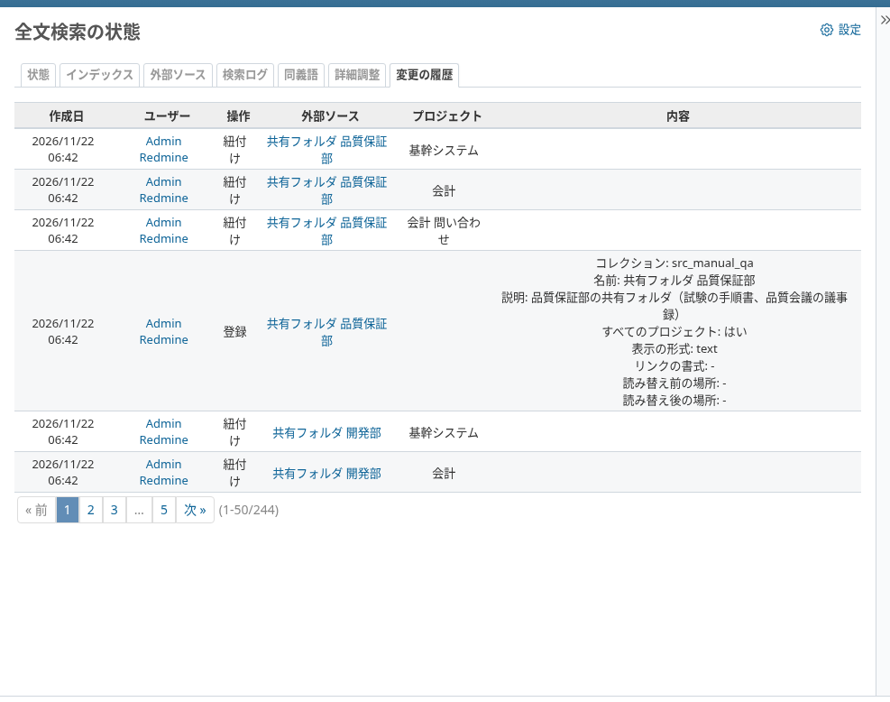  
*画面15-1：「変更の履歴」タブ（外部ソースの登録・許可・紐付けと、接続先の変更が、新しい順に並びます。先頭の6行だけを表示）*

次の変更が、新しい順に残ります（50件ずつのページ送り。上限はありません）。

- 外部ソースの登録・変更・削除
- 利用を許可するプロジェクトの追加・削除
- プロジェクトの側での紐付けの変更
- Solrの接続先と、Redmineのデータのコレクションの変更
- Tikaの接続先の変更

「いつから、どのプロジェクトで、この外部ソースが見えていたか」を、あとから確かめるためのものです。

---

### 15.2 監視（Prometheus・Grafana）

監視の例として、Prometheus・Grafana・blackbox exporter・solr-exporterの構成と、日本語のダッシュボードを同梱しています（同梱のDocker Composeの`full`・`try-full`）。採用するかどうかは、組織の監視の方針で決めてください。別の監視の仕組み（Zabbixなど）を使うなら、次の「出すもの」を読めば足ります。

**プラグインが出すもの**（`Authorization: Bearer <トークン>`が要ります。トークンは環境変数`SOLR_SEARCH_METRICS_TOKEN`。設定しなければ、口は404で閉じたままです）

| 口 | 中身 |
|---|---|
| `/solr_search/metrics` | スケジューラーの生存、処理ごとの最後の実行、検索とクリックの回数、正解つきの検索の最新の結果（データベースだけを読みます） |
| `/solr_search/metrics/index` | 種類ごとのRedmineとSolrの件数の違い、インデックスの遅れ、Redmineにないカスタムフィールドの値が残っている数（Solrに問い合わせます） |

- **この口は、入口のリバースプロキシで外へ通さないでください**。
- **検索語と利用者は、指標に出しません**。見られるのは、管理ページの「検索ログ」だけです。
- Solr自身の指標は、Solrの標準の`/solr/admin/metrics?wt=prometheus`と、レプリカの状態を出すsolr-exporterから読みます。
- ダッシュボードのパネルには、題名の横の「i」に、何の数か、どうなったら見るか、まず何をするかを書いています。

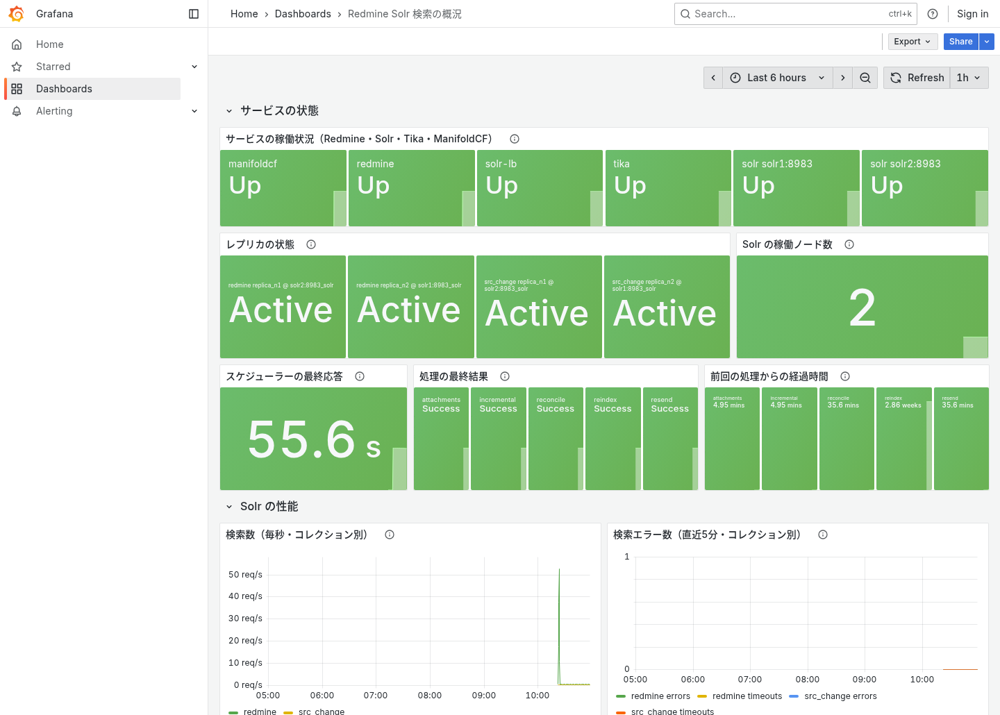  
*画面15-2：Grafanaのダッシュボード「Redmine Solr 検索の概況」（サービスの状態、スケジューラーと処理の結果、Solrの性能の始まり。上の部分だけを表示。メニューなどGrafana自体の表示は英語）*

---

### 15.3 Solrについて見てほしいこと

Solrの性能や扱う量は導入先ごとに違うので、数字の目標は示しません。**増え方と傾向**を見てください。チューニングやクラスタの操作は、Solrの公式のドキュメントに従ってください。

| 項目 | 見る場所 | 見てほしいこと |
|---|---|---|
| ディスクの空き | ダッシュボード「ディスク容量」 | 空きが減り続けていないか |
| インデックスのサイズ | ダッシュボード「インデックスサイズ」 | ディスクの空きと比べた増え方。1レプリカ分の値なので、レプリカの数を掛けます。文書を消しても、すぐには減りません |
| ヒープの使用率 | ダッシュボード「JVM ヒープ使用量」 | ガベージコレクションのあとも、上限の近くに張り付いていないか |
| レプリカの状態 | 「状態」タブ、ダッシュボード「レプリカの状態」 | すべて`active`か |
| Solrのノードの数 | ダッシュボード「Solr の稼働ノード数」 | ZooKeeperが生きていると見ているSolrのノードの数が、想定どおりか |
| ZooKeeperの状態 | Solrの管理画面の「Cloud」→「ZK Status」 | すべてのZooKeeperが答えているか（ダッシュボードには出ません） |
| バックアップ | [第17章](#第17章バックアップバージョンアップアンインストール) | インデックスを作り直す時間を待てるか。待てないなら、Solrのバックアップを取ります |

---

# 【第7部：保守と逆引き】

この部では、システムの保守・トラブルシューティング・運用の引き継ぎに必要な技術情報、データベースの構造、設定一覧、バックアップ手順、FAQをまとめます。

## 第16章：仕組みとデータ（技術解説）

本プラグインがどのようにRedmine・Solr・外部コンポーネントと協調して動作しているのか、内部のアーキテクチャとデータ構造を解説します。

### 16.1 全体の配置と流れ

本プラグインは、Web画面を担当する「Redmine本体」と、バックグラウンド処理を担当する「スケジューラー」の2系統で動作します。

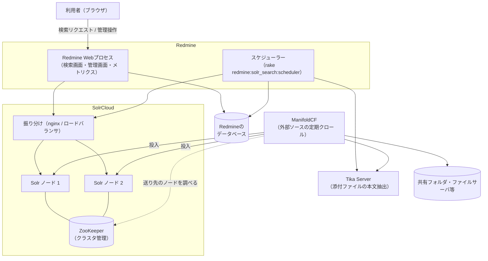

#### 検索時の2段階セキュリティ

検索結果に「本来見てはいけない文書」が漏洩しないよう、本プラグインでは**2重のセキュリティゲート**を設けています。

1. **Solr問い合わせ時の絞り込み（`fq`）**
   - 検索を実行する利用者が「見てよいプロジェクト」「閲覧権限のあるトラッカー」「プライベート注記の閲覧可否」などの情報をRedmineから集め、Solrのフィルタークエリ（`fq`）として組み立てて問い合わせます。
   - これにより、見てよいものに候補を絞ります。ただし、権限やデータが変わってからインデックスが更新されるまでの間は、件数やページ送りに、見られないものが数えられることがあります（一覧には、次の判定で出しません。[2.1](#21-インデックスと反映までの時間)）。
2. **画面表示直前の二重判定（Redmineモデル判定）**
   - Solrから返ってきた文書をRedmineのデータベースから読み込み、Railsモデルの権限判定メソッド（`Issue#visible?`、`Journal.visible`、`Attachment#visible?` など）をもう一度実行します。
   - SolrインデックスとRedmine DBとのわずかなタイムラグがあっても、表示直前の判定で弾かれます。Redmineの画面と同じ判定を使うので、見えてはいけないものが一覧に出ることを防ぎます。

#### 3つのデータ投入経路

Solrに文書が登録される経路は以下の3系統に分かれています。

1. **Redmineのデータ（チケット・注記・Wiki・文書）**
   - スケジューラー（常駐プロセス）が定期的に「差分クロール（`incremental`）」を動かし、更新・作成されたデータをSolrへ送ります。
2. **Redmineの添付ファイル**
   - 添付ファイル専用のクロール（`attachments`）が動き、Tika Serverにファイルを送ってテキスト本文を取り出してからSolrへ送ります（大きな負荷を避けるため、1回あたり200件／最大180秒で区切って少しずつ処理します）。
3. **外部の文書（共有フォルダ等）**
   - ManifoldCFが直接ファイルシステムをクロールし、Tika Serverで本文を抽出し、ZooKeeper経由でSolrCloudの専用コレクション（`src_<名前>`など）へ直接投入します（送り先のノードは、ZooKeeperに問い合わせて決めます）。**本プラグインおよびRedmine側は外部文書の投入には関与しません**。

---

### 16.2 プラグインのテーブル

本プラグインは、データベースに以下の12個のテーブルを作成して利用します。

#### テーブル間の関係（ER図）

外部ソースの管理、および検索ログとクリックの記録は以下のような関連を持っています。

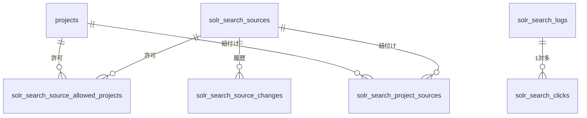

#### テーブル一覧と概要

| テーブル名 | 用途 | データの増え方と削除方針 |
|---|---|---|
| `solr_search_runs` | 定期処理の実行記録および管理ページからの「作り直し依頼」 | 実行のたびに1行追加。設定された保存日数（初期値30日）を過ぎた古い記録は自動的に削除されます。 |
| `solr_search_heartbeats` | スケジューラーの死活監視用レコード | 常に1行のみ（1分ごとの生存確認でタイムスタンプを上書き更新）。 |
| `solr_search_sources` | 登録された外部ソースのメタ情報（名前、コレクション名、表示形式、リンク書式など） | システム管理者が登録・編集したときに更新されます。 |
| `solr_search_source_allowed_projects` | 外部ソースの利用を許可するプロジェクトの中間テーブル | システム管理者の設定によって更新されます。 |
| `solr_search_project_sources` | プロジェクト側で実際に検索対象として紐付けた外部ソースの中間テーブル | プロジェクト管理者の設定によって更新されます。 |
| `solr_search_source_changes` | 外部ソースの登録・許可・紐付けや接続先の変更履歴 | 変更のたびに1行追加されます。上限はなく、消す画面もありません（あとから確かめるための記録のため）。 |
| `solr_search_logs` | 検索1回ごとのログ（日時、利用者、検索語、ヒット件数、所要時間など） | **消さない限り蓄積されます**。管理ページの「検索ログ」タブから手動で日付指定または全削除が可能です。 |
| `solr_search_clicks` | 検索結果から開かれたリンクの記録（クリックされた順位、文書の題名など） | 検索ログと一緒に蓄積・削除されます。 |
| `solr_search_counters` | 監視（Prometheus）用の集計カウンター（検索回数、レスポンス時間の分布など） | 集計の種類と区切り（応答時間の段階など）ごとに1行で、数十行です。値（数値）が加算されるだけで、検索が増えても行数は増えません。 |
| `solr_search_golden_runs` | 正解つき検索セット（テスト）の実行記録 | コマンドラインから実行するたびに1行追加されます。 |
| `solr_search_tunings` | 「詳細調整」タブで設定した並びの重み | 保存するたびに1行追加されます（最新行が有効な値で、過去行は履歴として保持）。 |
| `solr_search_synonyms` | 「同義語」タブで登録した言い換え辞書データ | 保存するたびに1行追加されます（最新行が有効な値で、過去行は履歴として保持）。 |

各テーブルの詳しいカラム名、データ型、制約などの定義は、[スキーマ仕様書（schema.md）の第5章](schema.md#5-プラグインのデータベーステーブル仕様)を参照してください。

---

### 16.3 設定の置き場所

各設定が「どこで管理され」「どこに保存され」「いつ反映されるか」の対応一覧です。

| 設定項目 | 設定する場所 | 保存先 | 反映タイミング |
|---|---|---|---|
| **Solrの接続先・コレクション名** | 管理ページ「状態」タブ（または環境変数 `SOLR_URL`） | データベース（管理ページ設定が環境変数より優先） | 次のリクエストと、スケジューラーの次のtickから反映 |
| **Tikaの接続先** | 管理ページ「状態」タブ（または環境変数 `TIKA_URL`） | データベース（管理ページ設定が環境変数より優先） | 次の添付ファイルの処理から反映 |
| **全体検索の利用範囲、検索語数の上限、タイムアウト、定期クロール間隔、添付ファイルの拡張子と上限** | 管理 → プラグイン → 全文検索「設定」画面 | Redmine標準のプラグイン設定テーブル（`settings`） | 保存後すぐに全員の検索・スケジューラーに反映 |
| **並びの重み** | 管理ページ「詳細調整」タブ | `solr_search_tunings` | 保存後すぐに全員の検索に反映 |
| **ハイライトのスタイル、綴りゆれ展開、問い合わせ表示、外部リランカー設定** | 管理ページ「詳細調整」タブ | Redmine標準のプラグイン設定テーブル（`settings`） | 保存後すぐに全員の検索に反映 |
| **同義語辞書** | 管理ページ「同義語」タブ | `solr_search_synonyms` | 保存後すぐに全員の検索に反映 |
| **リランカーAPIキー** | 環境変数 `RERANKER_API_KEY` | コンテナ・OS環境変数（DBには保存しません） | Redmineの再起動のとき（環境変数は、プロセスの起動のときに読み込まれます） |
| **外部ソースの登録・許可** | 管理ページ「外部ソース」タブ | `solr_search_sources` など | 保存後すぐに反映 |
| **プロジェクトの外部ソース紐付け** | 各プロジェクトの設定「全文検索」タブ | `solr_search_project_sources` | 保存後すぐに反映 |
| **メトリクス認証トークン** | 環境変数 `SOLR_SEARCH_METRICS_TOKEN` | コンテナ・OS環境変数 | Redmineの再起動のとき |

---

### 16.4 Solrのスキーマの要点

Solr側でどのような設定・インデックス設計が行われているかの要点です。

#### 2つの Configset

1. **`redmine`**: Redmine本体のデータ（チケット、注記、Wiki、文書、添付ファイル）を格納するコレクション用の設定セットです。
2. **`src`**: 外部の文書（ファイルサーバー等）を格納するコレクション用の設定セットです。

#### 日本語解析の2本立て（ハイブリッド検索）

日本語の検索漏れを防ぎつつ、自然な単語一致を高く評価するため、2つの解析器（アナライザー）を併用しています。

* **形態素解析（Kuromoji）**: 日本語の文を「単語」に分解し、基本形（原形）にそろえます。「確認する」で「確認した」にヒットさせる活用形の吸収や、専門用語の単語一致を評価します。
* **2-gram（バイグラム）**: 文字を2文字ずつ機械的に切り出してインデックス化します。複合語の一部、製品型番、記号混じりの単語など、形態素解析の辞書に載っていない未知語でも、2文字以上なら部分一致で拾えます（1文字の語は拾えません。[13.4](#134-1文字の語語の一部)）。

#### 入れ物（`group_id`）とまとめ表示

チケット、注記、添付ファイルは、Solr上では**1件ずつ独立したフラットなドキュメント**として登録されています。

* それぞれのドキュメントが、親となる入れ物の識別子（`group_id`。例：`issue-12`）を持っています。
* 検索時には、Solrの **collapse / expand** 機能を用いて、「入れ物（チケット）ごとに代表ドキュメント1件にまとめ、その下にマッチした注記や添付ファイルをぶら下げる」形で取得しています。1件ずつの文書なので、注記や添付ファイルを、それぞれ1件ずつ送り直せます。

#### 外部文書のなりすまし防止（セキュリティ更新チェイン）

外部ソースのファイルは、利用者が自由に作成・配置できるため、文書のメタデータを偽装する攻撃（なりすまし）を防ぐ必要があります。

`src` の設定セットでは、Solrの更新プロセッサ（Update Request Processor）により、以下のフィールドを強制的に上書き・無害化しています：
* `source`: そのコレクションの名前で強制上書き
* `type`: 固定値 `file` で強制上書き
* `group_id`: ドキュメント固有の `id` と同一値で強制上書き（Redmine側のチケット等の `group_id` と重複させない）
* `file_extension`（拡張子）・`file_dir_1`〜`file_dir_6`（フォルダの階層）: 送られた値は捨て、`id`（ファイルのパス）から作り直す
* `title`・`content`: タブ・改行以外の制御文字を取り除く（検索結果の抜粋の印に使う文字を、文書の側から紛れ込ませないため）

全フィールドの一覧、データ型、XIncludeによる共通定義、カスタムフィールドの動的マッピング仕様などの詳細は、[スキーマの設計書（schema.md）](schema.md)を参照してください。

---

## 第17章：バックアップ・バージョンアップ・アンインストール

### 17.1 バックアップと復旧

障害やサーバー移行に備えて、本プラグインに関わるものを、どう守るかの**一般的な考えかた**です。

> **実際のバックアップは、ご自身の環境と、会社・組織のルールに従って計画してください**。何を、どのくらいの間隔で、どこに取り、どのくらいの時間で戻せればよいかは、組織によって違います。ここに書くのは、本プラグインの仕組みから見た目安と、本プラグインならではの注意だけです。Solrのバックアップと復元の操作そのものは、[Solrの公式ドキュメント（バックアップと復元）](https://solr.apache.org/guide/solr/9_10/deployment-guide/backup-restore.html)に従ってください。

#### 対象ごとの考えかた（目安）

| 対象 | 目安 | 理由と取りかたの例 |
|---|---|---|
| **Redmineのデータベース** | **必須** | プラグインのテーブル（外部ソースの登録・紐付け、検索ログ、同義語辞書、並びの重みなど）もすべて含まれています。Redmineの通常のバックアップ手順（`pg_dump` や `mysqldump` 等）でバックアップします。 |
| **Redmineの添付ファイル（`files/`）** | **必須** | Redmine標準のバックアップ対象です。ストレージのスナップショットやコピーで取得します。 |
| **Solrのインデックス** | 任意（復旧時間の要件による） | **Redmineのデータは、DBからいつでも全件作り直せます**（[第7章](#第7章インデックスタブ)）。そのため必須ではありません。ただし、データが多く、作り直しの時間を待てない環境では、Solrの Collections API（`action=BACKUP`）でバックアップを取得しておくと、作り直さずに戻せます（復元にも時間はかかります。どちらが早いかは、データの量と機器で違います）。 |
| **ZooKeeperのデータ** | 低（再作成可能） | Solrのconfigset（`redmine`・`src`）は、本プラグインの `solr/` ディレクトリからいつでもアップロードし直せます。 |
| **ManifoldCFのデータ** | 推奨 | 外部ソースのクロールジョブの定義を保持しています。万一消えた場合は手動でジョブを再作成するか、ManifoldCFのデータベース（ボリューム）をバックアップしておきます。 |

#### 復旧の流れ（例）

1. **Redmineのデータベースと添付ファイルから作り直す場合**
   1. Redmineのデータベースと添付ファイルをリストアします。
   2. SolrCloudが起動していることを確認し、コレクション（`redmine`）が存在しなければ作成します（[4.1](#41-solrの準備configsetの組み立てとアップロードコレクションの作成)）。
   3. 管理ページの「インデックス」タブ、またはサーバーコマンド（`rake redmine:solr_search:reindex`）でインデックスを全件作り直します。
   4. スケジューラーを起動し、添付ファイルのクロールを進めます。
2. **Solrのバックアップから戻す場合**（本プラグインならではの注意があります）
   - Solrの Collections API（`action=RESTORE`）でバックアップからコレクションを復元します。復元が終わると、バックアップを取ったときの内容で検索できるようになります。
   - **差分の反映では、バックアップを取ってから復元するまでの間の変更は拾われません**。差分の反映は、Redmineのデータベースにある「前回成功した回」から拾うため、Solrだけを古い状態に戻しても、その間の変更を「もう送った」ものとして扱います。
   - 最新の状態に追いつかせるには、管理ページの「インデックス」タブから、インデックスの作り直し（チケット・注記・Wikiページ・文書）を依頼します（[7.2](#72-インデックスの作り直し)）。作り直しの間も、復元した内容で検索を続けられます。その間に添付ファイルが増えていれば、添付ファイルの作り直しも依頼します。
   - 外部ソースのコレクションは、ManifoldCFのジョブを動かし直して追いつかせます。

---

### 17.2 バージョンアップ

本プラグインを新しいバージョンに更新する手順です。

1. **Redmineとスケジューラーを停止します**。
   - Webサーバー（Puma / Unicorn / Passenger等）と、常駐スケジューラーを停止します。
   - Docker環境の場合：`docker compose stop redmine scheduler`
2. **プラグインのコードを最新版に更新します**。
   - `git pull`、または新しいバージョンのファイルを `plugins/redmine_solr_search` に上書き配置します。
3. **データベースのマイグレーションを実行します**。
   - プラグインのテーブルスキーマに変更がある場合、マイグレーションを流します。

   ```bash
   cd /path/to/redmine
   bin/rake redmine:plugins:migrate RAILS_ENV=production
   ```
   （Docker環境の場合：コンテナ起動時に自動実行されるか、`docker compose exec redmine bin/rake redmine:plugins:migrate RAILS_ENV=production`）
4. **Solrのconfigsetを更新します（変更がある場合のみ）**。
   - スキーマや設定ファイルの更新がある場合は、[4.1](#41-solrの準備configsetの組み立てとアップロードコレクションの作成)と同じく、configsetを共通部分と**組み立ててから**ZooKeeperへ上げ直し、そのconfigsetを使うコレクションをリロードします。`solr/configsets/redmine/conf/`をそのまま上げると、共通部分が入らず、コレクションが読めなくなります。

   ```bash
   cd /path/to/redmine/plugins/redmine_solr_search/solr
   for name in redmine src; do
     rm -rf /tmp/cs/${name}; mkdir -p /tmp/cs/${name}
     cp -r configsets/${name}/conf/. common/. /tmp/cs/${name}/
     solr zk upconfig -n ${name} -d /tmp/cs/${name} -z <ZooKeeperの接続先>
   done
   # configset redmine を使うコレクションと、src を使う外部ソースのコレクションを、それぞれリロードする
   curl "http://<Solrのホスト>:8983/solr/admin/collections?action=RELOAD&name=redmine"
   curl "http://<Solrのホスト>:8983/solr/admin/collections?action=RELOAD&name=src_<名前>"
   ```

   - `solr zk upconfig`は、ファイルの追加と上書きしかしません。新しい版でなくなったファイルは、ZooKeeperに残ります。消すときは`solr zk rm`で消します。
   - リリースの説明に「インデックスの作り直しが要る」とあるときは、リロードのあとで作り直しを依頼します（[7.2](#72-インデックスの作り直し)）。
5. **Redmineとスケジューラーを起動します**。
   - Webサーバーとスケジューラーを再起動します。
   - 管理ページ（管理 →「全文検索」→「状態」タブ）を開き、Solrとスケジューラーが正常に応答していることを確認します。

---

### 17.3 アンインストール

本プラグインをRedmineから完全に削除する手順です。**この手順は、まだ実際に流して確かめていません**（特に2のテーブルの削除）。先にデータベースのバックアップを取ってから行ってください。

1. **スケジューラーを停止します**。
   - 常駐スケジューラーのプロセスを停止し、自動起動設定（systemdサービスやcron）を解除します。
2. **プラグインのテーブルをロールバック（削除）します**。
   - データベース内に作成されたプラグインのテーブルをすべて削除します。

   ```bash
   cd /path/to/redmine
   bin/rake redmine:plugins:migrate NAME=redmine_solr_search VERSION=0 RAILS_ENV=production
   ```
3. **プラグインのディレクトリを削除します**。
   - `plugins/redmine_solr_search` ディレクトリを削除（または退避）します。
   - プラグインの設定（Redmineの`settings`テーブルの`plugin_redmine_solr_search`の行）は、2では消えずに残ります。
4. **Redmineを再起動します**。
   - Webサーバーを再起動し、管理画面等にプラグインの項目が消えていることを確認します。
5. **Solrのコレクションを削除します（任意）**。
   - 今後本プラグインを利用しない場合は、Solr上の `redmine` コレクションおよび外部ソース用コレクション（`src_*`）を Collections API から削除します。

   ```bash
   curl "http://<Solrホスト>:8983/solr/admin/collections?action=DELETE&name=redmine"
   ```

---

## 第18章：FAQ・困ったとき・既知の制約

### 18.1 困ったとき

トラブルシューティングの一覧です。問題が起きたときは、まず該当する現象を確認してください。

| 症状 | 考えられる原因 | 確認箇所と対処法 |
|---|---|---|
| **「検索できませんでした」と表示される** | Solrが停止しているか、ネットワーク接続に問題があります。 | 管理ページ「状態」タブ（[第6章](#第6章状態タブ)）でSolrの接続状態を確認してください。Solrノードや振り分けプロキシ（nginx）が起動しているか確認します。 |
| **管理ページでの作り直し依頼が「待機中」のまま進まない** | スケジューラーが停止しています。 | 「状態」タブの「スケジューラー」の生存時刻を確認してください。スケジューラーのプロセス（コンテナやsystemdサービス）が起動しているか確認します。cron運用の場合は `rake redmine:solr_search:requests` が毎分実行されているか確認してください。 |
| **新しく登録・更新したチケットが検索結果に出ない** | 定期クロールがまだ実行されていないか、時刻がずれています。 | 差分クロール（初期値10分間隔）の実行を待つか、「状態」タブで最後の実行が成功しているか確認してください。また、Redmineのサーバーとスケジューラーの時計が5分を超えてずれていると、更新を取りこぼす原因になります（差分クロールは、前回の成功の開始時刻の5分前から探します）。 |
| **Redmineで削除したはずのデータが検索結果に出る** | 突き合わせ処理（`reconcile`）がまだ動いていません。 | 削除されたデータの検知とSolrからの削除は、突き合わせ処理（初期値1日1回）で行われます。画面表示時にはRedmine側の再判定で除外されるため実害はありませんが、急ぐ場合はサーバーから手動で `rake redmine:solr_search:reconcile` を実行してください。 |
| **添付ファイルの本文（中身）でヒットしない** | 未対応の拡張子、ファイルサイズ超過、またはTikaの処理待ちです。 | 添付ファイルの本文抽出は、チケットの差分クロールとは別に10分ごとに少しずつ処理されます。また、プラグイン設定で許可された拡張子（Office系、PDF、テキスト等）であるか、サイズの上限（初期値は、ファイルが50MB、取り出した本文が3MB）を超えていないか確認してください（[5.1](#51-プラグインの設定の画面)）。 |
| **外部ソースの文書が表示されない** | モジュールや権限、プロジェクト紐付けが不足しています。 | ① そのプロジェクトで「全文検索」モジュールが有効か、② 利用者に「全文検索」と「外部の文書を検索」の両方の権限があるか、③ 外部ソースの利用がそのプロジェクトに許可され、プロジェクトの設定で紐付けられているか、を確認してください（[第9章](#第9章プロジェクトでの有効化と外部ソースの紐付け)、[8.2](#82-登録と利用を許可するプロジェクト)）。 |
| **外部ソースのリンクを開くと404やエラーになる** | リンクの書式やパスの読み替え設定が合っていません。 | 管理ページの「外部ソース」タブで、そのソースの「リンクの書式」や「場所の読み替え」ルールが正しいか確認してください（[8.3](#83-場所の見せかた表示の形式リンクの書式場所の読み替え)）。 |

---

### 18.2 性能の目安

検索の速度やリソースの使用量は、登録されている文書の量だけでなく、**利用者が所属しているプロジェクトの数**や**Redmineのプロセス構成**によって変化します。

* **プロジェクト数と検索速度の関係**
  * 本プラグインは利用者が閲覧可能なプロジェクトをSolrのフィルタークエリ（`fq`）に展開して権限を保証します。そのため、見られるプロジェクトが多い利用者ほど問い合わせ文が長くなり、検索に時間がかかります。どのくらい変わるかは、データと権限の組み合わせで違うので、導入先で測ってください。
* **測った例**（開発環境。導入先の目標値ではありません）
  * 検索の時間：Redmineのデータ約52.5万文書（チケット10万件など）と、外部ソース20個の計10万文書で、8〜134ms（1人ずつ検索し、利用者ごとに5回の中央値）。外部ソースを足しても、ほとんど変わりませんでした。
  * 受けられる検索：Redmineの1プロセスで、1秒あたり約17〜19件。それ以上は順番待ちで遅くなりますが、失敗はしませんでした。
  * 全件の作り直し：約51.5万文書で102秒（添付ファイルの本文は別。24スレッドのPCで、文書の本文は短いもの）。本文が長ければ、もっとかかります。
  * インデックスの大きさ（1レプリカ）：約52.5万文書で約344MB、約4.6万文書で約36MB。本文の長さで変わるので、見積もりには使えません。
* **検索スループットの向上（Puma workers）**
  * 検索リクエストが増えると、WebサーバーのCPUがボトルネックになりやすくなります。検索の同時実行数を増やしたい場合は、RedmineのWebサーバーのプロセス（ワーカー）の数を、CPUコア数に合わせて増やしてください。Pumaなら、環境変数`WEB_CONCURRENCY`か、Pumaの設定ファイルの`workers`で決まります（Puma 8.0.2のソースで確かめています）。ほかのアプリケーションサーバー（Passengerなど）は、その手引きに従ってください。開発環境では、Redmineの1プロセスが受けられる検索は、CPUの1コアを使い切るところで頭打ちになりました。
* **メモリ使用量の目安**
  * Solrノードは、コレクション数や文書量に応じて適切なJVMヒープメモリ（同梱のDocker構成の初期値は、Solrが1台なら512MB、2台なら1台あたり1GB）を割り当ててください。GC（ガベージコレクション）後もヒープ使用率が高止まりしている場合はヒープ上限の引き上げを検討します。

---

### 18.3 既知の制約

本プラグインを利用する上での仕様上の制限事項です。

1. **1文字だけの検索**
   * 「字面どおりに探す」をオンにしている場合、1文字のキーワード（漢字1文字やアルファベット1文字）では検索できません（2文字以上の部分一致を前提としているためです）。ふだんの探しかたでも、言葉として切れたときだけ当たります（[13.4](#134-1文字の語語の一部)）。
2. **キーワード数が多い場合のカスタムフィールド除外**
   * 「属性も含めて検索する」で語が多いと、Solrが1回の問い合わせで扱える条件の数の上限（`maxBooleanClauses`）を超えて、問い合わせを断ることがあります。そのときは、**チケットのカスタムフィールド（属性）を外して検索し直し**、画面に「語が多いので、カスタムフィールド（属性）は探さずに検索しました。語を減らすと、属性も探せます。」と出します。
3. **外部文書の個別アクセス権限**
   * 外部ソースの文書には、WindowsのNTFSアクセス権やSharePointのアクセス権のような「ファイル単位のきめ細かなアクセス権限」は同期されません。プロジェクトへの外部ソースの紐付けと、Redmine上のロール権限（「外部の文書を検索」）によって、プロジェクト単位で一括して閲覧可否を制御する仕様となっています。
4. **関連度の順での、外部の文書の位置**
   * 「関連度」の順では、Redmineのデータが先に並び、外部の文書は後ろに回りやすくなります。語の珍しさを、Redmineのデータと外部ソースで、それぞれ別に数えるためです（Solrの、コレクションをまたいで数えをそろえる仕組みは、複数のコレクションでは毎回の並びが変わってしまうため使っていません）。外部の文書は、左の欄の「種類」「フォルダ」で絞って探してください（[12.3](#123-並び順)）。
5. **添付ファイルの画像・圧縮ファイル非対応**
   * 画像ファイル（OCR処理が必要なもの）や、ZIPなどの圧縮ファイルの中身は本文検索の対象外です（ファイル名や説明欄でのみ検索可能です）。

---

---

*(マニュアル 本文完)*
