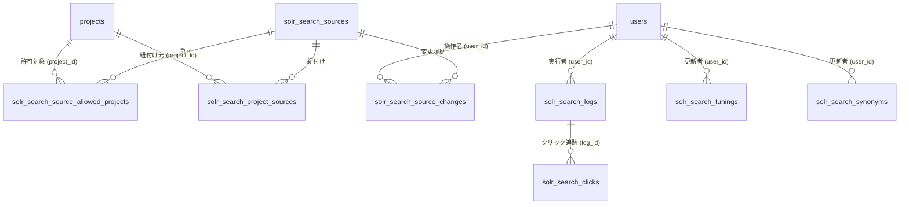

# スキーマ仕様書：Solrとデータベースのデータ構造

本ドキュメントは、Redmineプラグイン `redmine_solr_search`（全文検索）が扱うデータ構造の正式仕様書である。
全文検索エンジン（Apache Solr）のフィールド仕様およびインデックス作成ルール（投入側と検索側の契約）と、Redmine側のデータベースに保持するテーブル定義を網羅する。

---

## 目次

- [1. 全体アーキテクチャとコレクション構成](#1-全体アーキテクチャとコレクション構成)
  - [1.1 コレクション構成](#11-コレクション構成)
  - [1.2 Configset と共通スキーマ](#12-configset-と共通スキーマ)
  - [1.3 ドキュメント単位とグルーピング（group_id）](#13-ドキュメント単位とグルーピングgroup_id)
  - [1.4 スキーマ変更ポリシー](#14-スキーマ変更ポリシー)
- [2. Solr フィールド仕様](#2-solr-フィールド仕様)
  - [2.1 全体一覧](#21-全体一覧)
  - [2.2 テキストフィールド型と日本語解析仕様](#22-テキストフィールド型と日本語解析仕様)
- [3. Redmine データのマッピング仕様](#3-redmine-データのマッピング仕様)
  - [3.1 種別ごとのフィールド対応表](#31-種別ごとのフィールド対応表)
  - [3.2 インデックス対象の判定条件](#32-インデックス対象の判定条件)
  - [3.3 カスタムフィールドの動的展開](#33-カスタムフィールドの動的展開)
  - [3.4 権限情報の付与とセキュリティ](#34-権限情報の付与とセキュリティ)
- [4. 外部文書（外部ソース）のマッピング仕様](#4-外部文書外部ソースのマッピング仕様)
  - [4.1 投入データとSolr側での自動補正（セキュリティ更新チェイン）](#41-投入データとsolr側での自動補正セキュリティ更新チェイン)
  - [4.2 ドキュメントID（id）の命名規則](#42-ドキュメントididの命名規則)
- [5. プラグインのデータベーステーブル仕様](#5-プラグインのデータベーステーブル仕様)
  - [5.1 テーブル一覧とライフサイクル](#51-テーブル一覧とライフサイクル)
  - [5.2 テーブル間のリレーション（ER構造）](#52-テーブル間のリレーションer構造)
  - [5.3 各テーブルの定義詳細](#53-各テーブルの定義詳細)
- [6. スキーマ変更手順と検証観点](#6-スキーマ変更手順と検証観点)
  - [6.1 フィールドの追加・変更手順](#61-フィールドの追加変更手順)
  - [6.2 反映とインデックス再作成（Reindex）の要否基準](#62-反映とインデックス再作成reindexの要否基準)
  - [6.3 変更後の検証観点](#63-変更後の検証観点)

---

## 1. 全体アーキテクチャとコレクション構成

### 1.1 コレクション構成
Solr側は、データソースの性質とアクセス権限の分離のため、コレクションを論理的に分離して管理する。

| コレクション | 用途 | コレクション名 | 適用 configset |
|---|---|---|---|
| **Redmineコレクション** | Redmine内のすべてのデータ（チケット、注記、Wiki、文書、添付ファイル）を格納 | 既定は `redmine`（管理画面の設定で変更可能） | `redmine` |
| **外部ソースコレクション** | 部門の共有フォルダやファイルサーバー等の外部文書を格納（ソースごとに1コレクション） | `src_<任意の英数字>`（例: `src_share`, `src_docs`） | `src` |

### 1.2 Configset と共通スキーマ
- **2つの Configset**: Redmine用の `redmine` と、外部ソース用の `src` の2種類を使用する。すべての外部ソースコレクションは同一の `src` configset を共有する。
- **共通フィールドの定義**: 検索条件（`q`, `fq`, `qf`, `sort`, Grouping, ファセット）で使用するフィールドおよびフィールド型は、すべて `solr/common/common-fields.xml` および `solr/common/common-types.xml` に定義し、XInclude で両方の configset に取り込む。複数のコレクションを横断検索する際、片方のコレクションに存在しないフィールドを検索条件に含めるとエラーになるためである。
- **返却専用フィールドの分離**: コレクション固有の情報（Redmineの内部ID `item_id` や、外部文書の `url`, `path`）は、各 configset の `schema.xml` 側に定義し、検索条件には使用せず `fl`（返却フィールド）でのみ使用する。

### 1.3 ドキュメント単位とグルーピング（`group_id`）
- Redmineのデータは、チケット・注記・添付ファイル・Wikiページ・文書をそれぞれ独立した1つのドキュメントとしてSolrに投入する（親子階層を持たせないフラット構造）。
- 検索結果の1件（代表コンテナ）としてまとめるため、同一の入れ物に属するドキュメントには共通の `group_id`（例: チケット#12とその注記・添付ファイルはすべて `issue-12`）を付与する。
- 検索時は Solr の Result Grouping（`group=true`）または Collapse/Expand パーサーを用いて代表件数を集約して表示する。
- 外部文書は1ドキュメントにつき1件が独立した結果となるため、`group_id` には自身の `id` と同じ値を設定する。

### 1.4 スキーマ変更ポリシー
- **不変スキーマ（Managed Schema 無効）**: `ClassicIndexSchemaFactory` を採用し、スキーマの変更は git 管理された `schema.xml` を直接編集してSolrに再アップロード・リロードする運用とする。Schema API や管理画面からの動的変更は拒否する。
- **スキーマレスモードの拒否**: 未知のフィールドの自動追加は禁止し、未定義のフィールドが投入された場合はエラーとして弾く。
- **動的フィールドの限定利用**: チケットのカスタムフィールドに限り、型プレフィックス付きの動的フィールド（`cft_*`, `cfj_*`, `cfs_*`, `cfn_*`, `cfd_*`）として柔軟に保持する。

---

## 2. Solr フィールド仕様

### 2.1 全体一覧

すべてのコレクションで定義されている共通フィールドおよび各コレクション固有フィールドの一覧である。

| フィールド名 | 型 | 必須 | 格納 | Redmine | 外部ソース | 定義場所 | 用途・説明 |
|---|---|---|---|---|---|---|---|
| `id` | `string` | ○ | ○ | ○ | ○ | 共通 | ドキュメントの一意識別子。Redmineは `<type>-<id>`（例: `issue-12`）、外部文書はURI等の一意文字列 |
| `_version_` | `plong` | | | ○ | ○ | 共通 | SolrCloudの楽観的排他制御用内部フィールド |
| `source` | `string` | ○ | ○ | `redmine` | `src_*` | 共通 | データの出自。権限フィルターで検索許可されたソースを列挙・制限するために使用 |
| `type` | `string` | ○ | ○ | ○ | `file` | 共通 | ドキュメントの種別（`issue`, `journal`, `attachment`, `wiki_page`, `document`, `file`） |
| `group_id` | `string` | ○ | ○ | ○ | `id`と同値 | 共通 | 検索結果のまとめ表示（グルーピング）用ID。`docValues` 必須 |
| `title` | `rs_text_ngram` | | ○ | ○ | ○ | 共通 | 件名・題名（ファイル名）。抜粋・ハイライト生成用（2-gram格納） |
| `content` | `rs_text_ngram` | | ○ | ○ | ○ | 共通 | 本文テキスト。抜粋・ハイライト生成用（2-gram格納） |
| `title_ja` | `rs_text_ja` | | | ○ | ○ | 共通 | `title` の検索専用コピーフィールド（Kuromoji形態素解析） |
| `content_ja` | `rs_text_ja` | | | ○ | ○ | 共通 | `content` の検索専用コピーフィールド（Kuromoji形態素解析） |
| `updated_at` | `pdate` | | ○ | ○ | ○ | 共通 | 更新日時（UTC）。ソート順（更新日時順）および期間絞り込み用 |
| `project_id` | `pint` | | ○ | ○ | 空 | 共通 | RedmineプロジェクトID。閲覧権限フィルター（`fq`）用 |
| `is_private` | `boolean` | | ○ | ○ | 空 | 共通 | プライベートチケットフラグ（注記・添付は親チケットの値を継承） |
| `author_id` | `pint` | | ○ | ○ | 空 | 共通 | チケット作成者のユーザーID |
| `assigned_to_id` | `pint` | | ○ | ○ | 空 | 共通 | チケット担当者のユーザーIDまたはグループID |
| `tracker_id` | `pint` | | ○ | ○ | 空 | 共通 | トラッカーID。権限判定およびファセット絞り込み用 |
| `status_id` | `pint` | | ○ | ○ | 空 | 共通 | ステータスID。属性フィルターおよびファセット用 |
| `priority_id` | `pint` | | ○ | ○ | 空 | 共通 | 優先度ID。属性フィルターおよびファセット用 |
| `category_id` | `pint` | | ○ | ○ | 空 | 共通 | カテゴリID。属性フィルター用 |
| `fixed_version_id` | `pint` | | ○ | ○ | 空 | 共通 | 対象バージョンID。属性フィルター用 |
| `start_date` | `pdate` | | ○ | ○ | 空 | 共通 | チケット開始日（UTC 0時）。属性フィルター用 |
| `due_date` | `pdate` | | ○ | ○ | 空 | 共通 | チケット期日（UTC 0時）。属性フィルター用 |
| `issue_created_at` | `pdate` | | ○ | ○ | 空 | 共通 | チケット作成日時（UTC）。属性フィルター用 |
| `issue_closed_at` | `pdate` | | ○ | ○ | 空 | 共通 | チケット終了日時（UTC）。属性フィルター用 |
| `is_private_note` | `boolean` | | ○ | ○ | 空 | 共通 | プライベート注記フラグ（`journal` のみ値を持つ） |
| `note_author_id` | `pint` | | ○ | ○ | 空 | 共通 | 注記作成者のユーザーID（`journal` のみ値を持つ） |
| `container_type` | `string` | | ○ | ○ | 空 | 共通 | 添付ファイルの添付先種別（`issue`, `wiki_page`, `document`, `project`, `version`） |
| `file_extension` | `string` | | ○ | ○ | ○ | 共通 | 拡張子（小文字統一）。ファイル種別のファセット絞り込み用 |
| `file_dir_1`〜`file_dir_6` | `string` | | ○ | | ○ | 共通 | 外部文書の第1階層〜第6階層までのフォルダパス。階層ドリルダウン用（更新チェインが自動付与） |
| `cft_*` | `rs_text_ngram` | | ○ | ○ | 空 | 共通 | 動的フィールド：チケットカスタムフィールド本文（抜粋・2-gram検索用、複数値） |
| `cfj_*` | `rs_text_ja` | | | ○ | 空 | 共通 | 動的フィールド：`cft_*` の形態素解析コピーフィールド（検索用、複数値） |
| `cfs_*` | `string` | | ○ | ○ | 空 | 共通 | 動的フィールド：文字列・リスト形式のカスタムフィールド（完全一致・ファセット用） |
| `cfn_*` | `pdouble` | | ○ | ○ | 空 | 共通 | 動的フィールド：数値形式のカスタムフィールド（範囲検索・数値比較用） |
| `cfd_*` | `pdate` | | ○ | ○ | 空 | 共通 | 動的フィールド：日付形式のカスタムフィールド（日付範囲検索用） |
| `item_id` | `pint` | | ○ | ○ | | `redmine` | Redmine内部の各エンティティID（`issues.id` 等）。リンク遷移用 |
| `url` | `string` | | ○ | | ○ | `src` | 外部文書のアクセス先URLまたはファイルURI |
| `path` | `string` | | ○ | | ○ | `src` | 外部文書の表示用パス文字列 |

### 2.2 テキストフィールド型と日本語解析仕様

日本語の検索漏れを防ぎつつ、活用変化にも対応するため、**ハイブリッド解析（形態素解析 ＋ N-gram）** を採用している。

| フィールド型 | 用途 | トークナイザー・フィルター処理フロー |
|---|---|---|
| **`rs_text_ngram`** | 抜粋表示および部分一致検索用（`title`, `content`, `cft_*`） | 1. 置換表フィルター（`mapping-ja.txt`：特殊文字・囲み文字の正規化） 2. NFKC 正規化フィルター（全角英数、半角カナ、異体字等の標準化） 3. `NGramTokenizer`（2文字固定） 4. 小文字化フィルター（`LowerCaseFilter`） 5. 【検索時のみ】同義語展開フィルター（`synonyms-ja.txt`） |
| **`rs_text_ja`** | 原形・語幹・複合語検索用（`title_ja`, `content_ja`, `cfj_*`） | 1. 置換表フィルター（`mapping-ja.txt`） 2. NFKC 正規化フィルター 3. `JapaneseTokenizer`（Kuromoji: `mode="search"`、複合語分割） 4. 活用語原形化フィルター（`JapaneseBaseFormFilter`） 5. 品詞除外フィルター（助詞・助動詞・接続詞等の除外） 6. ストップワードフィルター 7. カタカナ長音正規化フィルター 8. 小文字化フィルター 9. 【検索時のみ】同義語展開フィルター（`synonyms-ja.txt`） |

- **ハイブリッド解析の連携**:
  - 検索時は、形態素解析フィールド（`title_ja`, `content_ja`）とN-gramフィールド（`title`, `content`）の両方を `qf`（問い合わせフィールド）に指定してスコアリングする。
  - 「確認する」で「確認した」を探すような活用の吸収は `rs_text_ja` が担当し、形態素解析が未知語・複合語で分割を誤った場合や部分一致（「マネジメント」で「ナレッジマネジメント」）は `rs_text_ngram` がカバーする。
- **表記ゆれ吸収（プラグイン側展開）**:
  - ヴ行・バ行（「バイオリン」と「ヴァイオリン」）や促音・拗音（「ヶ」と「ケ」）の表記ゆれは、インデックス側では正規化せず表記のまま格納し、検索時にプラグイン（`SpellingVariants`）がクエリ側をOR展開して送信する。これにより、「字面どおりに探す」指定時には表記ゆれ展開をバイパスできる。
- **クエリ展開辞書（`solr_search_synonyms`）**:
  - Solr側の静的同義語ファイル（`synonyms-ja.txt`）とは別に、プラグインのDBに同義語辞書を保持し、検索時に語を同義語群の句（フレーズOR）に展開してSolrへ発行する。管理画面から登録後、インデックス再作成なしで即座に有効となる。

---

## 3. Redmine データのマッピング仕様

プラグインのクローラーがRedmineの各モデルからSolrの `redmine` コレクションへデータを投入する際のマッピング仕様である。

### 3.1 種別ごとのフィールド対応表

| 種別（`type`） | `id` | `group_id` | `title` | `content` | `updated_at` | `project_id` | 権限フィールド |
|---|---|---|---|---|---|---|---|
| `issue` | `issue-<id>` | `issue-<id>` | `subject` | `description` | `updated_on` | `project_id` | `is_private`, `author_id`, `assigned_to_id`, `tracker_id` |
| `journal` | `journal-<id>` | `issue-<journalized_id>` | （空） | `notes` | `updated_on` | 親チケットの値 | 親チケットの値 ＋ `is_private_note`, `note_author_id` |
| `wiki_page` | `wiki_page-<id>` | `wiki_page-<id>` | `title` | 最新版の本文（`wiki_contents.text`） | `updated_on` | 所属WikiのプロジェクトID | `is_private=false` |
| `document` | `document-<id>` | `document-<id>` | `title` | `description` | `created_on` | `project_id` | `is_private=false` |
| `attachment` | `attachment-<id>` | 添付先の `group_id`（`issue-<id>` 等） | ファイル名（＋説明文） | Tikaで抽出した本文テキスト | `created_on` | 添付先のプロジェクトID | 親コンテナの権限を継承 ＋ `container_type` |

### 3.2 インデックス対象の判定条件
整合性を欠いたレコードや不要なノイズを除外するため、クローラーは以下の条件を満たすレコードのみをインデックスに投入する。

- **チケット（`issue`）**: すべてのチケット（プライベートチケットも含む。閲覧権限は検索時の `fq` と、表示の前のRedmineの判定で制限）。
- **注記（`journal`）**: 対象がチケット（`journalized_type = 'Issue'`）であり、親チケットが存在し、かつ `notes` が空文字・NULLでないもの（空白文字のみの注記は含む）。属性変更のみの注記は投入しない。
- **Wikiページ（`wiki_page`）**: 所属するWikiが存在するページ（親Wikiが存在しない孤立レコードは除外）。
- **文書（`document`）**: すべての文書レコード。
- **添付ファイル（`attachment`）**: 添付先レコード（チケット、Wiki、文書、プロジェクト、バージョン）が実在するもの。ニュース、フォーラム、メッセージ等の添付ファイルは対象外。

### 3.3 カスタムフィールドの動的展開
チケットに設定されたカスタムフィールドは、用途に応じて2系統の動的フィールドに自動展開される。

1. **キーワード検索・抜粋用**:
   - テキスト・長文テキスト・リスト形式のカスタムフィールド値は、`cft_<カスタムフィールドID>`（抜粋用2-gram）および `cfj_<カスタムフィールドID>`（検索用形態素解析）に投入される。
   - 画面の「属性も含めて検索する」が有効な場合に検索対象となる。
2. **属性絞り込み・ファセット用**:
   - 「検索条件に使用」が有効なカスタムフィールドは、データ型に応じて以下のフィールドに投入される。
     - 文字列・リスト・ユーザー・バージョン形式: `cfs_<カスタムフィールドID>`（`string`）
     - 整数・小数形式: `cfn_<カスタムフィールドID>`（`pdouble`）
     - 日付形式: `cfd_<カスタムフィールドID>`（`pdate`）

### 3.4 権限情報の付与とセキュリティ
- チケットの子要素である「注記」および「チケットの添付ファイル」には、親チケットの `project_id`, `is_private`, `author_id`, `assigned_to_id`, `tracker_id` が自動的にコピーされてSolrに記録される。
- 検索時は、利用者のプロジェクト所属状態およびロール権限から `SolrSearch::PermissionFilter` がSolrのフィルタークエリ（`fq`）を動的に構築し、閲覧権限のないドキュメントをSolr側で除く。権限の値はインデックスに入った時点のものなので、更新までの間のずれは、表示の前にRedmineの判定（`visible?`など）で一覧から除く（件数には数えられることがある）。

---

## 4. 外部文書（外部ソース）のマッピング仕様

共有フォルダや外部ストレージから ManifoldCF 等のクローラー経由で外部ソースコレクション（configset `src`）へ投入する際のマッピング仕様である。

### 4.1 投入データとSolr側での自動補正（セキュリティ更新チェイン）
外部クローラー側の誤設定や悪意あるデータ投入によるセキュリティ侵害を防ぐため、Solr の Update Request Processor Chain（`external-document`）により、機密に関わるフィールドを強制的に自動生成・上書きする。

| フィールド | 投入側（クローラー）の責務 | Solr側更新チェインの動作（自動上書き） |
|---|---|---|
| `id` | ファイルURI等の一意なIDを付与 | そのまま保持 |
| `source` | 送信不要（送られた値は破棄） | **対象コレクション名（`src_<名前>`）を強制セット** |
| `type` | 送信不要（送られた値は破棄） | **固定値 `'file'` を強制セット** |
| `group_id` | 送信不要（送られた値は破棄） | **自身の `id` と同一値を強制セット** |
| `title` | ファイル名を設定 | タブ・改行を除くC0制御文字を除去して格納 |
| `content` | Tika等で抽出した本文を設定（上限目安300万文字） | タブ・改行を除くC0制御文字を除去して格納 |
| `updated_at` | ファイルの最終更新日時（UTC）を設定 | そのまま格納 |
| `url` | 検索結果リンク用のURI（`file://...` 等） | そのまま格納 |
| `path` | 画面表示用のパス文字列 | そのまま格納 |
| `file_extension` | 送信不要 | **`id` または `path` の末尾から拡張子を抽出して自動付与** |
| `file_dir_1`〜`file_dir_6` | 送信不要 | **パス文字列をパースし、第1階層〜第6階層までのディレクトリを自動生成** |

※この更新チェインにより、外部文書が勝手に `source: redmine` を名乗ったり、Redmine側のチケットIDを `group_id` に設定してRedmineの検索結果に偽装・混入することをSolr層で確実に防止する。

### 4.2 ドキュメントID（`id`）の命名規則
- 外部文書の `id` は、すべての外部ソースおよびRedmineのデータ（`issue-12` 等）と重複してはならない。
- 重複が発生した場合、Solr内部で同一ドキュメントとして上書きまたは集約され、検索結果の表示崩れが発生する。
- ファイルのスキーム付き絶対URI（例: `file://server/share/docs/spec.pdf`）を使用することで、一意性を担保する。

---

## 5. プラグインのデータベーステーブル仕様

プラグインがRedmineのデータベースに保持する12テーブルの詳細仕様である。

### 5.1 テーブル一覧とライフサイクル

| テーブル名 | 用途 | レコード増加傾向とライフサイクル |
|---|---|---|
| `solr_search_runs` | 定期クロール実行記録およびインデックス作り直し依頼 | 実行ごとに1行追加。設定された保存日数（初期値30日）で古い記録を自動削除 |
| `solr_search_heartbeats` | スケジューラープロセスの死活監視 | 常に1行のみ（1分ごとの生存確認でタイムスタンプを上書き更新） |
| `solr_search_sources` | 外部ソースの定義（名前、コレクション名、リンク書式、パス読み替えなど） | 管理者が登録・編集したときに更新 |
| `solr_search_source_allowed_projects` | 外部ソースの利用を許可するプロジェクト（多対多中間テーブル） | システム管理者が外部ソース編集画面で設定 |
| `solr_search_project_sources` | プロジェクト側で実際に検索対象として紐付けた外部ソース（多対多中間テーブル） | プロジェクト管理者がプロジェクト設定画面で設定 |
| `solr_search_source_changes` | 外部ソースの作成・変更・削除・紐付け操作の監査履歴 | 操作ごとに1行追加（最新500件を上限として保持） |
| `solr_search_logs` | 検索実行ログ（キーワード、ヒット数、所要時間、エラー等） | 検索ごとに1行追加。管理ページの「検索ログ」タブから手動削除するまで保持 |
| `solr_search_clicks` | 検索結果リンクのクリック記録（順位、種別、題名、URL等） | クリックごとに1行追加。親ログ（`solr_search_logs`）の削除時にカスケード削除 |
| `solr_search_counters` | 監視（Prometheus）用のメトリクス集計カウンター | メトリクス種類ごとに約40行の固定キー（値が加算更新されるのみ） |
| `solr_search_golden_runs` | 品質測定（正解つき検索セット）の実行結果記録 | コマンドラインから測定を実行するたびに1行追加 |
| `solr_search_tunings` | 「詳細調整」タブで保存された並びの重み設定履歴 | 保存するたびに1行追加（最新行が有効値、過去行は履歴） |
| `solr_search_synonyms` | 「同義語」タブで保存された言い換え辞書データ | 保存するたびに1行追加（最新行が有効値、過去行は履歴） |

### 5.2 テーブル間のリレーション（ER構造）

※Redmine本体のテーブル（`projects`, `users`）とは論理的な関連であり、外部キー制約（DB制約）は設けていない（Redmine本体側のレコード削除・運用を妨げないための設計）。

---

### 5.3 各テーブルの定義詳細

#### 1. `solr_search_runs`
スケジューラーが実行したタスクや、管理画面から受け付けたインデックス作り直し依頼を追跡・排他制御する。

| カラム名 | 型 | NULL許容 | デフォルト | 説明 |
|---|---|---|---|---|
| `id` | `bigint` | NO | auto | 主キー |
| `task` | `string` | NO | | 処理の種類（`incremental`, `resend`, `reconcile`, `reindex`, `attachments`） |
| `status` | `string` | NO | | 状態（`requested`, `running`, `succeeded`, `failed`） |
| `triggered_by` | `string` | NO | | 起動元（`scheduler`, `rake`, `admin`） |
| `running_slot` | `integer` | YES | | 同時実行制御用スロット（実行中タスクは1が入り、一意制約で重複起動を抑止） |
| `since` | `datetime` | YES | | 差分クロールの起点日時 |
| `started_at` | `datetime` | YES | | 処理開始日時 |
| `finished_at` | `datetime` | YES | | 処理完了日時 |
| `counts` | `text` | YES | | 処理件数の内訳（JSON: `{type => {"sent" => n, "deleted" => n}}`） |
| `error` | `text` | YES | | 失敗時のエラーメッセージとバックトレース |
| `request_options` | `text` | YES | | 部分インデックス作り直しの絞り込み条件（JSON） |
| `created_at` | `datetime` | NO | | 作成日時 |
| `updated_at` | `datetime` | NO | | 更新日時（実行中は生存確認のため定期更新される） |

- **インデックス**:
  - `running_slot`（ユニーク：`add_index :solr_search_runs, :running_slot, unique: true`）
  - `[task, status, started_at]`（状態・タスク検索用複合インデックス）

#### 2. `solr_search_heartbeats`
スケジューラープロセスが生存しているかを管理画面（「状態」タブ）へ伝えるための死活監視レコード。

| カラム名 | 型 | NULL許容 | デフォルト | 説明 |
|---|---|---|---|---|
| `id` | `bigint` | NO | auto | 主キー |
| `name` | `string` | NO | | スケジューラー識別名（常に `'scheduler'`） |
| `info` | `string` | YES | | 実行環境情報（ホスト名とPID） |
| `started_at` | `datetime` | YES | | プロセス起動日時 |
| `beat_at` | `datetime` | YES | | 最後の生存確認日時（毎分更新） |

- **インデックス**:
  - `name`（ユニーク：常に1行のみ存在）

#### 3. `solr_search_sources`
管理ページで登録された外部ソースのメタデータ定義。

| カラム名 | 型 | NULL許容 | デフォルト | 説明 |
|---|---|---|---|---|
| `id` | `bigint` | NO | auto | 主キー |
| `name` | `string` | NO | | 画面に表示する外部ソースの名称 |
| `description` | `text` | YES | | 外部ソースの説明文 |
| `collection` | `string` | YES | | 対応するSolrのコレクション名（`src_<名前>`） |
| `link_format` | `string` | NO | `'text'` | リンクの形式（`text`: 文字列のみ, `link`: 直リンク, `custom`: 書式展開） |
| `link_pattern` | `string` | YES | | カスタムリンクの書式（`%url%` や `%path%` の展開テンプレート） |
| `path_from` | `string` | YES | | パス読み替え元のプレフィックス（UNCパスやプレフィックス） |
| `path_to` | `string` | YES | | パス読み替え先のプレフィックス（ローカルパスやURL） |
| `all_projects` | `boolean` | NO | `false` | すべてのプロジェクトに利用を許可するかどうか |
| `missing_collection_at` | `datetime` | YES | | Solr側にコレクションが見つからなかった最後の検知日時 |
| `created_at` | `datetime` | NO | | 作成日時 |
| `updated_at` | `datetime` | NO | | 更新日時 |

- **インデックス**:
  - `name`（ユニーク）
  - `collection`（ユニーク）

#### 4. `solr_search_source_allowed_projects`
システム管理者が外部ソースの利用を許可したプロジェクトを紐付ける中間テーブル。

| カラム名 | 型 | NULL許容 | デフォルト | 説明 |
|---|---|---|---|---|
| `id` | `bigint` | NO | auto | 主キー |
| `source_id` | `integer` | NO | | 外部ソースID |
| `project_id` | `integer` | NO | | 許可するプロジェクトID（サブプロジェクトには自動継承されない） |
| `created_at` | `datetime` | NO | | 登録日時 |

- **インデックス**:
  - `[source_id, project_id]`（ユニーク：`index_solr_search_allowed_on_source_and_project`）
  - `project_id`

#### 5. `solr_search_project_sources`
プロジェクト管理者がプロジェクト設定画面で実際に検索対象として紐付けた外部ソースの中間テーブル。

| カラム名 | 型 | NULL許容 | デフォルト | 説明 |
|---|---|---|---|---|
| `id` | `bigint` | NO | auto | 主キー |
| `project_id` | `integer` | NO | | 紐付け先のプロジェクトID |
| `source_id` | `integer` | NO | | 紐付ける外部ソースID |
| `created_at` | `datetime` | NO | | 紐付け日時 |

- **インデックス**:
  - `[project_id, source_id]`（ユニーク）
  - `source_id`

#### 6. `solr_search_source_changes`
外部ソースの登録・変更・削除やプロジェクトへの紐付け・解除の監査履歴（最新500件まで保持）。

| カラム名 | 型 | NULL許容 | デフォルト | 説明 |
|---|---|---|---|---|
| `id` | `bigint` | NO | auto | 主キー |
| `user_id` | `integer` | YES | | 操作を実行したユーザーID |
| `action` | `string` | NO | | 操作内容（`source_created`, `source_updated`, `source_deleted`, `linked`, `unlinked`） |
| `source_id` | `integer` | YES | | 対象となった外部ソースID |
| `source_name` | `string` | YES | | 操作時の外部ソース名 |
| `project_id` | `integer` | YES | | 対象となったプロジェクトID（紐付け時） |
| `project_name` | `string` | YES | | 操作時のプロジェクト名 |
| `details` | `text` | YES | | 変更差分や解除理由の詳細（JSON） |
| `created_at` | `datetime` | NO | | 記録日時 |

- **インデックス**:
  - `created_at`
  - `source_id`

#### 7. `solr_search_logs`
検索1回ごとに記録されるログテーブル。

| カラム名 | 型 | NULL許容 | デフォルト | 説明 |
|---|---|---|---|---|
| `id` | `bigint` | NO | auto | 主キー |
| `created_at` | `datetime` | NO | | 検索実行日時 |
| `user_id` | `integer` | YES | | 実行ユーザーID（未ログイン時はnil） |
| `user_login` | `string` | YES | | 実行ユーザーのログイン名 |
| `query` | `text` | NO | | 入力された検索キーワード |
| `request_path` | `text` | YES | | 検索時のリクエストパスおよびクエリ文字列 |
| `project_id` | `integer` | YES | | 検索元のプロジェクトID（全体検索時はnil） |
| `page` | `integer` | NO | `1` | 表示ページ番号 |
| `hit_count` | `integer` | YES | | Solrが返した総ヒット件数（失敗時はnil） |
| `group_count` | `integer` | YES | | 代表グループ（`group_id`）の件数 |
| `dropped_count` | `integer` | YES | | Redmineの権限判定で表示直前に除外された件数 |
| `took_ms` | `integer` | YES | | Solrへの問い合わせ所要時間（ミリ秒） |
| `error` | `string` | YES | | 失敗時のエラー内容 |
| `collection` | `string` | YES | | 検索対象としたRedmineコレクション名 |
| `external_sources` | `text` | YES | | 検索対象となった外部ソースコレクション名一覧（カンマ区切り） |
| `click_token` | `string(32)` | YES | | クリック追跡用トークン（改ざん防止・CSRF対策） |
| `clicked_at` | `datetime` | YES | | 初回クリック日時（結果からリンクが開かれた時刻） |

- **インデックス**:
  - `created_at`
  - `[hit_count, created_at]`（0件検索の抽出・集計用複合インデックス）

#### 8. `solr_search_clicks`
検索結果画面からリンクが開かれた際のクリックログテーブル。

| カラム名 | 型 | NULL許容 | デフォルト | 説明 |
|---|---|---|---|---|
| `id` | `bigint` | NO | auto | 主キー |
| `created_at` | `datetime` | NO | | クリック日時 |
| `log_id` | `integer` | NO | | 親となる検索ログ（`solr_search_logs.id`） |
| `group_id` | `string` | NO | | 開かれた文書の識別子（`issue-12`, `wiki_page-3`, 外部文書ID等） |
| `rank` | `integer` | YES | | 検索結果一覧での掲載順位（1〜） |
| `kind` | `string` | YES | | クリックされた箇所（`title`, `note`, `attachment`, `more`, `other`） |
| `title` | `string` | YES | | クリック時のリンクの題名 |
| `href` | `text` | YES | | リンク先URL |

- **インデックス**:
  - `log_id`
  - `group_id`

#### 9. `solr_search_counters`
Prometheus等の外部監視システムへメトリクスを高速に提供するための集計カウンターテーブル。

| カラム名 | 型 | NULL許容 | デフォルト | 説明 |
|---|---|---|---|---|
| `id` | `bigint` | NO | auto | 主キー |
| `key` | `string(100)` | NO | | カウンター名（例: `searches_total`, `search_duration_seconds_bucket` など） |
| `value` | `bigint` | NO | `0` | カウンターの現在値（インクリメントされる累積値） |

- **インデックス**:
  - `key`（ユニーク）

#### 10. `solr_search_golden_runs`
検索品質測定ツール（正解つき検索セット）の実行結果を記録するテーブル。

| カラム名 | 型 | NULL許容 | デフォルト | 説明 |
|---|---|---|---|---|
| `id` | `bigint` | NO | auto | 主キー |
| `kind` | `string(20)` | NO | | 測定種類（`coverage`: 網羅性テスト, `ranking`: 順位精度テスト） |
| `dataset` | `string(100)` | YES | | テストに使用したデータセット名（例: `ja-basic`, `ja-cf`） |
| `ran_at` | `datetime` | NO | | 測定実行日時 |
| `duration_ms` | `integer` | YES | | 全測定クエリの所要時間（ミリ秒） |
| `queries` | `integer` | NO | `0` | 実行した検索クエリ数 |
| `expected` | `integer` | NO | `0` | 期待される正解数（網羅性: ヒットすべき入れ物数, 順位: クエリ数） |
| `found` | `integer` | NO | `0` | 実際にヒットした件数 |
| `leaks` | `integer` | NO | `0` | 権限漏洩件数（網羅性テストのみ: 見えてはならない文書のヒット数） |
| `recall` | `float` | YES | | 再現率（Recall） |
| `precision` | `float` | YES | | 適合率（Precision：網羅性テストのみ） |
| `mrr` | `float` | YES | | 平均逆順位（MRR：順位精度テストのみ） |
| `recall_at_k` | `float` | YES | | Top-K再現率（順位精度テストのみ） |
| `k` | `integer` | YES | | Top-K測定の評価閾値 K（順位精度テストのみ） |
| `note` | `string(255)` | YES | | 測定時のメモ（`GOLDEN_NOTE` 環境変数で指定された調整内容） |
| `details` | `text` | YES | | 不正解だったクエリや差分の詳細（JSON） |

- **インデックス**:
  - `[kind, ran_at]`

#### 11. `solr_search_tunings`
管理ページの「詳細調整」タブで設定された並びの重み（ブースト係数等）の保存履歴テーブル。

| カラム名 | 型 | NULL許容 | デフォルト | 説明 |
|---|---|---|---|---|
| `id` | `bigint` | NO | auto | 主キー |
| `user_id` | `integer` | YES | | 設定を変更したユーザーID |
| `user_login` | `string` | YES | | 設定を変更したユーザーのログイン名 |
| `settings` | `text` | NO | | 重み・表示設定のJSONデータ（最新レコードが現在の有効設定となる） |
| `created_at` | `datetime` | NO | | 保存日時 |

#### 12. `solr_search_synonyms`
管理ページの「同義語」タブで登録されたクエリ展開用の言い換え辞書の保存履歴テーブル。

| カラム名 | 型 | NULL許容 | デフォルト | 説明 |
|---|---|---|---|---|
| `id` | `bigint` | NO | auto | 主キー |
| `user_id` | `integer` | YES | | 辞書を更新したユーザーID |
| `user_login` | `string` | YES | | 辞書を更新したユーザーのログイン名 |
| `body` | `text` | NO | | 同義語辞書のテキスト本文（カンマ区切り1行1グループ。最新レコードが有効） |
| `created_at` | `datetime` | NO | | 保存日時 |

---

## 6. スキーマ変更手順と検証観点

### 6.1 フィールドの追加・変更手順

1. **配置先の決定**:
   - 検索条件（`q`, `fq`, `qf`, `sort`, Grouping, ファセット）に使用するフィールドは、必ず `solr/common/common-fields.xml`（共通部分）に追加する（両方の configset に取り込まれる）。
   - 特定コレクションの返却専用フィールドは、対象 configset の `schema.xml` に追加する。
2. **モデル・バリデーションの整合**:
   - `redmine` コレクションのフィールドを追加・変更した場合は、`lib/solr_search/schema_check.rb` の定義配列（`FIELDS` / `DYNAMIC_FIELDS`）も更新する（管理画面でのスキーマ検証およびユニットテストで使用される）。
3. **Solrへの反映**:
   - configset ファイルを ZooKeeper にアップロード後、該当コレクションをリロードする。

### 6.2 反映とインデックス再作成（Reindex）の要否基準

| 変更内容 | 反映方法 | インデックス再作成の要否 |
|---|---|---|
| **新しいフィールドの追加** | Configset アップロード ＋ コレクションリロード | **原則不要**。既存ドキュメントにも値を投入したい場合は再作成または再クロールを実施 |
| **返却専用フィールドの追加** | 同上 | **不要**（既存ドキュメントには次回更新時に反映） |
| **既存フィールドの型・解析ルールの変更** | 同上 | **必須**（登録時のトークナイズ結果が変わるため、全件作り直しが必要） |
| **同義語ファイル（`synonyms-ja.txt`）の更新** | コレクションリロード | **不要**（検索時のみ適用されるため、リロードのみで即座に有効） |
| **クエリ展開辞書（DB）の登録・変更** | 管理画面での保存 | **不要**（検索発行時にプラグインが動的展開するため、即座に有効） |
| **Redmineカスタムフィールドの新規追加** | 操作不要（動的フィールドへ自動格納） | **不要**（次回チケット更新時または差分クロールで反映） |
| **Redmineカスタムフィールドの対象トラッカー・プロジェクト変更** | 操作不要 | **部分インデックス再作成を推奨**（チケットの `updated_on` が進まないため、管理画面の「インデックス」タブから対象フィールドの部分作り直しを実施） |
| **フィールドの削除** | コード側で使用停止した後にConfigset反映 | **不要**（不要となった値は次回の全件作り直し時に消去される） |

### 6.3 変更後の検証観点

スキーマ変更後は、以下の観点で動作確認を実施する。

1. **スキーマチェックテスト**: `bin/rake redmine:solr_search:light_test` を実行し、`lib/solr_search/schema_check.rb` との整合性を検証する。
2. **共通スキーマの同一性**: `redmine` と `src` で共通フィールドの定義に差異が生じていないか確認する。
3. **権限フィルターの整合**: 権限外のドキュメントが `fq` をすり抜けてヒットしないことを確認する。
4. **カスタムフィールドの検索・抜粋**: 「属性も含めて検索する」を有効にした際、対象ユーザーに見せてよいカスタムフィールドのみが検索・ハイライトされることを確認する。
